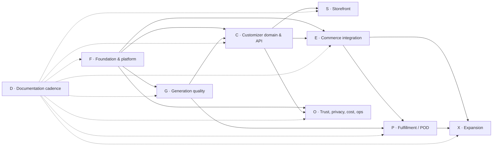
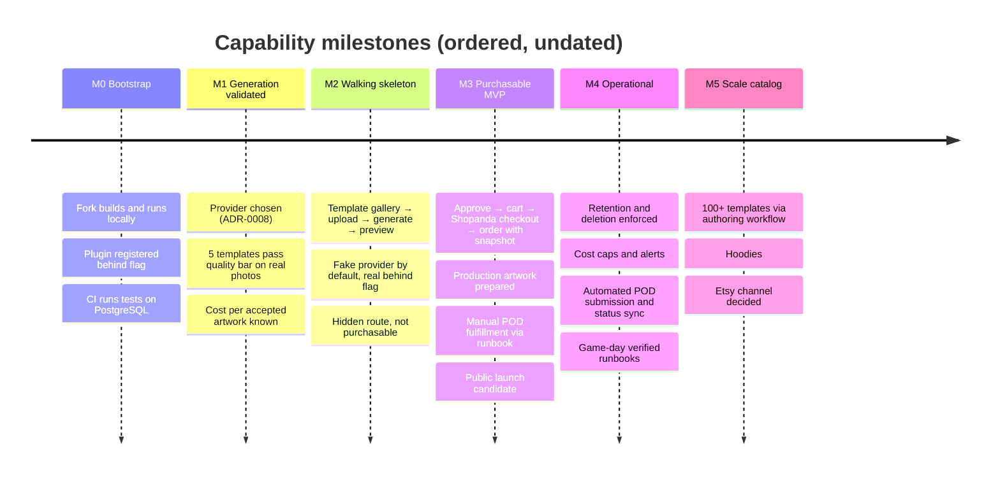
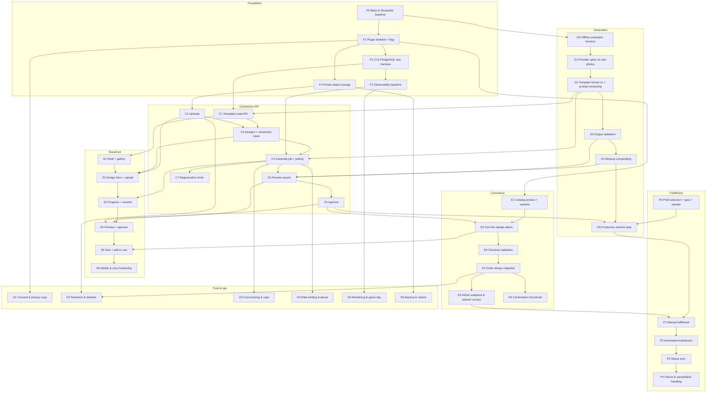

# Metal Dogs roadmap

Status: living document. Updated at the close of every CR round (see [`cr-rounds/`](cr-rounds/README.md)).

This roadmap turns [`PROJECT_DESCRIPTION.md`](PROJECT_DESCRIPTION.md) into **tracks** of **vertical slices**. Every slice is a complete, thin path through storefront → API → domain → persistence/worker → external adapter (where relevant), with tests at each boundary, and it can be merged and deployed without breaking the live site.

No calendar dates are given. Ordering is expressed through dependencies and milestones; sizing is relative (S / M / L ≈ ≤2 days / ≤1 week / >1 week for one engineer).

---

## 1. Ground truth this plan is built on

Inspected against Shopanda source at pin [`5681894658c44ce344b2df930effecda7ffd43c4`](UPSTREAM_PIN.md) (`upstream/main` at F0 close). **Inspected at pin** = code/docs read + ImportBoundary where noted; not a runtime contract suite. Promote a row to **Contract-tested** when F1/F2/E* add automated checks. Re-inspect on every upstream upgrade.

| Capability | Status | Consequence for Metal Dogs |
| --- | --- | --- |
| Go + PostgreSQL single binary; runtime modes `serve`, `worker`, `scheduler`, `dev` | Inspected at pin; `go build` exercised | No separate service; generation worker is a Shopanda worker process |
| Extensions are in-module, **compile-time** plugins registered in `cmd/api/register_plugins.go` | Inspected at pin | Metal Dogs backend is an external plugin `plugins/metaldogs` in a Shopanda fork tracked against upstream ([ADR-0001](adr/0001-metal-dogs-as-shopanda-external-plugin.md)) |
| Plugins may own tables (scoped, via `Bootstrap.DB`), register public HTTP routes, events (`Bus.On`/`OnAsync`), cart hooks, checkout steps, extension fields, permissions, admin config, CLI commands | Inspected at pin | Customizer API, snapshot creation, and admin tooling are all plugin-level; no core forks |
| Import boundary: plugins must not import `internal/infrastructure` or `internal/interfaces` (test-enforced) | Contract-tested (`ImportBoundary`) | Our hexagonal layout sits inside the plugin; Shopanda ports are consumed through `plugin.Bootstrap` |
| PostgreSQL job queue with admin API and `jobs:*` CLI; cron scheduler | Inspected at pin | Generation, artwork preparation, retention sweeps run as queue jobs ([ADR-0003](adr/0003-async-generation-pg-job-queue-polling.md)) |
| Plugin on-demand enqueue + handlers | Inspected at pin (Phase 13 PR-1087–1088) | Use `RegisterManual` + `Enqueue`; queue types are `integration.sync.metaldogs.<name>` (no free-form `metaldogs.*` types) |
| Plugin-owned schema migrations | Inspected at pin (Phase 13 PR-1084–1086) | Implement `plugin.Migrator`; versions `plugin:<name>:<basename>`; applied by `app migrate` / boot `InitAll` with advisory lock |
| Extension fields with cart → order snapshot at checkout | Inspected at pin | Line-level (`cart_item` / `order_item`); `design_id` attach via [ADR-0005](adr/0005-immutable-order-design-snapshot.md) |
| Guest checkout, Stripe core plugin, S3 core plugin, media storage port | Inspected at pin | No account required for MVP; private S3 bucket ([ADR-0004](adr/0004-private-object-storage-signed-urls.md)) |
| SSR storefront with themes, UI slots, asset manifest | Inspected at pin | Cart and checkout pages are reused from Shopanda; only the customizer is custom ([ADR-0002](adr/0002-storefront-customizer-and-shopanda-checkout.md)) |
| `order.created` / `order.failed` published | Inspected at pin (PR-1088) | Prefer `order.paid` for fulfilment; tolerate `order.created` followed by `order.failed` if checkout compensates |
| Plugin shipment status update | Inspected at pin (PR-1400) | `IntegrationShipmentStatusUpdater.ApplyShipmentStatus` for POD status sync (track P) |

Product assumptions still open (section 10 of the project description) are resolved by slices `G1`, `P0`, `O1`, and `S6`; each closes with an ADR.

---

## 2. Delivery rules for every slice

A slice is **done** only when all of the following hold:

1. **Dark by default.** New behaviour is unreachable in production until explicitly enabled: plugin config flag (`plugins.metaldogs.*`), route returns `404` when disabled, template `status = draft`, provider adapter `fake` unless configured.
2. **Expand/contract migrations only.** Add columns/tables first, backfill, switch reads, remove later in a separate slice. Workers and HTTP servers may run mixed versions during deploy.
3. **Idempotent commands.** Anything that can be retried (generate, approve, attach to cart, snapshot, submit to POD) carries an idempotency key or natural unique constraint, and a duplicate returns the first result.
4. **No paid calls in CI.** AI and POD adapters have a `fake` implementation used by default in tests and local dev. Real calls are opt-in smoke tests.
5. **Tests at the right level** (see §7): domain unit tests, feature tests through HTTP/worker with real PostgreSQL, contract tests with sanitized fixtures for every adapter touched.
6. **Observability for every async boundary:** structured log with `design_id`, `job_id`, `correlation_id`, attempt, duration, terminal reason.
7. **Docs updated in the same change:** API contract, status transitions, ADR if a decision was made, runbook if a new failure mode exists.
8. **Rollback path stated** in the PR: flag off, or revert with the migration remaining compatible.

---

## 3. Tracks

| Track | Owns | Public API it exposes to other tracks |
| --- | --- | --- |
| **F** Foundation | Repo layout, Shopanda fork/upstream sync, plugin skeleton, config flags, CI, test harness, storage, observability | `plugins/metaldogs` skeleton, feature flags, test helpers |
| **G** Generation quality | Template definition format, provider port + adapters, prompt versioning, output validation, mockup compositing, production artwork | `generation` module: `Generate(ctx, GenerationRequest) → GenerationResult`, `Validate`, `ComposeMockup`, `PrepareProductionArtwork` |
| **C** Customizer | Templates catalog, uploads, designs, generation jobs orchestration, approval, assets | REST `/api/customizer/*`; application services used by E |
| **S** Storefront | Vanilla JS customizer UI, mobile capture, polling, previews, accessibility | Static assets served under the shop origin |
| **E** Commerce | Shopanda catalog setup, cart attach, checkout validation, order design snapshot, admin views | Cart line extension `metaldogs.design_id`; `OrderDesignSnapshot` read API for P |
| **P** Fulfillment | POD selection, artwork spec, manual fulfillment, automated submission, status sync | Fulfillment status on snapshot |
| **O** Trust & ops | Consent copy, retention/deletion, cost caps, rate limits, monitoring, backups | Policies enforced in C/G; dashboards; runbooks |
| **X** Expansion | Template authoring at scale, hoodies, Etsy decision, accounts, SSE | — |
| **D** Documentation | Diagrams, ADRs, runbooks, READMEs at every CR-round closure | — |

---

## 4. Milestones

| Milestone | Closes when these slices are done | User-visible result |
| --- | --- | --- |
| **M0** | F0 F1 F2 F3 F4 D0 | Nothing visible; deployable fork with inert plugin |
| **M1** | G0 G1 G2 | Internal: evaluation report, accepted provider ADR, template format v1 |
| **M2** | C1 C2 C3 C4 C5 S1 S2 S3 S4 G3 G4 O1 | Hidden `/customize` flow works end to end with previews |
| **M3** | C6 C7 E1 E2 E3 E4 E5 S5 S6 G5 P0 P1 O2 O4 | Customers can buy; orders carry immutable artwork; fulfilment manual |
| **M4** | P2 P3 P4 O3 O5 O6 E6 | Hands-off fulfilment, cost and privacy controls, monitoring |
| **M5** | X1 X2 X3 (X4 X5 only if justified) | Catalog growth, second product, channel decision |

---

## 5. Slice dependency graph

---

## 6. Slices

Each slice uses the same card. "Safe delivery" explains why the site does not break when the slice is merged and deployed alone.

### Track F — Foundation & platform

#### F0 · Repository and Shopanda baseline — size M — **DONE** (CR-01, 2026-11-05)

- **Goal:** This repository builds and runs Shopanda unchanged, pinned to a specific upstream commit, with an `upstream` remote and a documented sync procedure.
- **Scope:** Fork layout per ADR-0001; `storefront/` and `plugins/metaldogs/` directories created empty; `.gitignore` for IDE and local files; Metal Dogs owns `docs/` (upstream docs not vendored).
- **Out of scope:** Any Metal Dogs code.
- **Depends on:** —
- **Tests:** Upstream ImportBoundary passes on the pin; full upstream suite remains available via upstream CI workflow in-tree.
- **Safe delivery:** No behaviour change.
- **Docs:** ADR-0001 → Accepted; runbook `shopanda-upgrade.md` gets real commands; `AGENTS.md` gets the real build/test commands; [`UPSTREAM_PIN.md`](UPSTREAM_PIN.md).
- **Exit:** `go build -o app ./cmd/api` succeeds; `./app dev` serves the default Shopanda storefront locally (after `./app setup`).
- **Pin:** `5681894658c44ce344b2df930effecda7ffd43c4` via `upstream` → `https://github.com/akarso/shopanda.git`.

#### F1 · Plugin skeleton behind a flag — size S — **DONE** (CR-02, 2026-11-06)

- **Goal:** `plugins/metaldogs` registers as an external plugin, enabled by `plugins.metaldogs.enabled` (default `false`), exposes `GET /api/customizer/health` only when enabled.
- **Scope:** `Plugin` implementation; config struct; registration line in `cmd/api/register_plugins.go`; internal layout `domain/`, `application/`, `ports/`, `adapters/`, `httpapi/`; **verification tasks** for custom job types and plugin migrations with the result written into ADR-0003.
- **Tests:** Import-boundary test passes with the new plugin; feature test: flag off → `404`, flag on → `200`.
- **Safe delivery:** Flag default off.
- **Docs:** `architecture/overview.md` module layout confirmed; ADR-0003 verification notes.

#### F2 · CI and PostgreSQL test harness — size S

- **Goal:** CI runs unit + feature tests against a real PostgreSQL; a shared test helper creates an isolated schema per test package and runs plugin migrations.
- **Scope:** CI workflow; `testutil` with DB fixture, fake clock, fake ID generator; coverage reporting.
- **Tests:** The harness itself is exercised by a trivial repository round-trip test.
- **Safe delivery:** CI only.
- **Docs:** `runbooks/local-development.md` test section; `AGENTS.md` commands.

#### F3 · Observability baseline — size S

- **Goal:** Structured logging with `correlation_id` propagated from HTTP request to enqueued job; metrics hooks for job duration/attempts; health endpoint reports queue depth for `metaldogs.*` job types.
- **Tests:** Unit test that log fields are present on a sample job; feature test for correlation propagation.
- **Safe delivery:** Additive.
- **Docs:** `runbooks/generation-job-stuck-or-failed.md` diagnosis section references the log fields.

#### F4 · Private object storage — size S

- **Goal:** S3-compatible storage configured (core plugin) with a **private** bucket for Metal Dogs assets; plugin `AssetStore` port with `Put`, `Head`, `SignedGetURL(ttl)`, `Delete`; local filesystem adapter for dev/test.
- **Scope:** Key scheme `designs/{design_id}/{asset_type}/{asset_id}.{ext}`; no public ACLs; server-side encryption if provider supports.
- **Tests:** Contract test against local adapter; opt-in integration test against MinIO or real bucket.
- **Safe delivery:** Nothing writes yet.
- **Docs:** ADR-0004 → Accepted.

### Track G — Generation quality

#### G0 · Offline evaluation harness — size M

- **Goal:** A CLI (`metaldogs:eval`) that takes a template definition, a set of local photos, and a provider name, runs generation, writes outputs + a JSON report (latency, cost if reported, validation results) to a local folder. Default provider is `fake` (returns deterministic fixture images).
- **Scope:** `generation` module skeleton: `ImageProvider` port, `fake` adapter, request/response types, deterministic seed handling.
- **Tests:** Unit tests for request assembly and report writing; CLI feature test with the fake provider.
- **Safe delivery:** CLI only, not reachable via HTTP.
- **Docs:** ADR-0008 drafted as Proposed with evaluation criteria.

#### G1 · Provider spike on real photos — size M (opt-in, paid)

- **Goal:** Answer project-description questions 1, 2, 3, 7: fidelity of dog + pattern + text, cost per accepted artwork, print usability (transparency/background), typography correctness for Polish names of varied length.
- **Scope:** One real provider adapter; 5 representative templates; ≥20 photos of varied quality; scoring rubric; spelling check of dog name by human review and a simple OCR heuristic recorded for later automation.
- **Tests:** Contract test with sanitized recorded fixtures for the provider; smoke test behind `METALDOGS_SMOKE=1`.
- **Safe delivery:** Never runs in CI; no production route.
- **Docs:** ADR-0008 → Accepted (provider, model, parameters, data-processing terms, commercial-use confirmation); evaluation report summarized in `architecture/generation-quality.md` (no customer photos).
- **Exit gate:** Quality bar met for ≥4 of 5 templates; cost per accepted artwork acceptable including failed attempts. If not met, iterate within G1 before continuing M2.

#### G2 · Template definition format v1 and prompt versioning — size M

- **Goal:** Declarative `Template` with: id, status (`draft|published|retired`), genre, style category, reference pattern asset, prompt instructions and model parameters, photo requirements (`head_front|head_angle|full_body_profile|...`, background and lighting hints), editable text fields (name, max length, allowed characters) and fixed texts, output configuration (canvas size, print area, monochrome), `version`.
- **Scope:** Loader from files (YAML/JSON) into the DB table with content hash; validation rules; the 5 spike templates authored.
- **Tests:** Table-driven validation tests; round-trip load/persist; version bump on content change.
- **Safe delivery:** Templates stored as `draft`; nothing published.
- **Docs:** `architecture/domain-model.md` Template section; `runbooks/template-publishing.md`.

#### G3 · Output validation — size M

- **Goal:** Deterministic checks on provider output before it becomes a preview: dimensions and aspect, monochrome tolerance, transparency/mask presence (or background removal step if ADR-0008 says the provider cannot), file integrity, basic blank/garbage detection; optional dog-name OCR check flagged as `warning`.
- **Tests:** Unit tests with fixture images for each rule; negative cases.
- **Safe delivery:** Pure functions; wired into the job in C4.
- **Docs:** Validation codes listed in `architecture/flows/generation-pipeline.md`.

#### G4 · Mockup compositing — size S

- **Goal:** Compose validated artwork onto a prepared black-tee mockup image within a defined print area, producing a web-sized preview PNG/WebP. No customer interaction with placement.
- **Tests:** Golden-image tests with tolerance; print-area bounds tests.
- **Safe delivery:** Pure function; wired in C5.
- **Docs:** Mockup asset requirements documented; distinction preview vs production restated.

#### G5 · Production artwork preparation — size M

- **Goal:** From the approved artwork, produce the production file matching the POD specification from P0 (resolution, dimensions, transparency, colour profile), compute checksum, store as `production` asset linked to the approved design version.
- **Scope:** Upscaling policy decided (reject vs upscale) based on P0; validation against spec; job `integration.sync.metaldogs.prepare_production_artwork`.
- **Tests:** Unit tests for spec validation; feature test: approve → job → production asset recorded with checksum; failure path marks `production_failed` with reason.
- **Safe delivery:** Runs only for approved designs; failures are visible in admin (E5) and do not block checkout until P2 requires it.
- **Docs:** `architecture/flows/checkout-snapshot-and-fulfillment.md`; runbook `production-artwork-failed.md` section inside `generation-job-stuck-or-failed.md`.

### Track C — Customizer domain & API

#### C1 · Templates read API — size S

- **Goal:** `GET /api/customizer/templates?genre=` and `GET /api/customizer/templates/{id}` returning only `published` templates with DTOs (no prompts, no model parameters, no reference pattern URLs beyond a thumbnail signed URL).
- **Tests:** Feature tests for filtering, draft exclusion, DTO shape (prompt must never appear), caching headers.
- **Safe delivery:** Flagged; no published templates exist yet.
- **Docs:** API contract in `architecture/api.md` (created here).

#### C2 · Uploads — size M

- **Goal:** `POST /api/customizer/uploads` (multipart) → `SourceAsset` in private storage; server-side checks: size limit, real MIME by sniffing, decode to verify format and dimensions, min/max dimensions, EXIF stripped, re-encoded; returns `upload_id` and a short-lived signed preview URL; uploads expire if not attached to a design (O2).
- **Tests:** Feature tests: oversize, wrong MIME with image extension, corrupt image, EXIF present → stripped, dimension bounds; unit tests for the validator.
- **Safe delivery:** Flagged; storage is private.
- **Docs:** Limits in `architecture/api.md`; privacy note in `O1`.

#### C3 · Designs and ownership token — size M

- **Goal:** `POST /api/customizer/designs` with `template_id`, texts, `upload_id` → `Design` in `draft` with a capability token (ADR-0007) returned once; `GET /api/customizer/designs/{id}` requires the token; `PATCH` texts/upload allowed only in `draft`/`generation_failed`/`preview_ready`.
- **Scope:** Domain `Design` aggregate with status machine (see `architecture/domain-model.md`), text validation per template field rules, template version pinned at creation.
- **Tests:** Unit: status transitions (valid and invalid), text validation table-driven; feature: unauthorized access → `404` (not `403`, to avoid enumeration), token rotation not supported, template draft → `422`.
- **Safe delivery:** Flagged.
- **Docs:** ADR-0006, ADR-0007 → Accepted; state diagram updated.

#### C4 · Generate job and status polling — size L

- **Goal:** `POST /api/customizer/designs/{id}/generate` (with `Idempotency-Key`) creates a `GenerationJob`, enqueues `integration.sync.metaldogs.generate`, moves design to `generating`; `GET /api/customizer/generation-jobs/{id}` returns status, attempt, user-facing error code, `retry_after`. Worker: prepare input → provider call (fake by default) → validation (G3) → store artwork asset → `preview_ready` or `generation_failed`.
- **Scope:** Retry policy (transient only, bounded, backoff); per-design mutex so two jobs cannot run concurrently; provider/model/prompt version recorded on the job; cost and latency recorded.
- **Tests:** Unit: job state machine, retry classification; feature: HTTP → job row → worker run with fake provider → preview_ready; duplicate request with same key returns same job; concurrent requests create one job; permanent failure terminal; worker crash mid-job (simulated) is recovered by queue lease expiry.
- **Safe delivery:** Flagged; provider `fake` unless `plugins.metaldogs.provider` set.
- **Docs:** `architecture/flows/generation-pipeline.md`; runbook `generation-job-stuck-or-failed.md` → real content.

#### C5 · Preview assets — size S

- **Goal:** Design response includes signed URLs (short TTL) for `artwork_preview` and `mockup_preview`; mockup produced in the generate job after validation (G4).
- **Tests:** Feature: URLs expire; asset of another design not retrievable; mockup exists iff artwork validated.
- **Safe delivery:** Flagged.

#### C6 · Approve — size M

- **Goal:** `POST /api/customizer/designs/{id}/approve` (idempotent) freezes the current artwork as `DesignVersion` with checksum, template version, texts, provider/model/prompt versions; design → `approved`; enqueues `integration.sync.metaldogs.prepare_production_artwork` (G5, if P0 closed; otherwise job type registered but handler no-ops with a `pending_spec` log). Approved designs reject further edits and regeneration; "change it" creates a new design cloned from the approved one.
- **Tests:** Unit: approve only from `preview_ready`; immutability enforced; feature: double approve returns same version; clone creates new draft with new token.
- **Safe delivery:** Flagged.
- **Docs:** ADR-0005 → Accepted.

#### C7 · Regeneration limits — size S

- **Goal:** Max attempts per design (config, default 3) enforced in the domain; UI-visible remaining count; cooldown between attempts; exceeding → `429` with `limit_reached` code.
- **Tests:** Unit: limit boundary; feature: 4th attempt rejected and no job created.
- **Safe delivery:** Lower risk once enabled; purely restrictive.

### Track S — Storefront

The customizer is a vanilla HTML/CSS/JS application served under the shop origin at `/customize` (ADR-0002). Each slice adds one screen and is hidden until `plugins.metaldogs.customizer_public = true`; before that, the route is reachable only with a preview query token for internal testing.

#### S1 · Shell and gallery — size M

- **Goal:** Mobile-first page shell, genre selector, template gallery from C1 with thumbnails, photo-requirement badges; state persisted in `sessionStorage`.
- **Tests:** Pure-module unit tests (state, API client, DTO mapping) runnable without a browser; a smoke E2E at the page level (opt-in locally, required in CI once harness exists in F2 follow-up).
- **Safe delivery:** Hidden route.
- **Docs:** `storefront/README.md` created (structure, conventions, how screens map to API).

#### S2 · Design form and upload — size M

- **Goal:** Dog name and other editable texts with live validation mirroring template rules; template-specific photo instructions; `<input type="file" accept="image/*" capture="environment">` with gallery fallback; client-side preview before upload with change option; upload progress; server error mapping to friendly messages.
- **Tests:** Unit tests for validation mirror and error mapping; E2E happy path with fake provider.
- **Safe delivery:** Hidden route.

#### S3 · Generation progress and resume — size S

- **Goal:** Polling with backoff and jitter against C4; progress copy per job status; resume on page reload from stored design token; failure states with actionable options (retry within limit, change photo).
- **Tests:** Unit tests for the polling state machine (timers injected); E2E failure path with fake provider forced to fail.

#### S4 · Preview and approve — size M

- **Goal:** Side-by-side or tabbed views clearly labelled *Artwork* and *On the tee*; regenerate (remaining count); approve with explicit confirmation copy that the artwork is final; approved view locked.
- **Tests:** E2E approve; unit tests for view state.

#### S5 · Size selection and add to cart — size M

- **Goal:** Size picker from Shopanda variants (E1); add to cart through E2; redirect to Shopanda cart page; design thumbnail visible in cart line via UI slot `cart.items` if feasible (**verify**), otherwise text label.
- **Tests:** E2E through to the Shopanda cart page with design attached (fake provider, test DB).
- **Safe delivery:** Hidden route until E2 and E3 are also enabled.

#### S6 · Mobile and accessibility hardening — size M

- **Goal:** Verify camera capture on target iOS Safari and Android Chrome versions (project question 6); keyboard operation, focus order, labels, contrast, reduced-motion; error announcements; large-file upload resilience on mobile networks.
- **Tests:** Accessibility checks in E2E; manual device matrix recorded in `storefront/README.md`.
- **Safe delivery:** Non-functional improvements.

### Track E — Commerce integration

#### E1 · Catalog product and variants — size S

- **Goal:** One Shopanda product "Metal Dogs custom tee" with size variants and SKUs, pricing, tax class, and stock policy (ADR-0009). Delivered as a seed/CSV import and documented, not hand-edited in admin.
- **Tests:** Import script idempotent; feature test reads variants through Shopanda API.
- **Safe delivery:** Product unpublished/hidden in Shopanda until M3.

#### E2 · Cart line design attach — size M

- **Goal:** Extension field `metaldogs.design_id` on the cart line (**verify** granularity); cart hook validates the design exists, is `approved`, belongs to the caller (token), and matches the product; quantity rules (one design per line); endpoint path either Shopanda cart API with extension payload or thin plugin route `POST /api/customizer/designs/{id}/add-to-cart` that calls Shopanda's cart application service.
- **Tests:** Feature: unapproved design rejected; foreign design rejected; happy path persists the field; idempotent re-add does not duplicate lines.
- **Safe delivery:** Flagged; hook is inert when no `design_id` present.

#### E3 · Checkout validation — size S

- **Goal:** `RegisterCheckoutStep` re-validates every design line (still approved, not expired/deleted); guest checkout and Stripe test mode confirmed end to end on the Shopanda SSR pages.
- **Tests:** Feature: checkout with a deleted design fails with a mapped error; happy path creates order.
- **Safe delivery:** Flagged.

#### E4 · Order design snapshot — size M

- **Goal:** On order creation (event handler, idempotent on `order_line_id`), create `OrderDesignSnapshot` referencing the approved `DesignVersion`, artwork asset and checksum, template version, texts, provider/model/prompt versions; design → `ordered`; retention of referenced assets switched to "keep until fulfilled + N days".
- **Scope:** Handler runs via queue job for reliability (transactional enqueue with the Shopanda order commit if the event is synchronous; otherwise idempotent async handler with reconciliation sweep).
- **Tests:** Unit: snapshot content; feature: order created → snapshot exists; duplicate event → one snapshot; reconciliation sweep finds orders with design lines and no snapshot.
- **Safe delivery:** Flagged; reconciliation is read-only until enabled.
- **Docs:** `architecture/flows/checkout-snapshot-and-fulfillment.md`; runbook `order-without-design-snapshot.md`.

#### E5 · Admin snapshot and artwork access — size S

- **Goal:** Permission `metaldogs.snapshots.read`; admin-only route or CLI `metaldogs:order-artwork <order_id>` yielding signed URLs to production/approved artwork and snapshot metadata; audit log entry on access.
- **Tests:** Feature: unauthorized → `403`; authorized returns URLs that expire.
- **Safe delivery:** Admin-only.

#### E6 · Confirmation thumbnail — size S

- **Goal:** Order confirmation email/page shows the approved mockup thumbnail via a signed URL with longer TTL or an inline attachment, without exposing storage paths.
- **Tests:** Feature: email rendering contains no raw storage key.

### Track P — Fulfillment / POD

#### P0 · POD selection, file specification, physical sample — size M (external, paid sample)

- **Goal:** Choose provider; record print technology, file format, DPI, dimensions per size, transparency, colour profile, API capabilities (order creation, status webhooks, cancellation window), data-processing terms; order a physical sample from a G1 artwork.
- **Docs:** ADR-0009 → Accepted (provider); spec stored in `architecture/production-spec.md`.
- **Safe delivery:** No code.

#### P1 · Manual fulfillment — size S

- **Goal:** Operator can fulfil an order by hand: list paid orders with snapshots lacking fulfilment, download production artwork (E5), record external POD order id and status manually (CLI or admin form).
- **Tests:** Feature: status transitions `pending → submitted_manually → shipped`; idempotent record.
- **Docs:** runbook `manual-pod-fulfillment.md`.

#### P2 · Automated submission — size L

- **Goal:** `FulfillmentProvider` port + adapter; job `integration.sync.metaldogs.submit_fulfillment` after payment confirmed and production artwork ready; idempotent on snapshot id; configurable manual-approval gate (default on) before submission.
- **Tests:** Contract tests with sanitized fixtures; feature: paid order → job → `submitted` with external id; provider 5xx → retry; 4xx validation → `submission_failed` terminal with reason.
- **Safe delivery:** Flag off; gate on when flag first enabled.
- **Docs:** runbook `pod-submission-failed.md`.

#### P3 · Status sync — size M

- **Goal:** Webhook endpoint (signature-verified) and/or polling job maps provider statuses to `in_production → shipped (tracking)`; updates Shopanda shipment/fulfilment state through its application API; customer notification via Shopanda mailer.
- **Tests:** Feature: replayed webhook is idempotent; invalid signature rejected; out-of-order status ignored.

#### P4 · Failure and cancellation handling — size S

- **Goal:** Cancellation within provider window from Shopanda order cancellation; re-submission after artwork fix; reconciliation sweep for stale `submitted`.
- **Tests:** Feature per path.

### Track O — Trust, privacy, cost, ops

#### O1 · Consent and privacy copy — size S

- **Goal:** Before upload, the customer is informed that the photo is processed by an external AI provider and how long it is kept; privacy page updated; copy reviewed against ADR-0008 provider terms.
- **Tests:** E2E asserts the notice precedes the file input and is not dismissible by default.
- **Safe delivery:** Content only.

#### O2 · Retention and deletion — size M

- **Goal:** Scheduler job enforces policy: unattached uploads (hours), source photos of unordered designs (days), unordered designs (days), ordered artwork (kept until fulfilled + N days, then source deleted, approved/production artwork retained per legal/warranty policy); GDPR delete request hook removes customer-linked assets; every deletion logged (ids only).
- **Tests:** Unit: policy decision table; feature: sweep deletes exactly the expected rows/objects; ordered designs never swept.
- **Safe delivery:** Dry-run mode first (logs what would be deleted), then enable.
- **Docs:** runbook `asset-retention-and-deletion.md`; policy table in `architecture/domain-model.md`.

#### O3 · Cost tracking and caps — size S

- **Goal:** Per-job cost recorded (provider-reported or configured estimate); daily/monthly cap in config; when reached, generation returns `temporarily_unavailable` and alerts fire; dashboard of attempts, success rate, cost per accepted artwork.
- **Tests:** Unit: cap evaluation at boundaries; feature: cap reached → no job created.
- **Docs:** runbook `ai-provider-outage-and-cost-cap.md`.

#### O4 · Rate limiting and abuse protection — size S

- **Goal:** Per-IP and per-design limits for uploads and generation; upload throttling; optional challenge on repeated failures; bot-friendly `429` with `Retry-After`.
- **Tests:** Feature tests with injected clock.

#### O5 · Monitoring and game day — size M

- **Goal:** Alerts: queue depth, job failure rate, provider latency, storage errors, snapshot reconciliation gaps, POD submission failures; run a game day executing every runbook against a staging environment; fix gaps.
- **Docs:** Every runbook gets "last exercised" date.

#### O6 · Backup and restore — size S

- **Goal:** PostgreSQL and object storage backup schedule; restore rehearsal proves an ordered design's production artwork and snapshot survive.
- **Docs:** runbook `backup-and-restore.md`.

### Track X — Expansion (after M4)

- **X1 · Template authoring at scale** — bulk import/validation CLI, preview rendering with the fake provider, publish/retire workflow, version migration for in-flight designs (pinned versions mean no migration is needed; document the policy). Target 100+ templates with no per-template code.
- **X2 · Hoodies** — second product with its own mockup and print area; template output configuration per product; POD spec per product.
- **X3 · Etsy channel** — decide between manual order transfer and pipeline reuse (project question 9); ADR.
- **X4 · Customer accounts and design history** — only if conversion data shows need.
- **X5 · SSE for job status** — only if polling cost or UX measurably justifies it.

### Track D — Documentation cadence

Executed at the close of **every** CR round, as a checklist in [`cr-rounds/README.md`](cr-rounds/README.md):

1. Update `ROADMAP.md`: mark slices closed, adjust dependencies, record new verify-results.
2. Update architecture diagrams touched by the round (context/container/module, ER, state machines, swimlanes).
3. Write or supersede ADRs for decisions taken in the round.
4. Add or update runbooks for new async boundaries, external dependencies, or failure modes introduced.
5. Update READMEs (`docs/README.md`, `storefront/README.md`, plugin README, `AGENTS.md` commands).
6. Record the round in `cr-rounds/CR-NN-*.md` with the slices included, test evidence, and rollout/rollback notes.

---

## 7. Test strategy per layer

| Level | What | Rules |
| --- | --- | --- |
| Domain unit | `Design`, `GenerationJob`, `DesignVersion`, `OrderDesignSnapshot`, value objects (`DogName`, `TemplateVersion`, `Checksum`, `PrintArea`), policies (retry, retention, attempt limits, cost cap) | No I/O, injected clock/IDs, table-driven, invalid transitions and duplicate commands covered |
| Application unit | Use-case orchestration with in-memory ports | Idempotency, transaction boundaries, event/job emission |
| Feature | HTTP handlers and worker handlers against real PostgreSQL and the local storage adapter | Validation, authorization (token/permission), persistence, response DTO contract, job creation, duplicate delivery |
| Contract | Shopanda extension points used (cart hook, checkout step, extension field, events), AI provider adapter, POD adapter | Sanitized fixtures recorded from documented behaviour; break loudly on upstream contract drift |
| Storefront unit | Pure JS modules (state, polling, validation mirror, API client) | No DOM required; timers injected |
| E2E | Full flow with fake provider on a test database | Happy path, failure path, resume, approve, add to cart, checkout |
| Smoke (opt-in) | Real AI provider, real POD sandbox, real S3 | Never in default CI; env-gated; costs recorded |
| Regression | Every bug fix | Test fails before the fix |

Frontend test tooling choice (runner, E2E driver) is made in S1 and documented in `storefront/README.md`; nothing is assumed before that.

---

## 8. Risks and how slices contain them

| Risk | Containment |
| --- | --- |
| Provider cannot render names reliably | G1 exit gate before any customer-facing work; G3 OCR warning; ADR-0008 may mandate a separate text layer for some templates |
| Shopanda upstream changes break extension points | F0 pins a tag; contract tests on extension points; `shopanda-upgrade.md` runbook; upgrades are their own slice |
| Verify-items in §1 turn out false | Fallbacks listed per item; decided in F1 before C-track starts |
| Cost blow-up from retries or abuse | C4 per-design mutex and bounded retries; C7 attempt limits; O3 caps; O4 rate limits |
| Private photos leaked via URLs or logs | F4 private bucket; short-TTL signed URLs; logging rules in `AGENTS.md`; O2 retention |
| Order references artwork that later changes | C6 frozen `DesignVersion` with checksum; E4 snapshot; retention keeps ordered assets |
| Print quality differs from preview | P0 physical sample before M3; G5 validates against the spec; explicit preview vs production wording in S4 |
| Mobile camera capture inconsistent | S2 always offers gallery; S6 device matrix |
