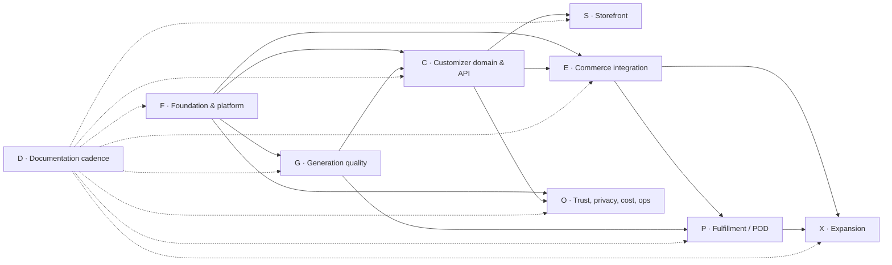
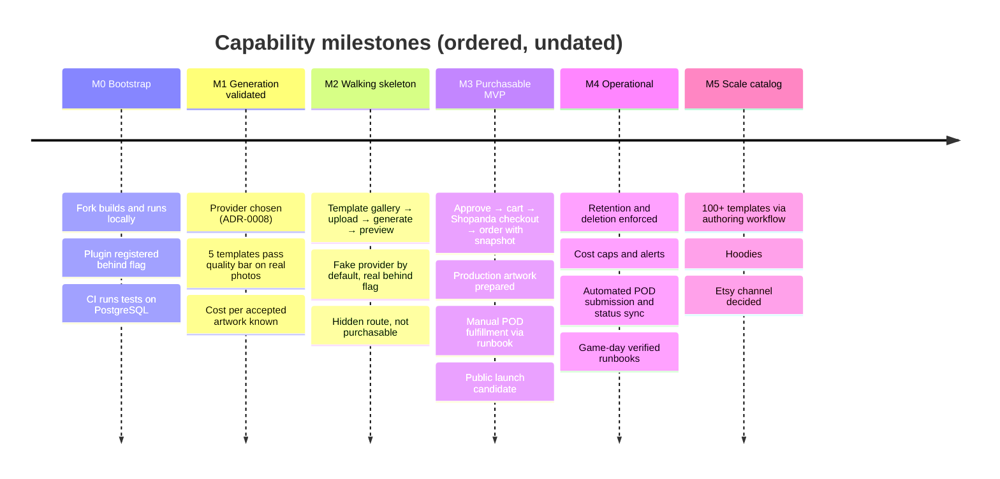
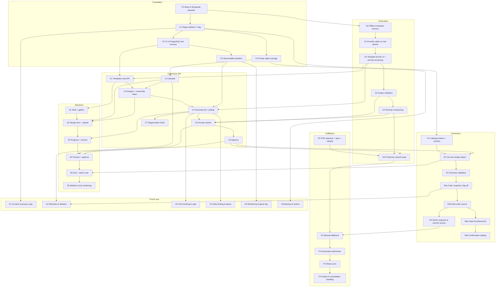

# Metal Dogs roadmap

Status: living document. Updated at the close of every CR round (see [`cr-rounds/`](cr-rounds/README.md)).

This roadmap turns [`PROJECT_DESCRIPTION.md`](PROJECT_DESCRIPTION.md) into **tracks** of **vertical slices**. Every slice is a complete, thin path through storefront → API → domain → persistence/worker → external adapter (where relevant), with tests at each boundary, and it can be merged and deployed without breaking the live site.

No calendar dates are given. Ordering is expressed through dependencies and milestones; sizing is relative (S / M / L ≈ ≤2 days / ≤1 week / >1 week for one engineer).

---

## 1. Ground truth this plan is built on

Inspected against Shopanda source at pin [`084d120660c50acabb045c1b19a78f25677d6843`](UPSTREAM_PIN.md) (explicit SHA; shopanda#660 / PR-1603; on `upstream/main` and the tip of `upstream/dev`; tree equals `upstream/main` tip `7d386c6b`, shopanda#661). **Inspected at pin** = code/docs read + ImportBoundary where noted; not a runtime contract suite. Promote a row to **Contract-tested** when F1/F2/E* add automated checks. Re-inspect on every upstream upgrade.

| Capability | Status | Consequence for Metal Dogs |
| --- | --- | --- |
| Go + PostgreSQL single binary; runtime modes `serve`, `worker`, `scheduler`, `dev` | Inspected at pin; `go build` exercised | No separate service; generation worker is a Shopanda worker process |
| Extensions are in-module, **compile-time** plugins registered in `cmd/api/register_products.go` | Inspected at pin | Metal Dogs backend is an external plugin `plugins/metaldogs` in a Shopanda fork tracked against upstream ([ADR-0001](adr/0001-metal-dogs-as-shopanda-external-plugin.md)) |
| Plugins may own tables (scoped, via `Bootstrap.DB`), register public HTTP routes, events (`Bus.On`/`OnAsync`), cart hooks, checkout steps, extension fields, permissions, admin config, CLI commands | Inspected at pin | Customizer API, snapshot creation, and admin tooling are all plugin-level; no core forks |
| Import boundary: plugins must not import `internal/infrastructure` or `internal/interfaces` (test-enforced) | Contract-tested (`ImportBoundary`) | Production `plugins/metaldogs` does not import `internal/*`. Shopanda ports are consumed through `pluginsdk.Host` ([CR-26](cr-rounds/CR-26-mig3b-pluginsdk-group-b2.md)) |
| PostgreSQL job queue with admin API and `jobs:*` CLI; cron scheduler | Inspected at pin | Generation, artwork preparation, retention sweeps run as queue jobs ([ADR-0003](adr/0003-async-generation-pg-job-queue-polling.md)) |
| Plugin on-demand enqueue + handlers | Inspected at pin (Phase 13 PR-1087–1088; PR-1592; PR-1593; PR-1595) | Use `RegisterManual` + `Enqueue`; queue types are `integration.sync.metaldogs.<name>` (no free-form `metaldogs.*` types). Generate and prepare call `SyncJobs.Enqueue` with `pluginsdk.WithJobID` (UUID). A stale generate processing claim is requeued with `WithRequeueMinAge` after that enqueue; fresh processing is left ([CR-26](cr-rounds/CR-26-mig3b-pluginsdk-group-b2.md)). Terminal requeue retries once ([CR-28](cr-rounds/CR-28-upg8-pin-d9ccc21c.md)). Admin health calls `pluginsdk.JobsPort.CountsByType` ([CR-26](cr-rounds/CR-26-mig3b-pluginsdk-group-b2.md)). Plugin CLI skips `CapJobs` and `CapMedia` ([CR-28](cr-rounds/CR-28-upg8-pin-d9ccc21c.md)) |
| Plugin-owned schema migrations | Inspected at pin (Phase 13 PR-1084–1086) | Implement `pluginsdk.Migrator` (`Migration` returns `pluginsdk.MigrationSpec`); versions `plugin:<name>:<basename>`; applied by `app migrate` / boot `InitAll` with advisory lock ([CR-26](cr-rounds/CR-26-mig3b-pluginsdk-group-b2.md)) |
| Extension fields with cart → order snapshot at checkout | Inspected at pin; E2 contract-tests the session-cart route, the plugin-only `403`, and `cart.validate` ([CR-19](cr-rounds/CR-19-e2-cart-design-attach.md)). E3 contract-tests `POST /api/v1/checkout` re-validation with manual payment ([CR-30](cr-rounds/CR-30-e3-checkout-validation.md)). Guest SSR pages and Stripe test mode are not recorded. Copy of snapshot-mode values onto the order line is core behaviour and, on this pin, runs before `order.created` is published (PR-1601, [CR-33](cr-rounds/CR-33-upg11-pin-e062d4d3.md)). `OrderPort` has `Lines`, `LinesForOrders`, and `ListCreatedSince` (PR-1600). E4b reads that copy through `Host.Orders()` when `plugins.metaldogs.order_snapshot.enabled` is true ([CR-34](cr-rounds/CR-34-e4b-order-source.md)). The flag defaults to false. | Line-level (`cart_item` / `order_item`); key `(order_id, variant_id)`; `metaldogs.design_id` is public, plugin-only write, snapshot storage ([ADR-0005](adr/0005-immutable-order-design-snapshot.md)) |
| Plugin-only extension writes | Inspected at pin ([shopanda#575](https://github.com/akarso/shopanda/pull/575), [#578](https://github.com/akarso/shopanda/pull/578), [#580](https://github.com/akarso/shopanda/pull/580); cart write order is phase PR-1549, merged in [#584](https://github.com/akarso/shopanda/pull/584)) | Untrusted writes of `Access.PluginOnlyWrite` fields return 403 `forbidden_plugin_only_field`. Trusted in-process code uses `App.PluginWriteContext` (error) or `App.WithPluginWrite` (panic). `Publish`, pricing, `checkout.Workflow.Execute`, and `jobs.Worker.safeHandle` strip the grant. Add-to-cart uses `Host.Cart()` and `Host.Catalog()` ([CR-20](cr-rounds/CR-20-mig1-cart-pluginsdk.md)). |
| Guest checkout, Stripe core plugin, S3 core plugin, media storage port | Inspected at pin | No account required for MVP; private S3 bucket ([ADR-0004](adr/0004-private-object-storage-signed-urls.md)). Checkout JSON errors can carry a plugin client code (`plugin.<slug>` via `pluginsdk.WithClientCode`), a `details` object (`WithDetails`), and HTTP 503 (`UnavailableError` / `IsUnavailable`; `httpx.ErrorBody.Details`) (PR-1597, shopanda#650). The E3 step uses that for `plugin.metaldogs.design_unavailable` and `plugin.metaldogs.validation_unavailable`. |
| SSR storefront with themes, UI slots, asset manifest | Inspected at pin | Cart and checkout pages are reused from Shopanda; only the customizer is custom ([ADR-0002](adr/0002-storefront-customizer-and-shopanda-checkout.md)). SSR checkout confirms a Stripe PaymentIntent (`themes/default/templates/checkout_confirm.html`, POST then 303 then GET, `payment.stripe.publishable_key`, `GET /checkout/payment/return`) (PR-1598, shopanda#651). That return route is out-of-scope in `PublicProductVisibilityRoutes` (PR-1599, shopanda#653). This row does not record a Stripe test-mode run. On this pin, `order_confirmed` lines and the storefront order pages (`checkout_confirm.html`, `account_order_detail.html`) include `VariantID`, `SKU`, and public `order_item` extensions (PR-1603, [CR-38](cr-rounds/CR-38-upg12-pin-084d1206.md)). The filter is visibility-only, so with the plugin enabled `metaldogs.design_id` renders as `Design ID: <uuid>` on that email and both pages. This pin accepts that. The bump is not behaviour-neutral for the shopper. There is no enrich hook for a derived image URL. E6b does not call `OrderThumbnailURL`. |
| `order.created` / `order.failed` published | Inspected at pin (PR-1088, PR-1601). `finishCreatedOrder` snapshots cart→order extensions, then publishes `order.created` (`internal/application/checkout/create_order_step.go`). A snapshot error still publishes, then returns the error. `Workflow.Execute` retries `create_order` once before compensate. Payload is `OrderCreatedData` (order id, customer id, contact email, currency, item count) and has no line extensions | Prefer `order.paid` for fulfilment; tolerate `order.created` followed by `order.failed` if checkout compensates. E4b subscribes when `plugins.metaldogs.order_snapshot.enabled` is true ([CR-34](cr-rounds/CR-34-e4b-order-source.md)). That flag defaults to false, so a real order gets no snapshot until it is turned on |
| Plugin shipment status update | Inspected at pin (PR-1400) | `IntegrationShipmentStatusUpdater.ApplyShipmentStatus` for POD status sync (track P) |
| Public catalog price and on-hand stock | Inspected at pin ([shopanda#573](https://github.com/akarso/shopanda/pull/573)); E1 guest product and variant offer reads contract-tested (CR-18) | Guest product and variant reads include a `PublicOffer` sibling (`amount` in minor units or `null`, `currency`, `in_stock`, `variant_id` only when `amount` is set). List and category lists use `meta.offers[<product id>]`; product detail uses `meta.offer`; variant list uses `offers[<variant id>]`; variant detail uses `offer`. Search and admin reads omit offers. E1 feature tests read the custom tee through these guest responses (PLN host; `amount` is the stored net price; stock 0 is `in_stock: false`). |

Product assumptions still open (section 10 of the project description) are resolved by slices `G1`, `P0`, `O1`, and `S6`; each closes with an ADR.

---

## 2. Delivery rules for every slice

A slice is **done** only when all of the following hold:

1. **Dark by default.** New behaviour is unreachable in production until explicitly enabled: plugin config flag (`plugins.metaldogs.*`), route returns `404` when disabled, template `status = draft`, provider adapter `fake` unless configured.
2. **Expand/contract migrations only.** Add columns/tables first, backfill, switch reads, remove later in a separate slice. Workers and HTTP servers may run mixed versions during deploy.
3. **Idempotent commands.** Anything that can be retried (generate, approve, attach to cart, snapshot, submit to POD) carries an idempotency key or natural unique constraint, and a duplicate returns the first result.
4. **No paid calls in CI.** AI and POD adapters have a `fake` implementation used by default in tests and local dev. Real calls are opt-in smoke tests.
5. **Tests at the right level** (see §7): domain unit tests, feature tests through HTTP/worker with real PostgreSQL, contract tests with sanitized fixtures for every adapter touched.
6. **Observability for every async boundary:** structured log with `design_id`, `job_id`, `correlation_id`, attempt, duration, terminal reason.
7. **Docs updated in the same change:** API contract, status transitions, ADR if a decision was made, runbook if a new failure mode exists.
8. **Rollback path stated** in the PR: flag off, or revert with the migration remaining compatible.

---

## 3. Tracks

| Track | Owns | Public API it exposes to other tracks |
| --- | --- | --- |
| **F** Foundation | Repo layout, Shopanda fork/upstream sync, plugin skeleton, config flags, CI, test harness, storage, observability | `plugins/metaldogs` skeleton, feature flags, test helpers |
| **G** Generation quality | Template definition format, provider port + adapters, prompt versioning, output validation, mockup compositing, production artwork | `generation` module: `Generate(ctx, GenerationRequest) → GenerationResult`, `Validate`, `ComposeMockup`, `PrepareProductionArtwork` |
| **C** Customizer | Templates catalog, uploads, designs, generation jobs orchestration, approval, assets | REST `/api/customizer/*`; application services used by E |
| **S** Storefront | Vanilla JS customizer UI, mobile capture, polling, previews, accessibility | Static assets served under the shop origin |
| **E** Commerce | Shopanda catalog setup, cart attach, checkout validation, order design snapshot, admin views | Cart line extension `metaldogs.design_id`; `OrderDesignSnapshot` read API for P |
| **P** Fulfillment | POD selection, artwork spec, manual fulfillment, automated submission, status sync | Fulfillment status on snapshot |
| **O** Trust & ops | Consent copy, retention/deletion, cost caps, rate limits, monitoring, backups | Policies enforced in C/G; dashboards; runbooks |
| **X** Expansion | Template authoring at scale, hoodies, Etsy decision, accounts, SSE | — |
| **D** Documentation | Diagrams, ADRs, runbooks, READMEs at every CR-round closure | — |

---

## 4. Milestones

| Milestone | Closes when these slices are done | User-visible result |
| --- | --- | --- |
| **M0** | F0 F1 F2 F3 F4 D0 | Nothing visible; deployable fork with inert plugin (F0–F4 closed; D0 open) |
| **M1** | G0 G1 G2 | Internal: evaluation report, accepted provider ADR, template format v1 |
| **M2** | C1 C2 C3 C4 C5 S1 S2 S3 S4 G3 G4 O1 | Hidden `/customize` flow works end to end with previews |
| **M3** | C6 C7 E1 E2 E3 E4a E4b E5 E6a S5 S6 G5 P0 P1 O2 O4 | Customers can buy; orders carry immutable artwork; fulfilment manual |
| **M4** | P2 P3 P4 O3 O5 O6 E6b | Hands-off fulfilment, cost and privacy controls, monitoring |
| **M5** | X1 X2 X3 (X4 X5 only if justified) | Catalog growth, second product, channel decision |

---

## 5. Slice dependency graph

---

## 6. Slices

Each slice uses the same card. "Safe delivery" explains why the site does not break when the slice is merged and deployed alone.

### Track F — Foundation & platform

#### F0 · Repository and Shopanda baseline — size M — **DONE** (CR-01, 2026-11-05)

- **Goal:** This repository builds and runs Shopanda unchanged, pinned to a specific upstream commit, with an `upstream` remote and a documented sync procedure.
- **Scope:** Fork layout per ADR-0001; `storefront/` and `plugins/metaldogs/` directories created empty; `.gitignore` for IDE and local files; Metal Dogs owns `docs/` (upstream docs not vendored).
- **Out of scope:** Any Metal Dogs code.
- **Depends on:** —
- **Tests:** Upstream ImportBoundary passes on the pin; full upstream suite remains available via upstream CI workflow in-tree.
- **Safe delivery:** No behaviour change.
- **Docs:** ADR-0001 → Accepted; runbook `shopanda-upgrade.md` gets real commands; `AGENTS.md` gets the real build/test commands; [`UPSTREAM_PIN.md`](UPSTREAM_PIN.md).
- **Exit:** `go build -o app ./cmd/api` succeeds; `./app dev` serves the default Shopanda storefront locally (after `./app setup`).
- **Pin (F0):** `56818946…`. **Current pin:** see [`UPSTREAM_PIN.md`](UPSTREAM_PIN.md) (`d9ccc21c…`, shopanda#646 / PR-1595; tree equals `upstream/main` tip `79c3b59a`). Ticket 02 removed `cmd/api/metaldogs_catalog.go`. Ticket 00d: `metaldogs:catalog-seed` is bound by upstream `runPluginCLICommand` (`register_products.go` only registers the plugin). Ticket 00e: pin includes `WithRequeueTerminal`, `Host.PlatformConfig`, and `cmd/api/plugin_boot.go`. Ticket 03b calls `Queue.Requeue` with `WithRequeueTerminal`, `pluginsdk.RequireQueueDriver`, and `bootServePlugins` / `bootWorkerPlugins`. Ticket 00f: non-UUID job ids are not-found on the pin; `job_queue.go` is not a Metal Dogs edit. Ticket 00g: `ReadableStorage.Read` takes a context; `localfs/storage.go` matches the pin. Ticket 05: cart extension tests are race-free (`go test -race ./internal/application/cart/` in `scripts/ci/unit.sh`).

#### F1 · Plugin skeleton behind a flag — size S — **DONE** (CR-02, 2026-11-06)

- **Goal:** `plugins/metaldogs` registers as an external plugin, enabled by `plugins.metaldogs.enabled` (default `false`), exposes `GET /api/customizer/enabled` only when enabled (not a process probe).
- **Scope:** `Plugin` implementation; config struct; registration line in `cmd/api/register_products.go` (F1 landed it in `register_plugins.go`); internal layout `domain/`, `application/`, `ports/`, `adapters/`, `httpapi/`; **verification tasks** for custom job types and plugin migrations with the result written into ADR-0003.
- **Tests:** Import-boundary; `registerPlugins` enabled/disabled (route + CollectMigrations); Cache-Control `no-store` for `/api/customizer/*` via shared prefix list.
- **Safe delivery:** Flag default off; `/api/customizer` on no-cache prefix list.
- **Docs:** `architecture/overview.md` module layout confirmed; ADR-0003 verification notes.

#### F2 · CI and PostgreSQL test harness — size S — **MERGED** (CR-03 + fixes, 2026-11-06)

- **Goal:** CI runs unit + feature tests against a real PostgreSQL; a shared test helper creates a unique schema per `OpenIsolated` call and runs plugin migrations into it.
- **Scope:** CI workflow; `testutil` with DB fixture, fake clock, fake ID generator; coverage reporting; dedicated `integration-metaldogs` job (decoupled from Shopanda DSN suite).
- **Tests:** The harness itself is exercised by a trivial repository round-trip test plus pool/same-slug/cleanup canaries.
- **Safe delivery:** CI only.
- **Docs:** `runbooks/local-development.md` test section; `AGENTS.md` commands.
- **Open gate:** Origin Actions billing still blocks live green proof of `CI / integration-metaldogs` on `origin`. When billing returns: require that check name on `main` branch protection, confirm green, then close CR-03. Shopanda DSN reds cannot fail this job.

#### F3 · Observability baseline — size S — **DONE** (CR-04, 2026-11-06; pin absorb 2026-11-08)

- **Goal:** Structured logging with `correlation_id` propagated from HTTP request to enqueued job; metrics hooks for job duration/attempts; health reports queue readiness (depths on admin).
- **Platform (Shopanda):** `request_id` injection on Enqueue, `SyncJobContext.Attempts`, `JobResult` metrics, `CountsByType` — [shopanda#568](https://github.com/akarso/shopanda/pull/568) merge at pin `a8cbcb18`.
- **Platform residuals (Metal Dogs only until upstreamed):** `App.BoundQueue()` is unused by the plugin after MIG3b ([CR-26](cr-rounds/CR-26-mig3b-pluginsdk-group-b2.md)). Sync-handler payload `request_id`→ctx reinjection remains; product correlation depends on it.
- **Vendor (Metal Dogs):** `correlation_id` log alias; public `GET /api/customizer/health` (`Host.Jobs()` bound / `CapJobs` only); admin depths via `Host.Jobs().CountsByType` (`jobs.read`); `obs.ping` (Enqueue + ctx reinjection + log fields; HTTP→worker E2E follow-up).
- **Tests:** Enqueue `request_id`; sync handler ctx reinjection; public `Host.Jobs()` probe; admin counts-error path; worker `JobResult` after Complete/Fail.
- **Safe delivery:** Additive; flag still default off. Public health does not run `CountsByType` or expose typed degrade reasons.
- **Docs:** runbook diagnosis; CR-04. Upstream guide: [SYNC_JOB_OBSERVABILITY](https://github.com/akarso/shopanda/blob/084d120660c50acabb045c1b19a78f25677d6843/docs/guides/SYNC_JOB_OBSERVABILITY.md).

#### F4 · Private object storage — size S — **DONE** (CR-05, 2026-11-07; pin absorb 2026-11-08)

- **Goal:** Plugin `AssetStore` over platform `media.SignedURLStorage` with namespaced private keys.
- **Scope:** Keys `private/blobs/metaldogs/...` enforced in mediastore; TTL cap; inline signed GET; no product shim ([shopanda#570](https://github.com/akarso/shopanda/pull/570) + [shopanda#571](https://github.com/akarso/shopanda/pull/571) at pin `a8cbcb18`). Local prefer `./var/media` (never FileServer). C2 landed Put + EXIF strip; ownership → C3; retention sweep → O2.
- **Tests:** Prefix reject; localfs ObjectKey→Put→GET contract; Init on fake SignedURLStorage.
- **Safe delivery:** Nothing writes yet. ADR notes remaining ops limits (S3 bucket policy, log redaction).
- **Docs:** ADR-0004 Accepted (with honest limits); CR-05.

### Track G — Generation quality

#### G0 · Offline evaluation harness — size M — **DONE** (CR-07, 2026-11-08)

- **Goal:** A CLI (`metaldogs:eval`) that takes a template definition, a set of local photos, and a provider name, runs generation, writes outputs + a JSON report (latency, cost if reported, validation results) to a local folder. Default provider is `fake` (returns deterministic fixture images).
- **Scope:** `plugins/metaldogs/generation`: `ImageProvider` port, `fake` adapter, `PhotoBytes` + dimension cap, length-prefixed digest/`ProviderReqID`; `generation/eval` runner + JSON report (root parameters); CLI `metaldogs:eval` (no DB). Template file stub (JSON/YAML) until G2.
- **Tests:** Fake determinism / seed collision / empty photo bytes / cancel; distinct output names; CLI registration (media optional) + non-zero exit on sample fail.
- **Safe delivery:** CLI only for eval. Without media: eval CLI registers, customizer HTTP/AssetStore stay off (fail-closed). With media: full plugin surface.
- **Docs:** ADR-0008 remains Proposed (provider TBD at G1); evaluation criteria unchanged; CR-07.

#### G1 · Provider spike on real photos — size M (opt-in, paid) — **SCAFFOLD DONE** (CR-08, 2026-11-08); **exit gate open**

- **Goal:** Answer project-description questions 1, 2, 3, 7: fidelity of dog + pattern + text, cost per accepted artwork, print usability (transparency/background), typography correctness for Polish names of varied length.
- **Scope (shipped):** OpenAI Images adapter (`gpt-image-2.5-sunburst`, `image[]`, no `response_format`); 5 spike templates; scorecard example; OCR name heuristic stub; `metaldogs:eval -provider openai`.
- **Scope (operator):** ≥20 local photos; paid runs; human scorecards; ADR accept if pass.
- **Tests:** Contract httptest fixtures (MIME / no `response_format` / 400); smoke behind `METALDOGS_SMOKE=1` (not default CI).
- **Safe delivery:** Never runs in CI; no production route; keys via `METALDOGS_OPENAI_API_KEY`.
- **Docs:** ADR-0008 Proposed with OpenAI candidate; [`architecture/generation-quality.md`](architecture/generation-quality.md); CR-08.
- **Exit gate:** Quality bar met for ≥4 of 5 templates; cost per accepted artwork acceptable including failed attempts. If not met, iterate within G1 before continuing M2.

#### G2 · Template definition format v1 and prompt versioning — size M — **DONE** (CR-09, 2026-11-09)

- **Goal:** Declarative `Template` with: id, status (`draft|published|retired`), genre, style category, reference pattern asset, prompt instructions and model parameters, photo requirements (`head_front|head_angle|full_body_profile|...`, background and lighting hints), editable text fields (name, max length, allowed characters) and fixed texts, output configuration (canvas size, print area, monochrome), `version`.
- **Scope:** `metaldogs_templates` migration; domain Validate + content hash; `metaldogs:templates validate|load|publish|retire`; five YAML under `plugins/metaldogs/templates/`; eval accepts v1 + `-dog-name`.
- **Tests:** Table-driven validation; hash sensitivity; postgres load/version bump/publish/retire; eval v1 fake run.
- **Safe delivery:** Templates load as `draft`; nothing published in this CR.
- **Docs:** `architecture/domain-model.md` Template section; `runbooks/template-publishing.md`; CR-09.

#### G3 · Output validation — size M — **DONE** (CR-10, 2026-11-09)

- **Goal:** Deterministic checks on provider output before it becomes a preview: exact canvas WxH, monochrome tolerance (un-premultiplied 16-bit), transparency warning, PNG decode integrity with IHDR size cap, near-uniform blank detection; dog-name OCR remains heuristic-only.
- **Scope:** `generation/validate.Validate` (hard fail: `decode_failed`, `dimensions_mismatch`, `not_monochrome`, `blank_or_low_detail`; `no_transparency` warning-only until ADR-0008 Accept). Wired into `metaldogs:eval` (`error_class=validation_failed`); job wiring deferred to C4. Not in G3: aspect-only checks beyond WxH, deeper “garbage” classifiers, byte-reading OCR, background-removal.
- **Tests:** Unit tests with fixture images for each rule; negative cases; eval fake run asserts `validation.status=pass`.
- **Safe delivery:** Pure functions; wired into the job in C4.
- **Docs:** Validation codes listed in `architecture/flows/generation-pipeline.md`; CR-10.

#### G4 · Mockup compositing — size S — **partial** (CR-15; web-sized base still open)

- **Goal:** Compose validated artwork onto a prepared black-tee mockup image within a defined print area, producing a web-sized preview PNG/WebP. No customer interaction with placement.
- **Scope (partial):** `generation/mockup.Compose` (contain-scale + center; dimension cap; longest-edge ≤1024 when base exceeds it). Embedded fixture is still an **80×100 placeholder** — not a real web-sized garment base; template `output_config.print_area` not yet driving placement. Close when a real web-sized base lands (or docs stop calling the preview web-sized).
- **Tests:** Unit: placement/bounds/letterbox+alpha; worker asserts mockup asset on fake preview_ready.
- **Safe delivery:** Pure function; wired from generate worker in C5.
- **Docs:** Pipeline stage contract; CR-15.

#### G5 · Production artwork preparation — size M — **partial** (G5a / [CR-36](cr-rounds/CR-36-g5a-production-artwork.md); open until P0)

- **Goal:** From the approved artwork, produce the production file matching the POD specification (resolution, dimensions, transparency, colour profile), compute checksum, store as `production` asset linked to the approved design version.
- **Status:** G5a runs that pipeline when `plugins.metaldogs.production_spec` is present and complete (`width_px`, `height_px`, `dpi`, `require_transparency`, `color_profile` = `srgb` only, `upscale_policy` = `reject|upscale`). No defaults and no printer numbers in the repo. The section absent: the job still errors `pending_spec` and the version stays `pending`. The section present with any field missing or invalid ends that plugin's Init: worker, scheduler, and the jobs CLI refuse to start; `serve` starts with metaldogs inactive (no routes and no jobs). G5 stays open until P0 records the real provider and file values ([ADR-0009](adr/0009-pod-provider-and-catalog-modelling.md)).
- **Scope:** `production.Prepare` fits the approved PNG (aspect within 1%, Lanczos downscale, `reject` or `upscale` when smaller, transparency check). Job `integration.sync.metaldogs.prepare_production_artwork` enqueues with `MaxRetries=3`. Permanent failures (`too_small`, `aspect_mismatch`, `transparency_required`, `artwork_unreadable`) set `production_status=failed` and `production_failure_reason` (migration `017`) and end that delivery (`max_retries = attempts`). Storage or database errors retry. Reclaim of `failed`/`cancelled` may set `attempts=0` and raise `max_retries` together; stale `processing` leaves `attempts` alone. A version already `ready` is a no-op. When the handler sets `ready`, it calls `(*metaldogs.Plugin).FillSnapshotProduction` (E4a, [CR-32](cr-rounds/CR-32-e4a-order-design-snapshot.md)); that error is logged and does not fail the job. The `reconcile_snapshots` cron still fills NULL production columns later, and only with an `OrderSource` bound (E4b).
- **Tests:** `production.Prepare` rules, DPI/sRGB, checksum; settings absent, complete, each missing field, bad profile/policy; Postgres seam `TestPrepareProductionJob` (ready and filled snapshots, `too_small`, upscale, aspect, transparency, unreadable, spec absent, rerun no-op, storage retry, fill error). [CR-36](cr-rounds/CR-36-g5a-production-artwork.md).
- **Safe delivery:** No new flag. Without the spec section the path is the previous `pending_spec` stub. A failed prepare job stays on that job ([`runbooks/generation-job-stuck-or-failed.md`](runbooks/generation-job-stuck-or-failed.md)) and does not block checkout until P2 requires it. E5 ([CR-35](cr-rounds/CR-35-e5-artwork-access.md)) returns `production: null` when the snapshot has no production asset.
- **Docs:** [`architecture/flows/checkout-snapshot-and-fulfillment.md`](architecture/flows/checkout-snapshot-and-fulfillment.md); [`runbooks/generation-job-stuck-or-failed.md`](runbooks/generation-job-stuck-or-failed.md); [ADR-0006](adr/0006-design-and-job-status-model.md); [ADR-0009](adr/0009-pod-provider-and-catalog-modelling.md); `configs/config.example.product.yaml`; [CR-36](cr-rounds/CR-36-g5a-production-artwork.md).

### Track C — Customizer domain & API

#### C1 · Templates read API — size S — **DONE** (CR-11 / PR #23)

- **Goal:** `GET /api/customizer/templates?genre=` and `GET /api/customizer/templates/{id}` returning only `published` templates with DTOs (no prompts, no model parameters, no reference pattern URLs beyond a thumbnail signed URL).
- **Scope:** Public-read SQL projection (`ListPublished` / `GetPublishedByID` never select prompt/model/hash/path columns); http-owned DTOs; catalog wired in plugin Init; `thumbnail_url: null` until asset ingest; `404` for draft/retired/unknown; platform `Cache-Control: no-store`.
- **Tests:** Feature tests for filtering, draft/retired exclusion, list+get secret omission, nil-catalog `503`, store-error `500`, caching headers (`no-store` prefix).
- **Safe delivery:** Flagged; no published templates exist yet.
- **Docs:** API contract in `architecture/api.md` (created here); CR-11.

#### C2 · Uploads — size M — **DONE** (CR-12 / PR #24)

- **Goal:** `POST /api/customizer/uploads` (multipart) → `SourceAsset` in private storage; server-side checks: size limit, real MIME by sniffing, decode to verify format and dimensions, min/max dimensions, EXIF stripped, re-encoded; returns `upload_id` and a short-lived signed preview URL; uploads expire if not attached to a design (O2).
- **Scope:** Migration `003` `metaldogs_assets` (`owner_ref` nullable, `UNIQUE(storage_key)`); `DecodeConfig` OOM gate + Orientation normalize + EXIF strip; SoftDelete-first compensating cleanup; in-process concurrency cap (`replicas × 4`, not IP — O4); retention stub only (sweep + orphan-blob reconcile = O2).
- **Tests:** Feature: happy / wrong MIME / WebP / dims / corrupt / 413 / missing / nil 503; unit: IHDR bomb, Orientation=6, cleanup paths; DSN Insert/Get/SoftDelete + unique key.
- **Safe delivery:** Flagged; storage private; unauthenticated until C3 (`owner_ref` reserved); no sweep yet — ops must treat unattached uploads as sticky until O2.
- **Docs:** Limits + split TTL fields in `architecture/api.md`; ADR-0004 Put call site; CR-12.

#### C3 · Designs and ownership token — size M — **DONE** (CR-13 / PR #28)

- **Goal:** `POST /api/customizer/designs` with `template_id`, texts, `upload_id` → `Design` in `draft` with a capability token (ADR-0007) returned once; `GET /api/customizer/designs/{id}` requires the token; `PATCH` texts/upload allowed only in `draft`/`generation_failed`/`preview_ready`.
- **Scope:** Migration `004` `metaldogs_designs`; domain Design + text charset validation; Bearer token (hash only stored); bind upload `owner_ref` to design id; signed source preview on DTO.
- **Tests:** Unit: status transitions, texts, token hash; feature: create+token, Bearer GET/PATCH, 404 auth, unpublished template 422; DSN CreateBound + bind exclusivity.
- **Safe delivery:** Flagged.
- **Docs:** ADR-0006, ADR-0007 → Accepted; api.md designs; CR-13.

#### C4 · Generate job and status polling — size L — **DONE** (CR-14)

- **Goal:** `POST /api/customizer/designs/{id}/generate` (with `Idempotency-Key`) creates a `GenerationJob`, enqueues `integration.sync.metaldogs.generate`, moves design to `generating`; `GET /api/customizer/generation-jobs/{id}` returns status, attempt, user-facing error code, `retry_after`. Worker: prepare input → provider call (fake by default) → validation (G3) → store artwork asset → `preview_ready` or `generation_failed`.
- **Scope:** Retry policy (transient only, bounded, backoff); per-design mutex so two jobs cannot run concurrently; provider/model/prompt version recorded on the job; cost and latency recorded.
- **Tests:** Unit: job state machine, retry classification; feature: HTTP → job row → worker run with fake provider → preview_ready; duplicate request with same key returns same job; concurrent requests create one job; permanent failure terminal; worker crash mid-job (simulated) is recovered by queue lease expiry.
- **Safe delivery:** Flagged; provider `fake` unless `plugins.metaldogs.generation.provider` set (C4 accepts only `fake`).
- **Docs:** `architecture/flows/generation-pipeline.md`; runbook `generation-job-stuck-or-failed.md` → real content; ADR-0003 Accepted.

#### C5 · Preview assets — size S — **partial** (CR-15; blocked on G4 web-sized base)

- **Goal:** Design response includes signed URLs (short TTL) for `artwork_preview` and `mockup_preview`; mockup produced in the generate job after validation (G4).
- **Scope (partial):** Worker persists artwork before mockup (`PersistArtwork`); compose/key/decode permanent; mockup Put transient; prior mockup/artwork blobs deleted after soft-delete; design GET signs only when job.DesignID, asset owner_ref, and type match (lookup I/O → 500). Still blocked on G4 web-sized base for customer-quality mockups.
- **Tests:** Unit: ownership/type/signer/I/O cases; worker mockup; Postgres CompleteSuccess mockup replace.
- **Safe delivery:** Flagged.
- **Docs:** `architecture/api.md` design DTO; pipeline compose stage; CR-15.

#### C6 · Approve — size M — **DONE** (CR-16)

- **Goal:** `POST /api/customizer/designs/{id}/approve` (idempotent) freezes the current artwork as `DesignVersion` with checksum, template version, texts, provider/model/prompt versions; design → `approved`; enqueues `integration.sync.metaldogs.prepare_production_artwork`. G5a runs that job when `production_spec` is set ([CR-36](cr-rounds/CR-36-g5a-production-artwork.md)); with no spec the handler still errors `pending_spec` and leaves the version `pending`. Approved designs reject further edits and regeneration; "change it" creates a new design cloned from the approved one.
- **Tests:** Unit: approve only from `preview_ready`; immutability enforced; feature: double approve returns same version; clone creates new draft with new token (source bytes Put-copied). DSN: `ApproveBound` unique + status race.
- **Safe delivery:** Flagged; migrations `013`/`014` (versions + append-only/FK). C6 enqueued prepare with `MaxRetries=1`. G5a enqueues with `MaxRetries=3`; `pending_spec` and validation still end that delivery (`max_retries = attempts`). Approve conflict never uses `Admin.Retry` (type-scoped cancelled/stale-processing UPDATEs; failed/done stay terminal).
- **Docs:** ADR-0005 Accepted for DesignVersion/approve. OrderDesignSnapshot is implemented in E4a ([CR-32](cr-rounds/CR-32-e4a-order-design-snapshot.md)). E4b reads it from `Host.Orders()` when the flag is on ([CR-34](cr-rounds/CR-34-e4b-order-source.md)). The flag defaults off.

#### C7 · Regeneration limits — size S — **DONE** (CR-17)

- **Goal:** Max attempts per design (config, default 3) enforced in the domain; UI-visible remaining count; cooldown between attempts; exceeding → `429` with `limit_reached` code.
- **Scope:** Design DTO exposes attempt budget + `retry_after` (cooldown lockout only); config `cooldown_seconds` (default 30, `0` disables); hard cap checked before cooldown; spent budget → `429` `limit_reached` (no `Retry-After`); cooling down → `429` `cooldown` with header + JSON `retry_after` + `job_id` when known. Cooldown anchor is terminal `finished_at` only (active latest → full-window wait; null `finished_at` / missing latest → `503` `unavailable`). Design `GET`/`PATCH`/`approve` view match that fail-closed rule (`PATCH` preflights before write; post-commit view failure includes committed `design` + preflight `retry_after`; approve preview I/O → `503` + `version_id`; post-commit source metadata I/O → `500`, retry safe). **Policy:** every `RequestGeneration` (including after `generation_failed`) consumes budget and cooldown; provider-fault refunds are a follow-up.
- **Tests:** Unit: limit boundary + `finished_at` CooldownAnchor; feature: 4th attempt inside window → `limit_reached`; cooldown then success; missing latest / null `finished_at` / job I/O → `503` with cause + ids; design GET/PATCH fail-closed + active `retry_after`; approve view / post-commit source `500`; HTTP `429` bodies include `job_id`.
- **Safe delivery:** Lower risk once enabled; purely restrictive. Config-only (no migration).
- **Docs:** `architecture/api.md`; [`CR-17`](cr-rounds/CR-17-c7-regen-limits.md).

### Track S — Storefront

The customizer is a vanilla HTML/CSS/JS application served under the shop origin at `/customize` (ADR-0002). Each slice adds one screen and is hidden until `plugins.metaldogs.customizer_public = true`; before that, the route is reachable only with a preview query token for internal testing.

#### S1 · Shell and gallery — size M

- **Goal:** Mobile-first page shell, genre selector, template gallery from C1 with thumbnails, photo-requirement badges; state persisted in `sessionStorage`.
- **Tests:** Pure-module unit tests (state, API client, DTO mapping) runnable without a browser; a smoke E2E at the page level (opt-in locally, required in CI once harness exists in F2 follow-up).
- **Safe delivery:** Hidden route.
- **Docs:** `storefront/README.md` created (structure, conventions, how screens map to API).

#### S2 · Design form and upload — size M

- **Goal:** Dog name and other editable texts with live validation mirroring template rules; template-specific photo instructions; `<input type="file" accept="image/*" capture="environment">` with gallery fallback; client-side preview before upload with change option; upload progress; server error mapping to friendly messages.
- **Tests:** Unit tests for validation mirror and error mapping; E2E happy path with fake provider.
- **Safe delivery:** Hidden route.

#### S3 · Generation progress and resume — size S

- **Goal:** Polling with backoff and jitter against C4; progress copy per job status; resume on page reload from stored design token; failure states with actionable options (retry within limit, change photo).
- **Tests:** Unit tests for the polling state machine (timers injected); E2E failure path with fake provider forced to fail.

#### S4 · Preview and approve — size M

- **Goal:** Side-by-side or tabbed views clearly labelled *Artwork* and *On the tee*; regenerate (remaining count); approve with explicit confirmation copy that the artwork is final; approved view locked.
- **Tests:** E2E approve; unit tests for view state.

#### S5 · Size selection and add to cart — size M

- **Goal:** Size picker from Shopanda variants (E1); add to cart through E2; redirect to Shopanda cart page; design thumbnail visible in cart line via UI slot `cart.items` if feasible (**verify**), otherwise text label.
- **Tests:** E2E through to the Shopanda cart page with design attached (fake provider, test DB).
- **Safe delivery:** Hidden route until E2 and E3 are also enabled.

#### S6 · Mobile and accessibility hardening — size M

- **Goal:** Verify camera capture on target iOS Safari and Android Chrome versions (project question 6); keyboard operation, focus order, labels, contrast, reduced-motion; error announcements; large-file upload resilience on mobile networks.
- **Tests:** Accessibility checks in E2E; manual device matrix recorded in `storefront/README.md`.
- **Safe delivery:** Non-functional improvements.

### Track E — Commerce integration

#### E1 · Catalog product and variants — size S — **DONE** (CR-18, 2026-11-12)

- **Goal:** One Shopanda product "Metal Dogs custom tee" with size variants and SKUs, pricing, tax class, and stock policy (ADR-0009). Delivered as a seed/CSV import and documented, not hand-edited in admin.
- **Tests:** Import script idempotent; feature test reads variants through Shopanda API.
- **Safe delivery:** Product unpublished/hidden in Shopanda until M3. Draft status and zero stock are independent protections; launch clears both.
- **Docs:** [ADR-0009](adr/0009-pod-provider-and-catalog-modelling.md) catalog modelling Accepted (fulfilment stays Proposed until P0); plugin README catalog section; [CR-18](cr-rounds/CR-18-e1-catalog.md). UPG4 ticket 02 runs the same command through `Host.CatalogSeed().Import` ([CR-21](cr-rounds/CR-21-upg4-pin-7c982b00.md)).

#### E2 · Cart line design attach — size M — **DONE** (CR-19, 2026-11-16)

- **Goal:** `POST /api/customizer/designs/{id}/add-to-cart` puts an approved design the caller owns onto the session cart as one line for a custom-tee size. The line carries `metaldogs.design_id` (public read, plugin-only write, snapshot storage). The route does not accept or return a cart id. The same design on the same variant again changes nothing. A different design on that variant, or a custom-tee line that already exists with no design id, is `409`. `cart.validate` blocks a custom-tee line whose design is missing, unknown, expired, or neither `approved` nor `ordered`. It does not check ownership. The add route still accepts only `approved`. A design that does not match the custom tee is reserved (`metaldogs.design_mismatch`) and is not emitted until X2.
- **Tests:** Feature tests call the route and the public cart API on an isolated database ([CR-19](cr-rounds/CR-19-e2-cart-design-attach.md)).
- **Safe delivery:** The plugin master switch. The field, the route, and the hook exist only when the plugin is enabled. The hook skips a loaded product with a different slug. A parent outside the catalog read scope is a blocking issue, not a skip. A custom-tee line with no `design_id` blocks that line. "Inert without design id" applies to other loaded products only.
- **Docs:** [`architecture/api.md`](architecture/api.md); [`architecture/flows/design-to-order.md`](architecture/flows/design-to-order.md); [CR-19](cr-rounds/CR-19-e2-cart-design-attach.md). Cart and catalog reads go through `pkg/pluginsdk` ([CR-20](cr-rounds/CR-20-mig1-cart-pluginsdk.md)). `pending_line`, `ClassifyProductSlug`, and `DiscardEmptyGuestCart` ([CR-21](cr-rounds/CR-21-upg4-pin-7c982b00.md) ticket 04).

#### E3 · Checkout validation — size S — **DONE** (CR-30, 2026-11-22)

- **Goal:** When the plugin is enabled, checkout step `metaldogs_design_sale` runs at `before:reserve_inventory` and re-checks every custom-tee line with `validateDesignLine` (the same rules as `cart.validate`). `approved` and `ordered` designs that have not expired pass. A refusal stops checkout before stock is reserved and before an order is created. A cart with no custom-tee line is unchanged. The plugin master switch is the flag.
- **Tests:** `TestCheckout_DesignSale` calls `POST /api/v1/checkout` on an isolated database with the manual payment provider ([CR-30](cr-rounds/CR-30-e3-checkout-validation.md)). A refused design is `422` `plugin.metaldogs.design_unavailable` with every failing line. A port failure is `503` `plugin.metaldogs.validation_unavailable` and `retryable: true`. A logged-in cart is refused the same way.
- **Safe delivery:** The step exists only when the plugin is enabled. It does nothing to a cart whose lines are other loaded products.
- **Manual verification:** Not recorded. SSR confirm exists upstream (PR-1598). Guest checkout with Stripe test mode is still a maintainer checklist ([`runbooks/checkout-manual-verification.md`](runbooks/checkout-manual-verification.md)). E3 is not an end-to-end Stripe proof until that checklist is filled in.
- **Known limits:** A cart line does not extend a design's lifetime, so a design can expire between add and pay (retention is O2). Reorder of an `ordered` design through the add-to-cart route stays `409` `invalid_transition`; re-order is a clone, then a new approval (E4a, [CR-32](cr-rounds/CR-32-e4a-order-design-snapshot.md)). A race between this step and order creation is the E4a snapshot plus reconciliation. E4b binds that source when the flag is on ([CR-34](cr-rounds/CR-34-e4b-order-source.md)). The flag still defaults off. Merging a guest cart copies `metaldogs.design_id` without hooks; this step is the check.
- **Docs:** [`architecture/api.md`](architecture/api.md); [`architecture/flows/design-to-order.md`](architecture/flows/design-to-order.md); [CR-30](cr-rounds/CR-30-e3-checkout-validation.md).

#### E4a · Order design snapshot (plugin) — size M — **DONE** (CR-32, 2026-11-23)

- **Goal:** After an order id is known, write one immutable `OrderDesignSnapshot` per custom-tee line, move the design `approved → ordered`, and keep snapshot artwork and production assets out of plugin deletion. The line key is `(order_id, variant_id)`. Delivery is `order.created` → one `dispatch_snapshot_order` job → one `snapshot_order_design` job (UUID v5 of the order id) → idempotent insert. A periodic report finds design lines with no snapshot. The operator's `--fix` is the only enqueue from that report.
- **Status:** E4a code is in the tree. `plugins.metaldogs.order_snapshot.enabled` defaults to false (`configs/config.example.product.yaml`). While it is false the handler and the `reconcile_snapshots` cron are not registered, and `metaldogs:snapshots reconcile --fix` is refused. E4a bound no adapter. E4b ([CR-34](cr-rounds/CR-34-e4b-order-source.md)) binds `hostorders` when the flag is on. With the flag off, `metaldogs:snapshots reconcile` (with or without `--order`) exits `order source is not bound` and prints nothing. If the flag is on and `Host.Orders()` is unbound, a root that asserts capabilities fails boot (`required capability "orders" not bound`) before that cron runs. A root that does not assert capabilities leaves the source nil, and the cron logs `metaldogs.reconcile_snapshots.failed`, not `metaldogs.reconcile_snapshots.gap`. An alert on the gap line is not configured. The report runs only when a source is bound. E4a tests use an in-memory fake. The real checkout path is E4b.
- **Scope:** Migration `015` `metaldogs_order_design_snapshots` (append-only; production columns once, from NULL). Plugin port `ports.OrderSource` (`Lines`, `ListCreatedSince`). Retention helper `AssetsReferencedBySnapshots` on every plugin deletion path. `FillSnapshotProduction` for a later `ready` version. Nothing under `internal/*`, `pkg/*`, or core `cmd/api/*`.
- **Tests:** Postgres seam runs `snapshot_order_design` for an order id with the fake source ([CR-32](cr-rounds/CR-32-e4a-order-design-snapshot.md)). With that fake source bound, `metaldogs:snapshots reconcile` reports a seeded line with no snapshot and `--fix` enqueues one job. The cron logs `metaldogs.reconcile_snapshots.gap` and, when the flag is on and the source is bound, fills production columns once. Without a bound source the command prints nothing.
- **Safe delivery:** Flag off. Rollback is the flag, or leave it off. Migration `015` stays.
- **Known limits:** `Host.Orders()` on this pin has `Lines`, `LinesForOrders`, and `ListCreatedSince` (PR-1600). E4b calls them when the flag is on ([CR-34](cr-rounds/CR-34-e4b-order-source.md)). The flag still defaults off. `order.created` is published after the cart→order extension snapshot (PR-1601). The payload still has no extension values. A snapshot error still publishes, so a handler can run before every line is copied. `OrderSource.Lines` does not tell a missing order from an order with no design lines; both end the job `done`. The sweep looks back 30 days (`ReconcileLookback`); older orders need `--order`. With `production_spec` set, `prepare_production_artwork` calls `FillSnapshotProduction` when it sets `production_status=ready` (G5a, [CR-36](cr-rounds/CR-36-g5a-production-artwork.md)); a fill error is logged and does not fail the job. Without that section the job still ends `pending_spec` and fills nothing. Deletion functions are not scheduled (O2). After-`shipped` retention is O2. Add-to-cart of an `ordered` design stays `409`; re-order is a clone. E6a is [CR-37](cr-rounds/CR-37-e6a-order-thumbnail.md). E6b and track P are out of this slice. E5 is [CR-35](cr-rounds/CR-35-e5-artwork-access.md).
- **Docs:** [ADR-0005](adr/0005-immutable-order-design-snapshot.md) decision 4; [`architecture/flows/checkout-snapshot-and-fulfillment.md`](architecture/flows/checkout-snapshot-and-fulfillment.md); [`architecture/domain-model.md`](architecture/domain-model.md); [`architecture/flows/design-to-order.md`](architecture/flows/design-to-order.md); runbooks [`order-without-design-snapshot.md`](runbooks/order-without-design-snapshot.md) (last exercised: never) and [`asset-retention-and-deletion.md`](runbooks/asset-retention-and-deletion.md); [CR-32](cr-rounds/CR-32-e4a-order-design-snapshot.md).

#### E4b · Order source adapter — size S — **DONE** (CR-34, 2026-11-23)

- **Goal:** Bind `ports.OrderSource` to `Host.Orders()` (`adapters/hostorders`). Give `order.created` a payload-derived dispatcher job id. Page the sweep with the SDK keyset. Prove one paid custom-tee checkout writes its snapshot.
- **Status:** Code is in the tree and dark. `plugins.metaldogs.order_snapshot.enabled` defaults to false. While it is false, snapshot jobs and `reconcile_snapshots` are not registered and no source is bound. When it is true, `Init` calls `Require(CapOrders)` and sets `hostorders.FromHost`. A root that asserts capabilities fails boot if that port is unbound (`required capability "orders" not bound`). A root that does not assert capabilities leaves the source nil; the jobs fail closed (`order source is not bound`). Turn the flag on when M3 starts.
- **Pin:** `e062d4d3` ([CR-33](cr-rounds/CR-33-upg11-pin-e062d4d3.md)).
  1. `pluginsdk.OrderPort` has `Lines`, `LinesForOrders` (extension values; line key `(order_id, variant_id)`), and `ListCreatedSince` (limit 1..100). Core migration `112_orders_created_at_id_asc_index.sql`.
  2. `finishCreatedOrder` snapshots cart→order extensions, then publishes `order.created`. A snapshot error still publishes, then returns the error. `Workflow.Execute` retries `create_order` once when `created_order_id` is set and `order_created_published` is not, then compensates with `order.failed`. The payload has no line extensions. Delivery is at-least-once. `dispatch_snapshot_order` calls `pluginsdk.WithEventJobID` (PR-1602): UUID v5 of the dispatcher job type and the order id, different from the snapshot job id. A blank id fails enqueue in `NewSyncJobEnvelopeWithID` (`job id requires a non-empty UUID`).
- **Tests:** `TestCheckout_OrderSnapshot` calls `POST /api/v1/checkout` on isolated Postgres, then runs the queued dispatcher and snapshot handlers (`RegisterSyncJobHandlers`). Flag off enqueues nothing. A custom tee writes one snapshot with the copied fields and sets the design `ordered`. The same design in two sizes writes two snapshots. A second `order.created` keeps one dispatcher job and one snapshot. Another product writes no snapshot. [CR-34](cr-rounds/CR-34-e4b-order-source.md).
- **Safe delivery:** Flag off. Rollback is the flag. Nothing under `internal/*`, `pkg/*`, or core `cmd/api/*`.
- **Known limits:** A missing order and an order whose lines have no design id both yield no lines; the job ends `done`. A non-string `metaldogs.design_id` fails the read. Sweep lookback is 30 days. `prepare_production_artwork` fills production columns when the version becomes `ready` and a spec is configured (G5a, [CR-36](cr-rounds/CR-36-g5a-production-artwork.md)); without the spec it does not. E6a is [CR-37](cr-rounds/CR-37-e6a-order-thumbnail.md). E6b and track P are out of this slice. E5 is [CR-35](cr-rounds/CR-35-e5-artwork-access.md).
- **Docs:** [ADR-0005](adr/0005-immutable-order-design-snapshot.md); [`architecture/flows/checkout-snapshot-and-fulfillment.md`](architecture/flows/checkout-snapshot-and-fulfillment.md); [`runbooks/order-without-design-snapshot.md`](runbooks/order-without-design-snapshot.md); [CR-34](cr-rounds/CR-34-e4b-order-source.md).

#### E5 · Admin snapshot and artwork access — size S — **DONE** (CR-35, 2026-11-23)

- **Goal:** Permission `metaldogs.snapshots.read`; admin route and CLI `metaldogs:order-artwork <order_id>` yielding signed URLs to production and approved artwork plus snapshot metadata; one audit row per issued URL.
- **Status:** Code is in the tree and dark. `plugins.metaldogs.order_snapshot.enabled` still defaults to false. While it is false the route, the permission, and the CLI command are not registered. When it is true, `Init` registers `metaldogs.snapshots.read` for role `admin` only, `GET /api/v1/admin/orders/{order_id}/artwork`, and `metaldogs:order-artwork`. Both call `OrderArtworkAccess`. TTL is 300s. `production` is null when the snapshot has no production asset. Unknown order is not found; an order with no snapshot lines is an empty `lines` array. A failed audit write returns no URL. The log table is `metaldogs_artwork_access_log` (migration `016`): no URL and no storage key. CLI actor is `cli` and skips the permission check. HTTP actor is the admin user id (`pluginsdk.CustomerID`). Turn the flag on when M3 starts.
- **Tests:** `TestOrderArtworkAdminRoute` on isolated Postgres through `RequirePermission`: `401`, `403`, `200` with metadata and both URLs, `Fetch` works before expiry and fails after `FakeClock` advances 300s + 1s, body has no storage key, one audit row per URL, `production: null`, unknown order `404`, empty lines `200`, audit failure `503` with no URL. `TestOrderArtworkAdmin_RegisteredOnlyWhenFlagOn`. `TestOrderArtworkCLI` is the same service with actor `cli`; flag off refuses. [CR-35](cr-rounds/CR-35-e5-artwork-access.md).
- **Safe delivery:** Flag off. Rollback is the flag. Migration `016` stays. Nothing under `internal/*`, `pkg/*`, or core `cmd/api/*`.
- **Known limits:** No admin theme page. The public thumbnail link is E6a ([CR-37](cr-rounds/CR-37-e6a-order-thumbnail.md)). Showing it in email and order pages is E6b. Listing orders and recording a POD id are P1. Without `production_spec`, G5a does not fill production columns, so `production` stays null. With a spec, the prepare job fills them when the version is `ready` ([CR-36](cr-rounds/CR-36-g5a-production-artwork.md)). Plugins have no audit port; the row is the plugin table (already on the Shopanda roadmap; not re-opened here).
- **Docs:** [ADR-0004](adr/0004-private-object-storage-signed-urls.md); [`architecture/api.md`](architecture/api.md); [`runbooks/manual-pod-fulfillment.md`](runbooks/manual-pod-fulfillment.md); [CR-35](cr-rounds/CR-35-e5-artwork-access.md).

#### E6a · Order thumbnail link — size S — **DONE** (CR-37, 2026-11-24)

- **Goal:** When a snapshot is written, keep the approved mockup and a small PNG made from it. Serve that PNG at a stable public URL for one order line. The URL does not expire and does not reveal a storage path. `(*Plugin).OrderThumbnailURL` is the only function that builds it. Nothing in email or storefront pages calls it.
- **Status:** Code is in the tree and dark. `plugins.metaldogs.order_snapshot.enabled` still defaults to false. While it is false the thumbnail route is not registered and `OrderThumbnailURL` returns empty. When the flag is true and `plugins.metaldogs.thumbnail_signing_key` is absent, the same: no route, empty link, no boot error. A key shorter than 32 characters fails plugin Init. The key is not included in that error. Migration `018` adds nullable `mockup_asset_id` and `thumbnail_asset_id` (both set or both null; insert-only). The snapshot job looks up the mockup of the generation job that stored the approved artwork, then the design's latest mockup with the same artwork checksum. It stores a PNG whose longest edge is at most 320 px (no metadata) as asset type `thumbnail` with a null `owner_ref`. The asset id is a UUID v5 of the order id and variant id. No mockup, a read/encode/store failure, or a thumbnail dropped at commit: the snapshot is still written with both columns null and logs `metaldogs.snapshot_order_design.thumbnail` with order id and variant id only. The object from that attempt is deleted unless a live asset row still has that storage key. A rolled-back commit deletes the same way. `GET /api/customizer/order-thumbnails/{token}` logs `metaldogs.order_thumbnail` on a snapshot, asset, or object read error (`order_id`, `variant_id`, `cause` only). `GET /api/customizer/order-thumbnails/{token}` is public and registered without `NoCache`. `200` sets `Cache-Control: private, max-age=86400`. `404` sets `Cache-Control: no-store`. Bad token, unknown snapshot, no thumbnail, or a missing object is `404` `{"error":"not_found"}`. `OrderThumbnailURL` returns `<public_base_url>/api/customizer/order-thumbnails/<token>` when the line has a thumbnail. `plugins.metaldogs.public_base_url` is required for that string; the plugin cannot read `server.public_base_url`. Turn the flag on when M3 starts. Set the key and the base URL in the same change.
- **Tests:** `TestSnapshotOrder_Thumbnail` on isolated Postgres: mockup sets both columns, longest edge ≤ 320, no metadata; no mockup or a failed encode/store still writes the snapshot with null columns; a rerun keeps one thumbnail object; two sizes of one design get distinct thumbnail ids; an existing thumbnail id still commits the snapshot with null columns and the thumbnail warning; that object is deleted when no live row has its key, and kept when one does; a rolled-back commit deletes the thumbnail objects. `TestOrderThumbnailBytes_FaultsStayOutOfTheMiss`. `TestRetention_MockupAndThumbnailSurviveEachPath`. `TestOrderThumbnailHTTP`: the URL from `OrderThumbnailURL` returns the bytes and the four headers, and the storage key is absent from headers, body, and log; changed order id, changed variant id, random, and truncated tokens, a line with no thumbnail, and a missing object share one `404` body and `Cache-Control: no-store`; the missing object logs `metaldogs.order_thumbnail` with order id, variant id, and cause `object`. `TestOrderThumbnail_NotRegisteredWithoutFlagOrKey`. `TestOrderThumbnail_ShortKeyIsSettingsError`. [CR-37](cr-rounds/CR-37-e6a-order-thumbnail.md).
- **Safe delivery:** Flag off. Absent key leaves the route off even when the flag is on. Rollback is the flag, or remove the key. Migration `018` stays. Nothing under `internal/*`, `pkg/*`, or core `cmd/api/*`. No email or page template calls the link.
- **Known limits:** `OrderThumbnailURL` is not called by mail or storefront (E6b). Confirmation email lines and those order pages include `VariantID`, `SKU`, and public `order_item` extensions (PR-1603, [CR-38](cr-rounds/CR-38-upg12-pin-084d1206.md)). The upstream filter is visibility-only, so with the plugin enabled the public `cart_item` field `metaldogs.design_id` is copied onto the order line and rendered as `Design ID: <uuid>` on that email and both order pages. This pin accepts that. Changing the field's visibility or label is [`.scratch/design-id-order-display/issues/01-visibility-or-label.md`](../.scratch/design-id-order-display/issues/01-visibility-or-label.md). The bump is not behaviour-neutral for the shopper. There is no enrich hook for a derived image URL, so the thumbnail is not shown. E6b is not done. A snapshot written before the mockup existed stays without a thumbnail; nothing backfills it. The token does not expire and cannot be revoked. `public_base_url` empty with a thumbnail present returns an error from `OrderThumbnailURL` rather than an empty string.
- **Docs:** [ADR-0004](adr/0004-private-object-storage-signed-urls.md); [`architecture/api.md`](architecture/api.md); [`architecture/flows/checkout-snapshot-and-fulfillment.md`](architecture/flows/checkout-snapshot-and-fulfillment.md); [`architecture/domain-model.md`](architecture/domain-model.md); [`runbooks/asset-retention-and-deletion.md`](runbooks/asset-retention-and-deletion.md); `configs/config.example.product.yaml`; [CR-37](cr-rounds/CR-37-e6a-order-thumbnail.md).

#### E6b · Confirmation display — size S

- **Goal:** Order confirmation email and order pages show the thumbnail for each custom line by calling `OrderThumbnailURL`. The rendered mail contains no storage key.
- **Blocked by:** Nothing in Shopanda for per-line `VariantID`, `SKU`, and public `order_item` extensions. Those are on `order_confirmed` and on `checkout_confirm.html` and `account_order_detail.html` (PR-1603, [CR-38](cr-rounds/CR-38-upg12-pin-084d1206.md)). There is no enrich hook for a derived image URL. This slice still has to call `OrderThumbnailURL` from the email and the order pages. It is not done. This pin bump does not edit those templates beyond taking upstream's version.
- **Known limits:** With the plugin enabled, each custom-tee line already shows `Design ID: <uuid>` on that email and both order pages. `metaldogs.design_id` is a public `cart_item` field copied onto the order line, and the upstream filter is visibility-only ([CR-38](cr-rounds/CR-38-upg12-pin-084d1206.md)). This pin accepts that. Changing the field's visibility or label is [`.scratch/design-id-order-display/issues/01-visibility-or-label.md`](../.scratch/design-id-order-display/issues/01-visibility-or-label.md). The bump is not behaviour-neutral for the shopper.
- **Tests:** Feature: email rendering contains no raw storage key.

### Track P — Fulfillment / POD

#### P0 · POD selection, file specification, physical sample — size M (external, paid sample)

- **Goal:** Choose provider; record print technology, file format, DPI, dimensions per size, transparency, colour profile, API capabilities (order creation, status webhooks, cancellation window), data-processing terms; order a physical sample from a G1 artwork.
- **Docs:** ADR-0009 → Accepted (provider); spec stored in `architecture/production-spec.md`.
- **Safe delivery:** No code.

#### P1 · Manual fulfillment — size S

- **Goal:** Operator can fulfil an order by hand: list paid orders with snapshots lacking fulfilment, download production artwork (E5), record external POD order id and status manually (CLI or admin form).
- **Tests:** Feature: status transitions `pending → submitted_manually → shipped`; idempotent record.
- **Docs:** runbook `manual-pod-fulfillment.md`.

#### P2 · Automated submission — size L

- **Goal:** `FulfillmentProvider` port + adapter; job `integration.sync.metaldogs.submit_fulfillment` after payment confirmed and production artwork ready; idempotent on `(order_id, variant_id)`; configurable manual-approval gate (default on) before submission.
- **Tests:** Contract tests with sanitized fixtures; feature: paid order → job → `submitted` with external id; provider 5xx → retry; 4xx validation → `submission_failed` terminal with reason.
- **Safe delivery:** Flag off; gate on when flag first enabled.
- **Docs:** runbook `pod-submission-failed.md`.

#### P3 · Status sync — size M

- **Goal:** Webhook endpoint (signature-verified) and/or polling job maps provider statuses to `in_production → shipped (tracking)`; updates Shopanda shipment/fulfilment state through its application API; customer notification via Shopanda mailer.
- **Tests:** Feature: replayed webhook is idempotent; invalid signature rejected; out-of-order status ignored.

#### P4 · Failure and cancellation handling — size S

- **Goal:** Cancellation within provider window from Shopanda order cancellation; re-submission after artwork fix; reconciliation sweep for stale `submitted`.
- **Tests:** Feature per path.

### Track O — Trust, privacy, cost, ops

#### O1 · Consent and privacy copy — size S

- **Goal:** Before upload, the customer is informed that the photo is processed by an external AI provider and how long it is kept; privacy page updated; copy reviewed against ADR-0008 provider terms.
- **Tests:** E2E asserts the notice precedes the file input and is not dismissible by default.
- **Safe delivery:** Content only.

#### O2 · Retention and deletion — size M

- **Goal:** Scheduler job enforces policy: unattached uploads (hours), source photos of unordered designs (days), unordered designs (days), ordered artwork (kept until fulfilled + N days, then source deleted, approved/production artwork retained per legal/warranty policy); GDPR delete request hook removes customer-linked assets; every deletion logged (ids only).
- **Entry:** The only retention deletion paths are `postgres.CleanupDueAssets`, `postgres.CleanupUnattachedUploads`, and `postgres.ExpireDesigns` (E4a, [CR-32](cr-rounds/CR-32-e4a-order-design-snapshot.md)). O2 schedules those three and applies policy, including after `shipped`, by calling them. It does not add its own `UPDATE` of `deleted_at` on the same rows. The GDPR hook in the goal is separate from that sweep.
- **Tests:** Unit: policy decision table; feature: sweep deletes exactly the expected rows/objects; ordered designs never swept.
- **Safe delivery:** Dry-run mode first (logs what would be deleted), then enable.
- **Docs:** runbook `asset-retention-and-deletion.md`; policy table in `architecture/domain-model.md`.

#### O3 · Cost tracking and caps — size S

- **Goal:** Per-job cost recorded (provider-reported or configured estimate); daily/monthly cap in config; when reached, generation returns `temporarily_unavailable` and alerts fire; dashboard of attempts, success rate, cost per accepted artwork.
- **Tests:** Unit: cap evaluation at boundaries; feature: cap reached → no job created.
- **Docs:** runbook `ai-provider-outage-and-cost-cap.md`.

#### O4 · Rate limiting and abuse protection — size S

- **Goal:** Per-IP and per-design limits for uploads and generation; upload throttling; optional challenge on repeated failures; bot-friendly `429` with `Retry-After`.
- **Tests:** Feature tests with injected clock.

#### O5 · Monitoring and game day — size M

- **Goal:** Alerts: queue depth, job failure rate, provider latency, storage errors, snapshot reconciliation gaps, POD submission failures; run a game day executing every runbook against a staging environment; fix gaps.
- **Docs:** Every runbook gets "last exercised" date.

#### O6 · Backup and restore — size S

- **Goal:** PostgreSQL and object storage backup schedule; restore rehearsal proves an ordered design's production artwork and snapshot survive.
- **Docs:** runbook `backup-and-restore.md`.

### Track X — Expansion (after M4)

- **X1 · Template authoring at scale** — bulk import/validation CLI, preview rendering with the fake provider, publish/retire workflow, version migration for in-flight designs (pinned versions mean no migration is needed; document the policy). Target 100+ templates with no per-template code.
- **X2 · Hoodies** — second product with its own mockup and print area; template output configuration per product; POD spec per product.
- **X3 · Etsy channel** — decide between manual order transfer and pipeline reuse (project question 9); ADR.
- **X4 · Customer accounts and design history** — only if conversion data shows need.
- **X5 · SSE for job status** — only if polling cost or UX measurably justifies it.

### Track D — Documentation cadence

Executed at the close of **every** CR round, as a checklist in [`cr-rounds/README.md`](cr-rounds/README.md):

1. Update `ROADMAP.md`: mark slices closed, adjust dependencies, record new verify-results.
2. Update architecture diagrams touched by the round (context/container/module, ER, state machines, swimlanes).
3. Write or supersede ADRs for decisions taken in the round.
4. Add or update runbooks for new async boundaries, external dependencies, or failure modes introduced.
5. Update READMEs (`docs/README.md`, `storefront/README.md`, plugin README, `AGENTS.md` commands).
6. Record the round in `cr-rounds/CR-NN-*.md` with the slices included, test evidence, and rollout/rollback notes.

---

## 7. Test strategy per layer

| Level | What | Rules |
| --- | --- | --- |
| Domain unit | `Design`, `GenerationJob`, `DesignVersion`, `OrderDesignSnapshot`, value objects (`DogName`, `TemplateVersion`, `Checksum`, `PrintArea`), policies (retry, retention, attempt limits, cost cap) | No I/O, injected clock/IDs, table-driven, invalid transitions and duplicate commands covered |
| Application unit | Use-case orchestration with in-memory ports | Idempotency, transaction boundaries, event/job emission |
| Feature | HTTP handlers and worker handlers against real PostgreSQL and the local storage adapter | Validation, authorization (token/permission), persistence, response DTO contract, job creation, duplicate delivery |
| Contract | Shopanda extension points used (cart hook, checkout step, extension field, events), AI provider adapter, POD adapter | Sanitized fixtures recorded from documented behaviour; break loudly on upstream contract drift |
| Storefront unit | Pure JS modules (state, polling, validation mirror, API client) | No DOM required; timers injected |
| E2E | Full flow with fake provider on a test database | Happy path, failure path, resume, approve, add to cart, checkout |
| Smoke (opt-in) | Real AI provider, real POD sandbox, real S3 | Never in default CI; env-gated; costs recorded |
| Regression | Every bug fix | Test fails before the fix |

Frontend test tooling choice (runner, E2E driver) is made in S1 and documented in `storefront/README.md`; nothing is assumed before that.

---

## 8. Risks and how slices contain them

| Risk | Containment |
| --- | --- |
| Provider cannot render names reliably | G1 exit gate before any customer-facing work; G3 OCR warning; ADR-0008 may mandate a separate text layer for some templates |
| Shopanda upstream changes break extension points | F0 pins a tag; contract tests on extension points; `shopanda-upgrade.md` runbook; upgrades are their own slice |
| Verify-items in §1 turn out false | Fallbacks listed per item; decided in F1 before C-track starts |
| Cost blow-up from retries or abuse | C4 per-design mutex and bounded retries; C7 attempt limits; O3 caps; O4 rate limits |
| Private photos leaked via URLs or logs | F4 private bucket; short-TTL signed URLs; logging rules in `AGENTS.md`; O2 retention |
| Order references artwork that later changes | C6 frozen `DesignVersion` with checksum; E4a snapshot plus E4b `Host.Orders()` when `plugins.metaldogs.order_snapshot.enabled` is true ([CR-34](cr-rounds/CR-34-e4b-order-source.md)); the flag defaults off; retention helper keeps assets a snapshot names |
| Print quality differs from preview | P0 physical sample before M3; G5 validates against the spec; explicit preview vs production wording in S4 |
| Mobile camera capture inconsistent | S2 always offers gallery; S6 device matrix |
