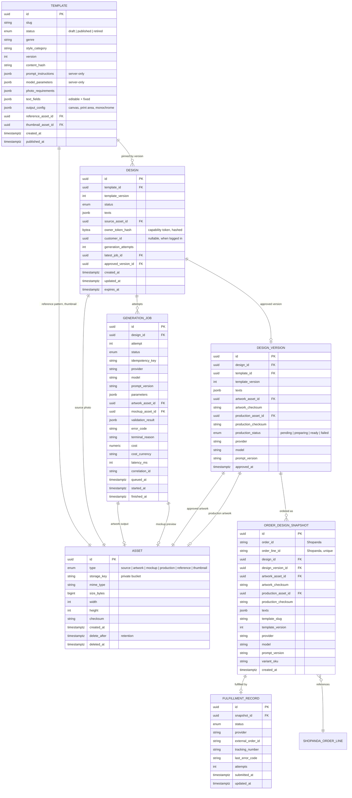
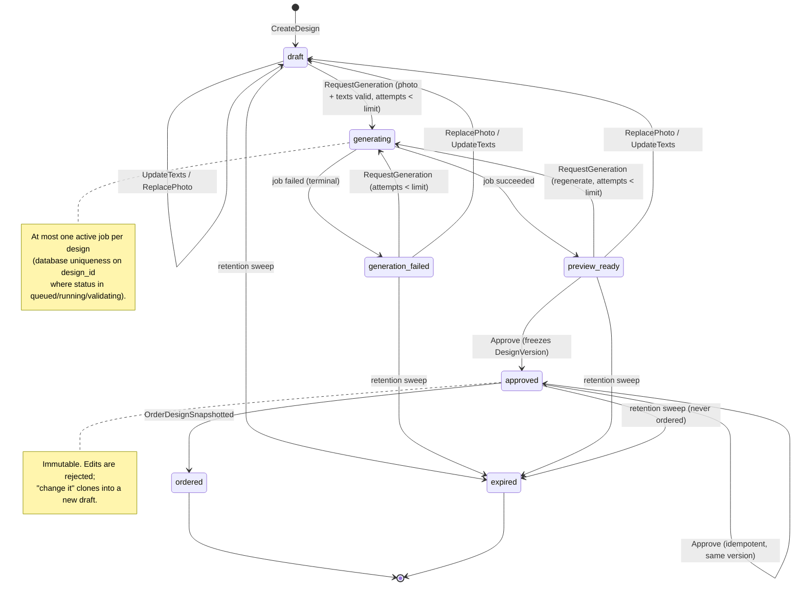
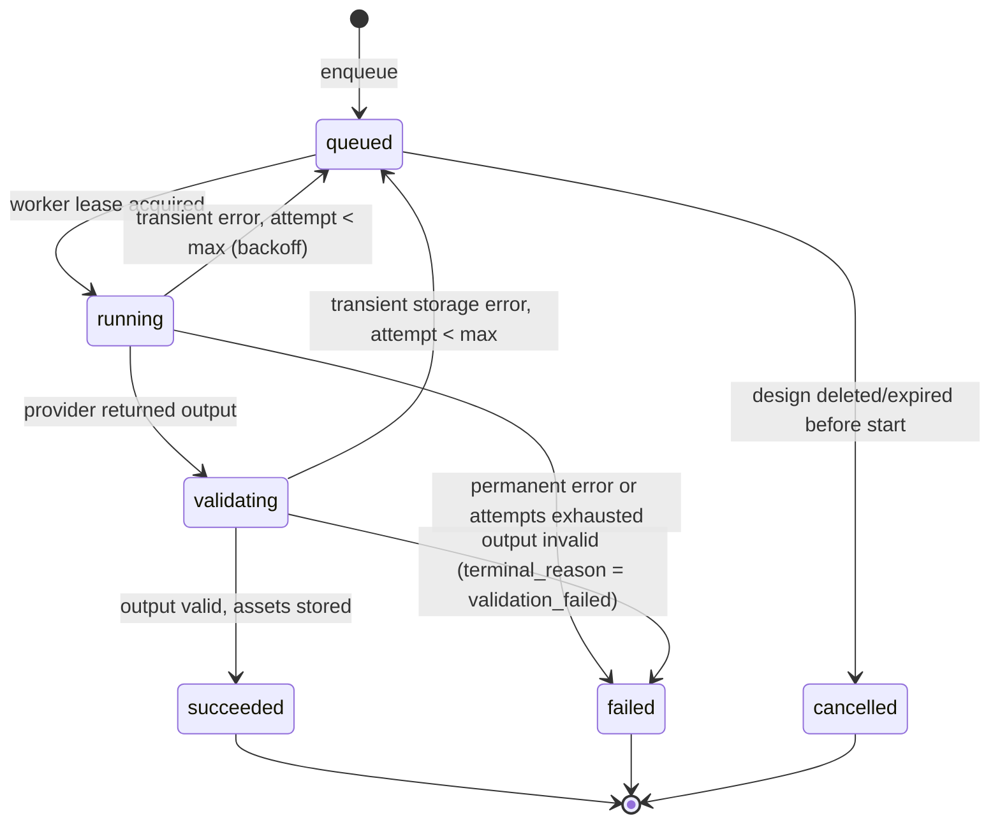
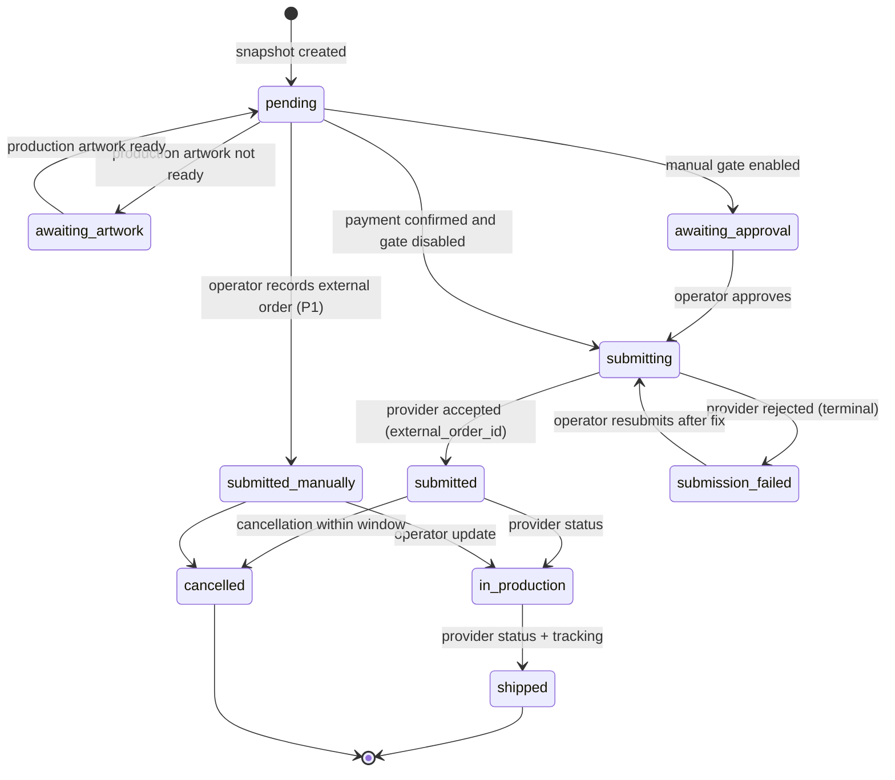

# Domain model

Concepts from the project description made explicit. Names here are the names used in code. Status enums are `snake_case` and enforced in domain code (see [ADR-0006](../adr/0006-design-and-job-status-model.md)).

## Entities and relationships

Notes:

- `DESIGN_VERSION` and `ORDER_DESIGN_SNAPSHOT` are **append-only**. Nothing updates them after creation except `production_*` fields on `DESIGN_VERSION`, which move once from `pending` to a terminal state.
- Snapshot duplicates the version's data (texts, template version, checksums) deliberately so an order remains fully described even if a design is deleted under retention rules. Assets referenced by a snapshot are never swept while the snapshot's fulfilment is incomplete.
- `owner_token_hash` stores only the hash of the capability token ([ADR-0007](../adr/0007-guest-design-ownership-tokens.md)).

## Template (G2)

Templates are declarative catalog rows in `metaldogs_templates`, authored as YAML/JSON under `plugins/metaldogs/templates/<slug>.yaml` and loaded via `metaldogs:templates`.

| Field group | Role |
| --- | --- |
| `slug` + `version` | Stable identity; unique pair. Version is a positive integer, immutable once the row exists. |
| `status` | `draft` (invisible to customers) → `published` → `retired`. Publish retires any prior published version for the same slug (and leftover drafts). |
| `published_at` | Set when a row **becomes** `published` from `draft` or `retired`. Re-running publish cleanup on an already-`published` row keeps the existing stamp (`CASE WHEN status = 'published' THEN published_at ELSE now() END`). Retire does not clear the column. |
| `content_hash` | SHA-256 of the definition body (slug, genre, style, prompts, model params, photo requirements, text fields, output config, optional relative asset paths). Same hash on reload is a no-op; a changed hash inserts `version+1` as `draft`. |
| `prompt_instructions` / `model_parameters` | Server-only. Never exposed on storefront list/detail DTOs (C1). |
| `photo_requirements` | Pose enum (`head_front`, `head_angle`, `full_body_profile`, …) plus background/lighting hints for the upload step. |
| `text_fields` | Editable (must include `dog_name` with max length + charset) and fixed copy. Keys are trimmed before validate/hash/persist so padded `dog_name` cannot pass Validate while storing a spaced key. |
| `output_config` | Canvas size, monochrome flag, print area in canvas pixels. |
| `reference_asset_id` / `thumbnail_asset_id` | Nullable UUIDs until asset ingest; files may declare relative `reference_pattern_path` / `thumbnail_path` for offline validation. |

Designs pin `template_id` + `template_version` at creation ([ADR-0005](../adr/0005-immutable-order-design-snapshot.md)). Publishing workflow: [runbooks/template-publishing.md](../runbooks/template-publishing.md).

## Design status machine

Invalid transitions return a domain error (`invalid_transition`) which the HTTP layer maps to `409`.

## GenerationJob status machine

Terminal reasons (stable codes exposed to the UI in mapped form): `provider_timeout`, `provider_rejected_input`, `provider_rate_limited`, `provider_error`, `validation_failed`, `storage_error`, `attempts_exhausted`, `cancelled`, `cost_cap_reached`.

## Fulfillment status machine

## Value objects

| Value object | Validation |
| --- | --- |
| `DogName` | Per-template max length, allowed character set (Latin incl. Polish diacritics by default), trimmed, no control characters |
| `TemplateVersion` | Positive integer, immutable once published |
| `Checksum` | SHA-256 hex, computed over stored bytes |
| `PrintArea` | Width/height in mm plus pixel canvas; validated against product print spec |
| `Attempts` | Bounded by template or global limit |
| `RetentionPolicy` | Durations per asset type and design status; pure decision function |
| `Money` | Provider cost with currency; never floats in persistence |

## Retention policy (initial, to be confirmed in O1/O2)

| Subject | Condition | Keep for |
| --- | --- | --- |
| Upload not attached to a design | — | 2 hours |
| Source photo | design never ordered | 7 days from last activity |
| Artwork and mockup previews | design never ordered | 7 days from last activity |
| Design row | never ordered | 30 days, then `expired` and purged |
| Source photo | design ordered | until fulfilment `shipped` + 14 days |
| Approved and production artwork | design ordered | per legal/warranty policy (decision in O2) |
| Snapshot row | always | with the order |
