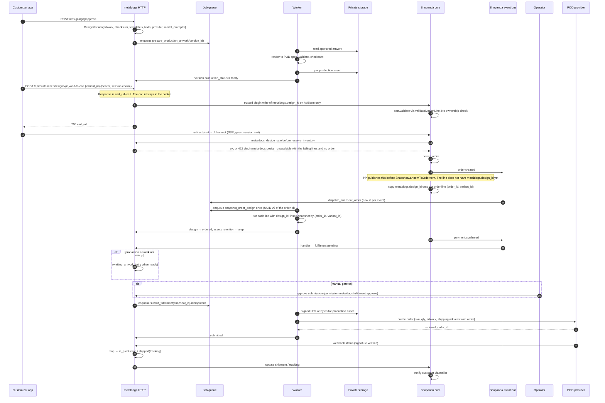

# Flow: approval, checkout, order snapshot, fulfillment

Covers [ADR-0005](../../adr/0005-immutable-order-design-snapshot.md) (immutable snapshot) and track P. Shopanda owns cart, checkout, payment, and the order; the plugin attaches the design and reacts to the order.

E4a ([CR-32](../../cr-rounds/CR-32-e4a-order-design-snapshot.md)) implements the snapshot path behind `plugins.metaldogs.order_snapshot.enabled`, default false. Nothing below runs on a real order: the handler and the `reconcile_snapshots` cron are not registered, the CLI refuses `--fix`, and no `OrderSource` adapter is bound. Tests inject an in-memory fake through `SetOrderSource`. E4b swaps in the adapter after two Shopanda changes and a pin bump (see below). The fulfilment boxes are track P and are not part of E4a.

## Swimlane

## Sequence

## Guarantees

| Guarantee | Mechanism |
| --- | --- |
| Order always references the exact approved artwork | `DesignVersion` frozen at approval with checksum; snapshot copies version fields; assets referenced by a snapshot are excluded from retention until fulfilment completes |
| Later template or prompt changes do not affect orders | Designs pin `template_version`; templates are versioned and immutable once published; snapshots copy the version number |
| One snapshot per order line | Unique `(order_id, variant_id)`; insert is `ON CONFLICT DO NOTHING`. A repeated `order.created` is a second dispatcher job and the same snapshot job (see Event delivery) |
| Snapshot eventually exists even if the event is lost | Cron `reconcile_snapshots` reports design lines with no snapshot and does not enqueue. `metaldogs:snapshots reconcile --fix` enqueues `snapshot_order_design` once per affected order (UUID v5 job id) |
| No double POD orders | `submit_fulfillment` idempotent on `snapshot_id`; provider idempotency key = snapshot id where supported; status `submitting` lock |
| Operator can always fulfil by hand | P1 manual path and runbook independent of P2 automation |

## Line key and what E4b waits on

Shopanda order items have no id of their own. The snapshot line key is `(order_id, variant_id)`, the same pair core uses for `order_item` extension values. [ADR-0005](../../adr/0005-immutable-order-design-snapshot.md) decision 4 called that pair `order_line_id`. The table primary key is the pair (`015_create_order_design_snapshots.sql`).

E4b is blocked on both of these, already on the Shopanda roadmap, plus a pin bump that contains them (merge `main`, same pattern as E3 / UPG10):

1. `pluginsdk.OrderPort` gains `Lines` (extension values included) and `ListCreatedSince`. At this pin `OrderPort` is only `FindByID` (`pkg/pluginsdk/ports.go`). E4a reads orders through the plugin port `ports.OrderSource` and does not query core tables.
2. `order.created` is published after the cart→order extension copy, or a later event is added, and at-least-once delivery plus idempotency are documented. At this pin `CreateOrderStep` saves the order, calls `publishOrderCreated`, and only then `SnapshotCartItemToOrderItem` (`internal/application/checkout/create_order_step.go`). The payload is `OrderCreatedData` (`OrderID`, `CustomerID`, `ContactEmail`, `Currency`, `ItemCount`) and carries no line extensions. A job that ran on this event and read the order line would not see `metaldogs.design_id` yet.

Until both land, leave `plugins.metaldogs.order_snapshot.enabled` false.

## Event delivery

`RegisterOnEvent` cannot set a job id. `NewSyncJobEnvelope` uses `id.New()`, and `pluginsdk.WithJobID` applies only to `SyncJobs.Enqueue`. `snapshot_order_design` is registered with `RegisterManual`. `dispatch_snapshot_order` is `RegisterOnEvent` on `order.created` and only calls `EnqueueSnapshotOrder`, which enqueues with `WithJobID` set to the UUID v5 of the canonical order id. A non-UUID order id fails the dispatcher and does not enqueue a snapshot job. Two events insert two dispatcher jobs and one snapshot job. The snapshot write is one row: `INSERT … ON CONFLICT (order_id, variant_id) DO NOTHING`. `approved → ordered` does nothing when the design is already `ordered`.

A build failure logs `metaldogs.snapshot_order_design.failed` for that line. A commit that rolls back logs `failed` once per design line in the order (order id, variant id, design id). Lines with no design id are skipped. An order the source does not return and an order whose lines have no design id both end the job `done` with no log: `OrderSource.Lines` does not distinguish them. E4b has to, or a missing order looks like a successful skip.

`plugins.metaldogs.order_snapshot.enabled` stays false until an `OrderSource` adapter is bound. With the flag on and no source bound, the snapshot handler returns an error. The job retries and ends `failed`, visible in `jobs:list --type=integration.sync.metaldogs.snapshot_order_design --status=failed`. E4a does not bind a source. Tests inject the in-memory fake through `SetOrderSource`.

`reconcile_snapshots` is registered only while that flag is on (`@every 5m`). An unscoped run calls `OrderSource.ListCreatedSince` with `since = now - 30 days`, then `Lines`. `--order` calls `Lines` for that id and does not list. The report is one line per design line without a snapshot: `order_id`, `line_key` (`order_id/variant_id`), `reason`. A line that already has a snapshot is omitted. `reason` is `missing_snapshot`, `snapshot_job_pending` while the snapshot job is pending, processing, or reclaiming, or `snapshot_job_failed:` plus the last error when the job is terminal-failed. One order that cannot be read is `inspect_failed`; the rest of the run continues. The cron logs that report and does not insert snapshots or enqueue jobs. The CLI report does not write production columns. `--fix` enqueues and skips `inspect_failed`; with the flag off the command still reports and refuses `--fix`. The cron calls `FillSnapshotProduction` for snapshots whose production columns are still NULL and whose version is `ready`. A second fill changes nothing. The prepare-production job does not call that fill until G5 sets `production_status=ready`.

## Open items to verify (tracked in ROADMAP §1)

- Cart-line `metaldogs.design_id` is contract-tested in E2 (CR-19). E3 contract-tests `POST /api/v1/checkout` re-validation with manual payment (CR-30), including `plugin.metaldogs.design_unavailable` and a retryable `503`. Core copies the field onto the order line after `order.created`. E4a does not read that copy. E4b will, after the two Shopanda changes above. SSR confirm exists upstream (PR-1598). Guest Stripe test mode is not recorded.
- `order.created` is confirmed at this pin and is not inside the order transaction: the order row is already saved, and there is no transactional enqueue. `payment.confirmed` and the shipment update API stay track P.
- Shopanda API for updating shipment/tracking from a plugin.
