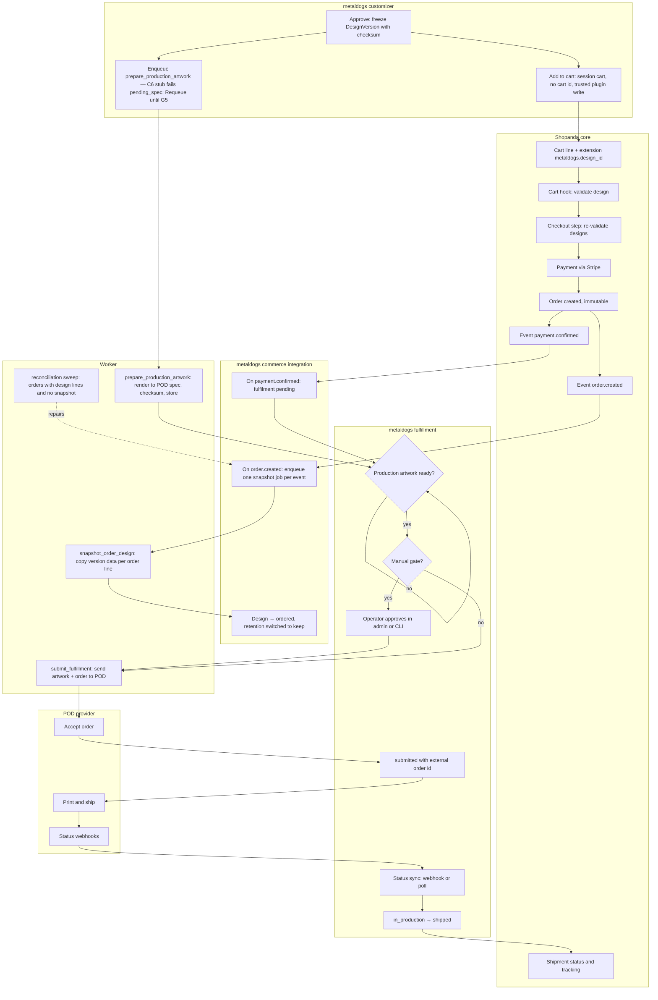
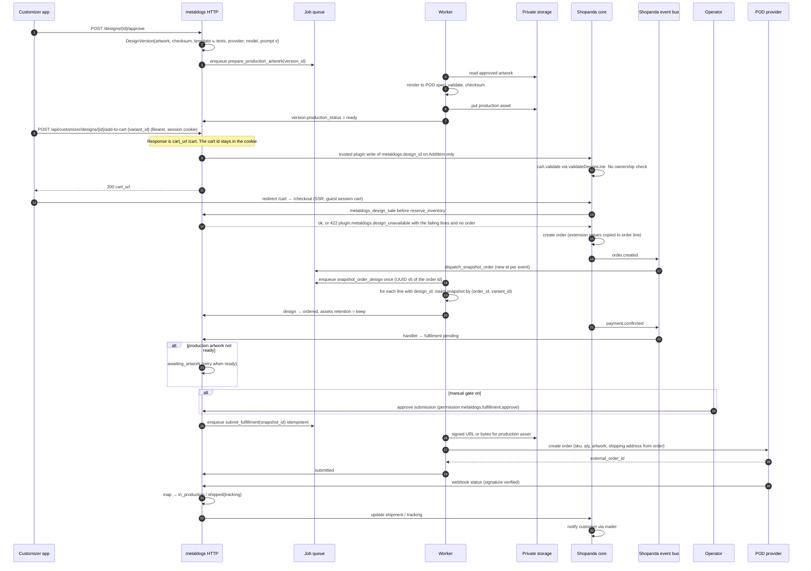

# Flow: approval, checkout, order snapshot, fulfillment

Covers [ADR-0005](../../adr/0005-immutable-order-design-snapshot.md) (immutable snapshot) and track P. Shopanda owns cart, checkout, payment, and the order; the plugin attaches the design and reacts to the order.

## Swimlane

## Sequence

## Guarantees

| Guarantee | Mechanism |
| --- | --- |
| Order always references the exact approved artwork | `DesignVersion` frozen at approval with checksum; snapshot copies version fields; assets referenced by a snapshot are excluded from retention until fulfilment completes |
| Later template or prompt changes do not affect orders | Designs pin `template_version`; templates are versioned and immutable once published; snapshots copy the version number |
| One snapshot per order line | Unique `(order_id, variant_id)`; insert is `ON CONFLICT DO NOTHING`. A repeated `order.created` is a second dispatcher job and the same snapshot job (see Event delivery) |
| Snapshot eventually exists even if the event is lost | Scheduler reconciliation sweep queries Shopanda orders with `metaldogs.design_id` lines lacking snapshots and re-enqueues |
| No double POD orders | `submit_fulfillment` idempotent on `snapshot_id`; provider idempotency key = snapshot id where supported; status `submitting` lock |
| Operator can always fulfil by hand | P1 manual path and runbook independent of P2 automation |

## Event delivery

`RegisterOnEvent` cannot set a job id. `NewSyncJobEnvelope` uses `id.New()`, and `pluginsdk.WithJobID` applies only to `SyncJobs.Enqueue`. `snapshot_order_design` is registered with `RegisterManual`. `dispatch_snapshot_order` is `RegisterOnEvent` on `order.created` and only calls `EnqueueSnapshotOrder`, which enqueues with `WithJobID` set to the UUID v5 of the order id. Two events insert two dispatcher jobs and one snapshot job. The snapshot write is one row: `INSERT … ON CONFLICT (order_id, variant_id) DO NOTHING`. `approved → ordered` does nothing when the design is already `ordered`.

`plugins.metaldogs.order_snapshot.enabled` stays false until an `OrderSource` adapter is bound. With the flag on and no source bound, the snapshot handler returns an error. The job retries and ends `failed`, visible in `jobs:list --type=integration.sync.metaldogs.snapshot_order_design --status=failed`. E4a does not bind a source. Tests inject the in-memory fake through `SetOrderSource`.

## Open items to verify (tracked in ROADMAP §1)

- Cart-line `metaldogs.design_id` is contract-tested in E2 (CR-19). E3 contract-tests `POST /api/v1/checkout` with manual payment (CR-30), including `plugin.metaldogs.design_unavailable` and a retryable `503`. Snapshot mode copies the field onto the order line in core; E4 consumes that copy. SSR confirm exists upstream (PR-1598). Guest Stripe test mode is not recorded.
- Event names `order.created` / `payment.confirmed` and whether handlers run synchronously within the order transaction (affects whether an outbox is needed).
- Shopanda API for updating shipment/tracking from a plugin.
