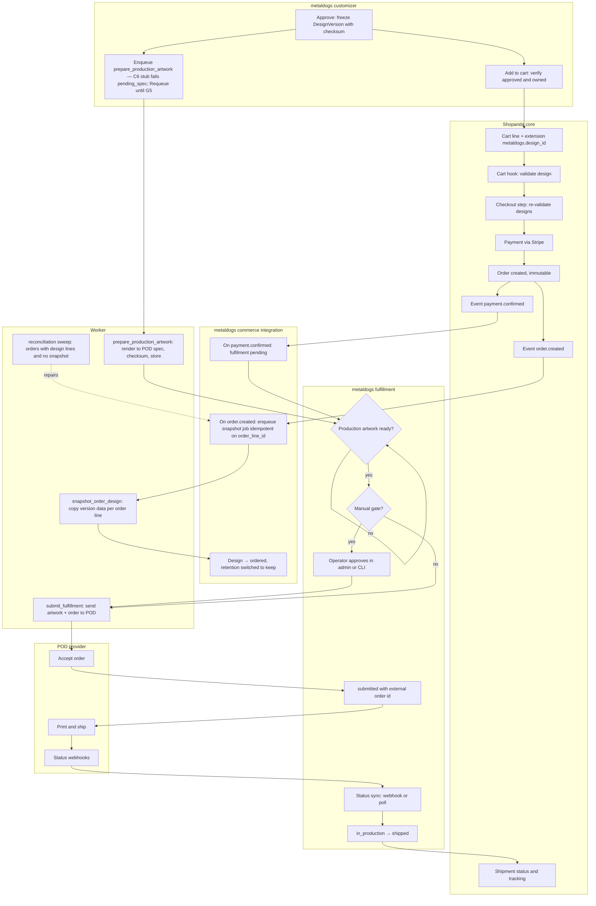
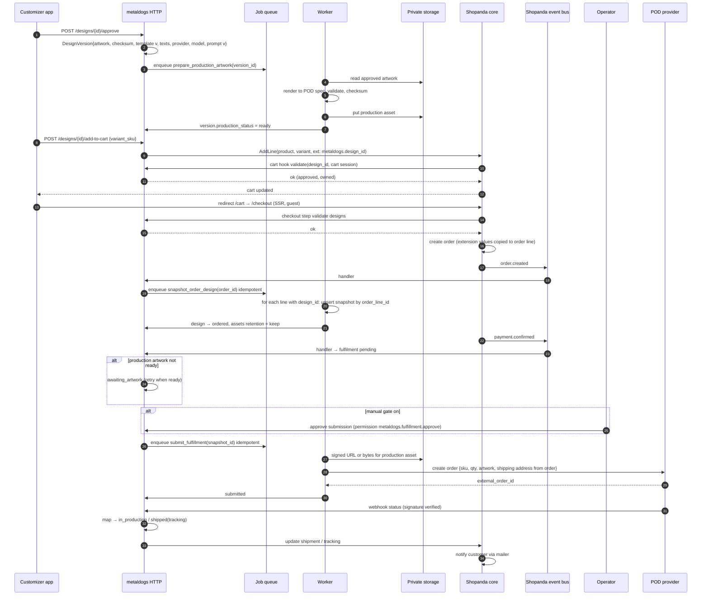

# Flow: approval, checkout, order snapshot, fulfillment

Covers [ADR-0005](../../adr/0005-immutable-order-design-snapshot.md) (immutable snapshot) and track P. Shopanda owns cart, checkout, payment, and the order; the plugin attaches the design and reacts to the order.

## Swimlane

## Sequence

## Guarantees

| Guarantee | Mechanism |
| --- | --- |
| Order always references the exact approved artwork | `DesignVersion` frozen at approval with checksum; snapshot copies version fields; assets referenced by a snapshot are excluded from retention until fulfilment completes |
| Later template or prompt changes do not affect orders | Designs pin `template_version`; templates are versioned and immutable once published; snapshots copy the version number |
| One snapshot per order line | Unique index on `order_line_id`; handler is an upsert |
| Snapshot eventually exists even if the event is lost | Scheduler reconciliation sweep queries Shopanda orders with `metaldogs.design_id` lines lacking snapshots and re-enqueues |
| No double POD orders | `submit_fulfillment` idempotent on `snapshot_id`; provider idempotency key = snapshot id where supported; status `submitting` lock |
| Operator can always fulfil by hand | P1 manual path and runbook independent of P2 automation |

## Open items to verify (tracked in ROADMAP §1)

- Extension fields are available at **cart line** granularity and are copied to the order line at checkout.
- Event names `order.created` / `payment.confirmed` and whether handlers run synchronously within the order transaction (affects whether an outbox is needed).
- Shopanda API for updating shipment/tracking from a plugin.
