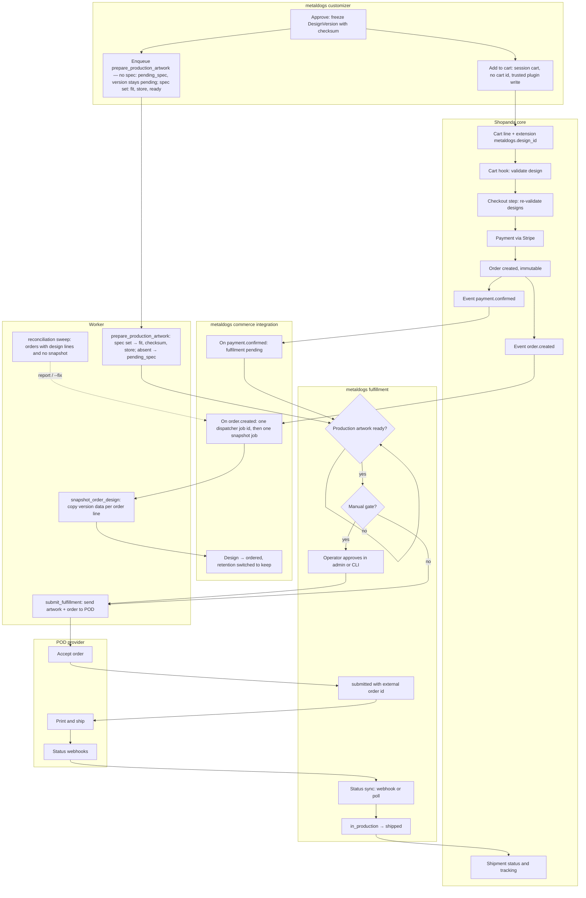

# Flow: approval, checkout, order snapshot, fulfillment

Covers [ADR-0005](../../adr/0005-immutable-order-design-snapshot.md) (immutable snapshot) and track P. Shopanda owns cart, checkout, payment, and the order; the plugin attaches the design and reacts to the order.

E4a ([CR-32](../../cr-rounds/CR-32-e4a-order-design-snapshot.md)) implements the snapshot write behind `plugins.metaldogs.order_snapshot.enabled`, default false. E4b ([CR-34](../../cr-rounds/CR-34-e4b-order-source.md)) binds `adapters/hostorders` to `Host.Orders()` when that flag is on. While it is false the handler and the `reconcile_snapshots` cron are not registered, the CLI refuses `--fix`, and no source is bound, so `metaldogs:snapshots reconcile` exits `order source is not bound` and prints nothing. Pin `e062d4d3` publishes `order.created` after the cart→order copy of `metaldogs.design_id`. The fulfilment boxes are track P.

## Swimlane



## Sequence

```mermaid
sequenceDiagram
    autonumber
    participant UI as Customizer app
    participant API as metaldogs HTTP
    participant Q as Job queue
    participant W as Worker
    participant S3 as Private storage
    participant Shop as Shopanda core
    participant Ev as Shopanda event bus
    participant Op as Operator
    participant POD as POD provider

    UI->>API: POST /designs/{id}/approve
    API->>API: DesignVersion{artwork, checksum, template v, texts, provider, model, prompt v}
    API->>Q: enqueue prepare_production_artwork(version_id)
    Note over W: production_spec absent: error pending_spec, version stays pending, no asset
    W->>S3: read approved artwork
    W->>W: fit to the configured spec, checksum
    W->>S3: put production asset
    W->>API: production_status = ready
    W->>API: FillSnapshotProduction (error logged; job still succeeds)

    UI->>API: POST /api/customizer/designs/{id}/add-to-cart {variant_id} (Bearer, session cookie)
    Note over API: Response is cart_url /cart. The cart id stays in the cookie
    API->>Shop: trusted plugin write of metaldogs.design_id on AddItem only
    Shop->>Shop: cart.validate via validateDesignLine. No ownership check
    API-->>UI: 200 cart_url
    UI->>Shop: redirect /cart → /checkout (SSR, guest session cart)
    Shop->>API: metaldogs_design_sale before reserve_inventory
    API-->>Shop: ok, or 422 plugin.metaldogs.design_unavailable with the failing lines and no order
    Shop->>Shop: persist order
    Shop->>Shop: copy metaldogs.design_id onto the order line (order_id, variant_id)
    Shop->>Ev: order.created
    Note over Shop: Published after the copy. A snapshot error still publishes, then the step returns the error
    Ev->>Q: dispatch_snapshot_order (one id per order)
    W->>Q: enqueue snapshot_order_design once (UUID v5 of the order id)
    W->>W: for each line with design_id: insert snapshot by (order_id, variant_id)
    Note over W,S3: E6a: read the approved mockup, store a PNG thumbnail (longest edge ≤ 320). Failure leaves mockup_asset_id and thumbnail_asset_id null and still writes the snapshot
    W->>API: design → ordered, assets retention = keep
    Shop->>Ev: payment.confirmed
    Ev->>API: handler → fulfilment pending
    alt production artwork not ready
        API->>API: awaiting_artwork (retry when ready)
    end
    alt manual gate on
        Op->>API: approve submission (permission metaldogs.fulfillment.approve)
    end
    API->>Q: enqueue submit_fulfillment(order_id, variant_id) idempotent
    W->>S3: signed URL or bytes for production asset
    W->>POD: create order {sku, qty, artwork, shipping address from order}
    POD-->>W: external_order_id
    W->>API: submitted
    POD->>API: webhook status (signature verified)
    API->>API: map → in_production / shipped(tracking)
    API->>Shop: update shipment / tracking
    Shop->>Shop: notify customer via mailer
```

## Guarantees

| Guarantee | Mechanism |
| --- | --- |
| Order always references the exact approved artwork | `DesignVersion` frozen at approval with checksum; snapshot copies version fields; assets referenced by a snapshot are excluded from retention until fulfilment completes. In E4a every snapshot reference protects the asset regardless of fulfilment (`AssetsReferencedBySnapshots`); the policy after `shipped` is O2 |
| Later template or prompt changes do not affect orders | Designs pin `template_version`; templates are versioned and immutable once published; snapshots copy the version number |
| One snapshot per order line | Unique `(order_id, variant_id)`; insert is `ON CONFLICT DO NOTHING`. A repeated `order.created` is the same dispatcher job and the same snapshot job (see Event delivery) |
| Snapshot eventually exists even if the event is lost | Once an `OrderSource` is bound, cron `reconcile_snapshots` logs `metaldogs.reconcile_snapshots.gap` and does not enqueue. No alert is configured on that line. The flag defaults off, so the cron is not registered. With the flag on, `Init` calls `Require(CapOrders)` and binds `hostorders` when `Host.Orders()` is present. A root that asserts capabilities fails boot if that port is unbound (`required capability "orders" not bound`). A root that does not assert capabilities leaves the source nil and the cron logs no gap. `metaldogs:snapshots reconcile --fix` enqueues `snapshot_order_design` once per affected order (UUID v5 job id) only when the flag is on and a source is bound |
| No double POD orders | `submit_fulfillment` idempotent on `(order_id, variant_id)`; provider idempotency key is that pair where supported; status `submitting` lock. The snapshot table has no surrogate id |
| Operator can always fulfil by hand | P1 manual path and runbook independent of P2 automation. The download is E5 ([CR-35](../../cr-rounds/CR-35-e5-artwork-access.md)): `metaldogs:order-artwork` and `GET /api/v1/admin/orders/{order_id}/artwork` when `order_snapshot.enabled` is true. Each URL is a row in `metaldogs_artwork_access_log`. See [`manual-pod-fulfillment.md`](../../runbooks/manual-pod-fulfillment.md) |
| A paid line can be shown later without a storage URL | E6a ([CR-37](../../cr-rounds/CR-37-e6a-order-thumbnail.md)): the snapshot stores `mockup_asset_id` and `thumbnail_asset_id` together, or both null. `GET /api/customizer/order-thumbnails/{token}` serves the PNG. `OrderThumbnailURL` builds the link. Email and order pages do not call it (E6b) |

## Line key and the order source

Shopanda order items have no id of their own. The snapshot line key is `(order_id, variant_id)`, the same pair core uses for `order_item` extension values. [ADR-0005](../../adr/0005-immutable-order-design-snapshot.md) decision 4 called that pair `order_line_id`. The table primary key is the pair (`015_create_order_design_snapshots.sql`).

The ordering guarantee is on pin `e062d4d3` ([CR-33](../../cr-rounds/CR-33-upg11-pin-e062d4d3.md)). E4b ([CR-34](../../cr-rounds/CR-34-e4b-order-source.md)) is the adapter. `plugins.metaldogs.order_snapshot.enabled` stays false until M3.

1. `pluginsdk.OrderPort` has `Lines`, `LinesForOrders` (extension values; line key `(order_id, variant_id)`), and `ListCreatedSince` (limit 1..100) (`pkg/pluginsdk/ports.go`). `adapters/hostorders` maps `OrderLineView.Extensions["metaldogs.design_id"]` onto `ports.OrderLine`. Absent, null, or blank is no design. A value that is not a string is an error. The plugin does not query core tables.
2. `finishCreatedOrder` snapshots cart→order extensions, then publishes `order.created` (`internal/application/checkout/create_order_step.go`). A snapshot error still publishes, then returns the error. `Workflow.Execute` retries `create_order` once when `created_order_id` is set and `order_created_published` is not. The payload is `OrderCreatedData` (`OrderID`, `CustomerID`, `ContactEmail`, `Currency`, `ItemCount`) and carries no line extensions. The adapter reads the copied field from `Host.Orders()`, so the handler sees `metaldogs.design_id` that was stored before the event. At-least-once: a handler must be idempotent.

## Event delivery

`dispatch_snapshot_order` is `RegisterOnEvent` on `order.created` with `pluginsdk.WithEventJobID` (PR-1602). The id is UUID v5 of the queue job type `integration.sync.metaldogs.dispatch_snapshot_order` and the canonical order id. It is not the `snapshot_order_design` id. A blank `order_id` makes the callback return `""`. `enqueueSyncJob` passes that to `plugin.NewSyncJobEnvelopeWithID`, which returns `job id requires a non-empty UUID` and does not enqueue (`internal/platform/plugin/sync_job.go`, `internal/application/integration/sync_runtime.go`). A non-empty value that is not a UUID fails the same function (`job id %q is not a UUID`). The callback hashes any non-blank order id, so that second failure is the SDK path, not this callback. Two deliveries insert one dispatcher job. The handler calls `EnqueueSnapshotOrder`, which enqueues `snapshot_order_design` (`RegisterManual`) with `WithJobID` set to the UUID v5 of the canonical order id. A non-UUID order id fails that enqueue. The snapshot write is one row: `INSERT … ON CONFLICT (order_id, variant_id) DO NOTHING`. `approved → ordered` does nothing when the design is already `ordered`.

A build failure logs `metaldogs.snapshot_order_design.failed` for that line. A commit that rolls back logs `failed` once per design line in the order (order id, variant id, design id). Lines with no design id are skipped. A non-string `metaldogs.design_id` fails that line. An order the port does not return is `(nil, nil)` from `Lines`; the adapter returns no lines, and the job ends `done` with no log, the same as an order whose lines have no design id.

`plugins.metaldogs.order_snapshot.enabled` defaults to false. When it is true, `Init` calls `Require(CapOrders)` and binds `hostorders` if `Host.Orders()` is present. A root that asserts capabilities fails boot if that port is unbound (`required capability "orders" not bound`) before a job is stored. A root that does not assert capabilities leaves the source nil, the snapshot handler returns an error, and the job retries and ends `failed`, visible in `jobs:list --type=integration.sync.metaldogs.snapshot_order_design --status=failed`. E4a tests still inject the in-memory fake through `SetOrderSource`. `TestCheckout_OrderSnapshot` uses the bound port.

`reconcile_snapshots` is registered only while that flag is on (`@every 5m`). An unscoped run calls `OrderSource.ListCreatedSince` with `since = now - 30 days`, page size 100, and cursor = the last id of the previous page (same `since`). Each page calls `LinesForOrders` once. `--order` calls `Lines` for that id and does not list. The report is one line per design line without a snapshot: `order_id`, `line_key` (`order_id/variant_id`), `reason`. A line that already has a snapshot is omitted. `reason` is `missing_snapshot`, `snapshot_job_pending` while the snapshot job is pending, processing, or reclaiming, or `snapshot_job_failed:` plus the last error when the job is terminal-failed. One order that cannot be read is `inspect_failed`; the rest of the run continues. A `LinesForOrders` error that is `context.Canceled` or `context.DeadlineExceeded` returns that page error and does not call `Lines` per id. The cron logs each of those lines as `metaldogs.reconcile_snapshots.gap` and does not insert snapshots or enqueue jobs. An alert on that line is not configured. The CLI report does not write production columns. `--fix` enqueues and skips `inspect_failed`. With an `OrderSource` bound and the flag off, the command still reports and refuses `--fix`. With the flag off, no source is bound, so `metaldogs:snapshots reconcile` (with or without `--order`) exits `order source is not bound` and prints nothing. With the flag on and `Host.Orders()` unbound, a root that asserts capabilities fails boot (`required capability "orders" not bound`). A root that does not assert capabilities fails the cron run, logs `metaldogs.reconcile_snapshots.failed`, and emits no gap line. With the flag on and the port present, the cron emits the gap line. The cron calls `FillSnapshotProduction` only when that source is bound, for snapshots whose production columns are still NULL and whose version is `ready`. Without the source the job errors and fills nothing. A second fill changes nothing. When `plugins.metaldogs.production_spec` is set, `prepare_production_artwork` calls `FillSnapshotProduction` after it sets `production_status=ready` (G5a, [CR-36](../../cr-rounds/CR-36-g5a-production-artwork.md)). A fill error is logged and the job still completes; this cron fills those NULL columns later. Without the spec the job errors `pending_spec`, the version stays `pending`, and nothing is filled.

## Thumbnail on the snapshot (E6a)

On insert, `snapshot_order_design` looks up a mockup and, when that read, the PNG encode, and the store all succeed, sets `mockup_asset_id` and `thumbnail_asset_id` (migration `018`). Both columns are null together otherwise. The lookup is the generation job that stored `artwork_asset_id`, then the design's latest mockup whose artwork checksum matches. The thumbnail is a PNG, longest edge at most 320 px, no metadata, asset type `thumbnail`, with `owner_ref` null (migration `009` allows one live row per `(owner_ref, type)`, and two lines can share a design). Its id is a UUID v5 of `(order_id, variant_id)`, so a rerun writes the same object. A miss, a read/encode/store failure, or a thumbnail dropped at commit logs nothing about storage and does not fail the snapshot. Each logs `metaldogs.snapshot_order_design.thumbnail` with `order_id` and `variant_id` only. An insert failure or a mockup that is no longer live rolls back to a savepoint and stores both columns null. The thumbnail object from that attempt is deleted unless a live asset row still has that storage key. A commit that rolls the order back deletes the same way. A lookup error leaves the object. The trigger treats both columns as insert-only, same as the frozen columns from `015`. `AssetsReferencedBySnapshots` keeps both asset ids.

`GET /api/customizer/order-thumbnails/{token}` is public. It is registered only when `order_snapshot.enabled` is true and `thumbnail_signing_key` is set (at least 32 characters; shorter fails Init; absent is not a boot error). The token does not expire. The handler returns the image bytes. It does not return a storage key. `(*Plugin).OrderThumbnailURL` returns `plugins.metaldogs.public_base_url` plus that path when the line has a thumbnail, and an empty string when the feature is off or the line has none. The plugin cannot read `server.public_base_url`. No mailer and no storefront template calls the function. Contract: [`api.md`](../api.md).

## Open items to verify (tracked in ROADMAP §1)

- Cart-line `metaldogs.design_id` is contract-tested in E2 (CR-19). E3 contract-tests `POST /api/v1/checkout` re-validation with manual payment (CR-30), including `plugin.metaldogs.design_unavailable` and a retryable `503`. Core copies the field onto the order line before `order.created`. E4b reads that copy through `Host.Orders()` when the flag is on ([CR-34](../../cr-rounds/CR-34-e4b-order-source.md)). The flag defaults off. SSR confirm exists upstream (PR-1598). Guest Stripe test mode is not recorded.
- `order.created` is confirmed at this pin and is not inside the order transaction: the order row is already saved, and there is no transactional enqueue. `payment.confirmed` and the shipment update API stay track P.
- Shopanda API for updating shipment/tracking from a plugin.
