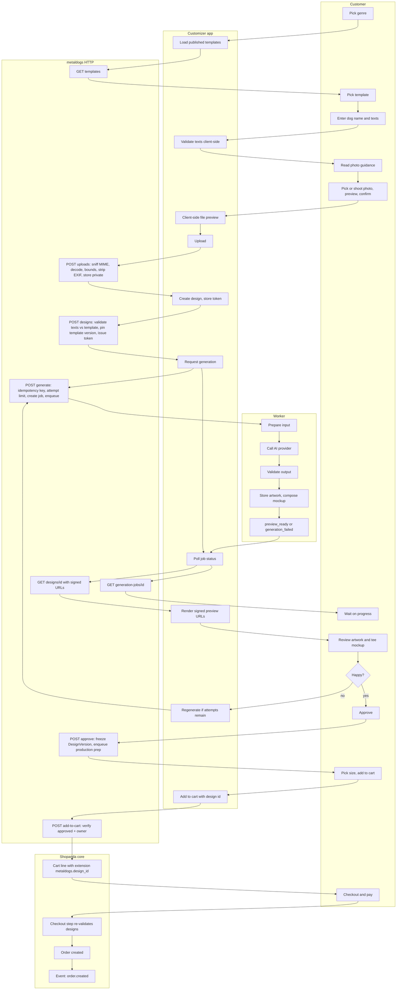

# Flow: design to order (standard path)

Covers steps 1–12 of the standard user path in the project description. Two views: a swimlane overview of responsibilities, and a sequence diagram with the exact calls.

## Swimlane overview



## Sequence (swimlanes by participant)

```mermaid
sequenceDiagram
    autonumber
    actor Cust as Customer
    participant UI as Customizer app
    participant API as metaldogs HTTP
    participant Q as Job queue (PostgreSQL)
    participant W as Worker
    participant AI as AI provider
    participant S3 as Private storage
    participant Shop as Shopanda core

    Cust->>UI: open /customize
    UI->>API: GET /api/customizer/templates?genre=
    API-->>UI: published templates (DTO, no prompts)
    Cust->>UI: choose template, enter dog name
    Cust->>UI: choose or capture photo
    UI->>UI: show local preview, allow change
    UI->>API: POST /api/customizer/uploads (multipart)
    API->>API: sniff MIME, decode, check bounds, strip EXIF
    API->>S3: put source asset (private)
    API-->>UI: upload_id, signed preview URL (short TTL)
    UI->>API: POST /api/customizer/designs {template_id, texts, upload_id}
    API->>API: validate texts, pin template version, issue owner token
    API-->>UI: design_id, owner_token (shown once)
    UI->>UI: persist design_id + token in sessionStorage
    UI->>API: POST /designs/{id}/generate (Idempotency-Key, token)
    API->>API: attempts < limit, cost cap ok, no active job
    API->>Q: enqueue integration.sync.metaldogs.generate (job_id, correlation_id)
    API-->>UI: 202 job_id
    loop poll with backoff and jitter
        UI->>API: GET /generation-jobs/{job_id} (token)
        API-->>UI: status, attempt, error_code?, retry_after
    end
    W->>Q: lease job
    W->>S3: get source asset
    W->>AI: generate(photo, reference pattern, prompt vN, params)
    AI-->>W: image or error
    alt transient error
        W->>Q: release with backoff (attempt+1)
    else permanent error or attempts exhausted
        W->>Q: failed (terminal_reason)
        W->>API: design → generation_failed
    else output
        W->>W: validate (dimensions, monochrome, transparency, integrity)
        W->>S3: put artwork asset, put mockup asset
        W->>Q: succeeded
        W->>API: design → preview_ready
    end
    UI->>API: GET /designs/{id} (token)
    API-->>UI: status, signed URLs for artwork and mockup
    Cust->>UI: review artwork vs tee mockup
    opt regenerate (attempts remain)
        Cust->>UI: regenerate
        UI->>API: POST /designs/{id}/generate (new Idempotency-Key)
    end
    Cust->>UI: approve
    UI->>API: POST /designs/{id}/approve (token, idempotent)
    API->>API: freeze DesignVersion (checksum, versions)
    API->>Q: enqueue integration.sync.metaldogs.prepare_production_artwork
    Note over Q: C6 stub fails pending_spec (not done); approve Requeues / retries enqueue until G5
    API-->>UI: approved, version_id
    Cust->>UI: choose size
    UI->>API: POST /designs/{id}/add-to-cart {variant_sku} (token)
    API->>Shop: add cart line with extension metaldogs.design_id
    Shop->>API: cart hook: design approved and owned?
    API-->>Shop: ok
    Shop-->>UI: cart line id
    UI->>Shop: redirect to /cart
    Cust->>Shop: checkout (guest), pay via Stripe
    Shop->>API: checkout step: designs still approved?
    API-->>Shop: ok
    Shop->>Shop: create immutable order
    Shop-->>API: event order.created
    Note over API,Q: continues in checkout-snapshot-and-fulfillment.md
```

## Error and resume paths

| Where | Failure | Customer sees | Recovery |
| --- | --- | --- | --- |
| Upload | wrong MIME, too large, corrupt, out of bounds | Specific message, file input retained | Choose another file |
| Create design | template unpublished, text invalid | Field-level message | Fix input |
| Generate | attempts exhausted | "Limit reached" with options to change photo or pick another template | New design or change photo (resets attempt budget per policy decided in C7) |
| Generate | cost cap reached / provider outage | "Temporarily unavailable, try again later"; design preserved | Retry later via stored token |
| Job | transient provider error | Progress continues (attempt count visible) | Automatic |
| Job | terminal failure | Mapped friendly reason | Retry if attempts remain |
| Reload mid-flow | — | Flow resumes from stored design id/token | Automatic |
| Add to cart | design not approved | Prompt to approve first | Approve |
| Checkout | design expired/deleted | Shopanda error mapped: "Design no longer available" | Return to customizer |
