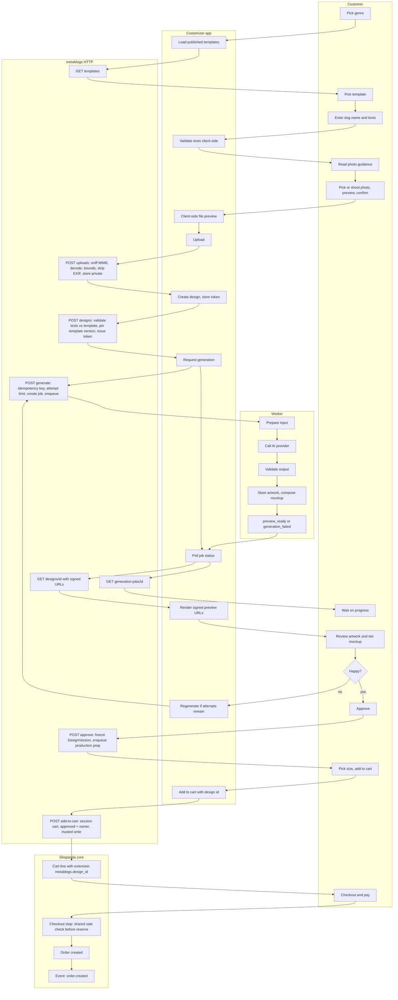

# Flow: design to order (standard path)

Covers steps 1–12 of the standard user path in the project description. Two views: a swimlane overview of responsibilities, and a sequence diagram with the exact calls.

## Swimlane overview



## Sequence (swimlanes by participant)

```mermaid
sequenceDiagram
    autonumber
    actor Cust as Customer
    participant UI as Customizer app
    participant API as metaldogs HTTP
    participant Q as Job queue (PostgreSQL)
    participant W as Worker
    participant AI as AI provider
    participant S3 as Private storage
    participant Shop as Shopanda core

    Cust->>UI: open /customize
    UI->>API: GET /api/customizer/templates?genre=
    API-->>UI: published templates (DTO, no prompts)
    Cust->>UI: choose template, enter dog name
    Cust->>UI: choose or capture photo
    UI->>UI: show local preview, allow change
    UI->>API: POST /api/customizer/uploads (multipart)
    API->>API: sniff MIME, decode, check bounds, strip EXIF
    API->>S3: put source asset (private)
    API-->>UI: upload_id, signed preview URL (short TTL)
    UI->>API: POST /api/customizer/designs {template_id, texts, upload_id}
    API->>API: validate texts, pin template version, issue owner token
    API-->>UI: design_id, owner_token (shown once)
    UI->>UI: persist design_id + token in sessionStorage
    UI->>API: POST /designs/{id}/generate (Idempotency-Key, token)
    API->>API: attempts < limit, cost cap ok, no active job
    API->>Q: enqueue integration.sync.metaldogs.generate (job_id, correlation_id)
    API-->>UI: 202 job_id
    loop poll with backoff and jitter
        UI->>API: GET /generation-jobs/{job_id} (token)
        API-->>UI: status, attempt, error_code?, retry_after
    end
    W->>Q: lease job
    W->>S3: get source asset
    W->>AI: generate(photo, reference pattern, prompt vN, params)
    AI-->>W: image or error
    alt transient error
        W->>Q: release with backoff (attempt+1)
    else permanent error or attempts exhausted
        W->>Q: failed (terminal_reason)
        W->>API: design → generation_failed
    else output
        W->>W: validate (dimensions, monochrome, transparency, integrity)
        W->>S3: put artwork asset, put mockup asset
        W->>Q: succeeded
        W->>API: design → preview_ready
    end
    UI->>API: GET /designs/{id} (token)
    API-->>UI: status, signed URLs for artwork and mockup
    Cust->>UI: review artwork vs tee mockup
    opt regenerate (attempts remain)
        Cust->>UI: regenerate
        UI->>API: POST /designs/{id}/generate (new Idempotency-Key)
    end
    Cust->>UI: approve
    UI->>API: POST /designs/{id}/approve (token, idempotent)
    API->>API: freeze DesignVersion (checksum, versions)
    API->>Q: enqueue integration.sync.metaldogs.prepare_production_artwork
    Note over Q: C6 stub fails pending_spec (not done); approve Requeues / retries enqueue until G5
    API-->>UI: approved, version_id
    Cust->>UI: choose size
    UI->>API: POST /api/customizer/designs/{id}/add-to-cart {variant_id} (Bearer owner token)
    Note over API,Shop: Cookie shopanda_storefront_cart. No cart id in the request or the JSON response
    API->>API: design exists, unexpired, approved, owned, variant is mdogs-tee
    API->>Shop: AddItem quantity 1 with trusted write of metaldogs.design_id
    Note over Shop: Public cart API, SSR cart, and admin values cannot set this field (403)
    API-->>UI: 200 {cart_url: "/cart"} and Set-Cookie
    UI->>Shop: redirect to /cart (guest session cart)
    Note over Shop: cart.validate already ran on the cart change. Checkout does not call it
    Cust->>Shop: guest checkout
    Shop->>API: metaldogs_design_sale at before:reserve_inventory
    Note over API: ValidateDesignLine, plugin clock. approved or ordered, unexpired, passes. Other loaded products are ignored
    alt a custom-tee line fails, or the product classification is unknown
        API-->>Shop: validation error
        Shop-->>Cust: 422 validation, "Design no longer available". No reservation and no order
    else no custom-tee line, or every custom-tee line passes
        API-->>Shop: ok
        Shop->>Shop: reserve stock, create order, copy metaldogs.design_id onto the order line
        Shop-->>API: event order.created
    end
    Note over API,Q: continues in checkout-snapshot-and-fulfillment.md
```

## Error and resume paths

| Where | Failure | Customer sees | Recovery |
| --- | --- | --- | --- |
| Upload | wrong MIME, too large, corrupt, out of bounds | Specific message, file input retained | Choose another file |
| Create design | template unpublished, text invalid | Field-level message | Fix input |
| Generate | attempts exhausted | "Limit reached" with options to change photo or pick another template | New design or change photo (resets attempt budget per policy decided in C7) |
| Generate | cost cap reached / provider outage | "Temporarily unavailable, try again later"; design preserved | Retry later via stored token |
| Job | transient provider error | Progress continues (attempt count visible) | Automatic |
| Job | terminal failure | Mapped friendly reason | Retry if attempts remain |
| Reload mid-flow | — | Flow resumes from stored design id/token | Automatic |
| Add to cart | design not approved | `409` `invalid_transition` ("design is not ready") | Approve |
| Add to cart | unknown, foreign, or expired design | `404` `not_found` | Use the caller's own approved design |
| Add to cart | variant is not the custom tee, or the body is invalid | `422` `unprocessable` | Pick a size of `mdogs-tee` |
| Add to cart | that size already has another design, or a custom-tee line with no design id | `409` `conflict`; cart unchanged | Remove the line, then add again |
| Add to cart | another client sets `metaldogs.design_id` | `403` `forbidden_plugin_only_field`; nothing stored | Use this route |
| Cart read or line change | custom tee missing, unknown, expired, or neither `approved` nor `ordered` | Blocking cart issue. Same `ValidateDesignLine` rules as checkout | Fix or remove that line. Other products still change |
| Checkout | custom-tee line missing, unknown, expired, deleted, or not `approved` or `ordered` | API `422` `validation`, message "Design no longer available". No line list. No reservation and no order | Return to the customizer and add the design again |
| Checkout | cart, catalog, or design store cannot be read | API `500` `internal`, message "internal server error" | Retry. Nothing was reserved or ordered |

## Limits of this checkout step

- A line in the cart does not extend `expires_at`. The design can expire after add and before pay. Retention stays O2.
- The add-to-cart route still accepts only `approved`. Buying an `ordered` design again through that route is an E4 decision.
- The step runs before reserve and order creation. A design that changes after the step and before the order row is E4 (snapshot plus reconciliation).
- Guest checkout on the SSR pages and Stripe test mode are not recorded. The maintainer checklist is [`docs/runbooks/checkout-manual-verification.md`](../../runbooks/checkout-manual-verification.md).
