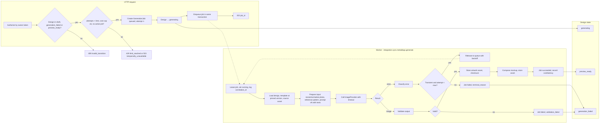

# Flow: asynchronous generation pipeline

The pipeline runs inside the Shopanda worker as the `integration.sync.metaldogs.generate` job type ([ADR-0003](../../adr/0003-async-generation-pg-job-queue-polling.md)). Stages are separate functions so each can be tested with fixtures and swapped independently: input preparation, provider call, output validation, mockup composition.

## Swimlane

## Stage contracts

| Stage | Input | Output | Pure? | Tested by |
| --- | --- | --- | --- | --- |
| Prepare input | source bytes, template, texts | `GenerationRequest` (normalized photo, reference, prompt text with version, parameters) | Yes (given bytes) | Unit with fixtures |
| Provider call | `GenerationRequest`, context with timeout | image bytes + provider metadata (cost, latency, model) or classified error | No | Contract tests with recorded fixtures; fake adapter |
| Validate output | image bytes, template output config | `ValidationResult` (codes, warnings) | Yes | Unit with fixture images |
| Compose mockup | artwork bytes, mockup base, print area | preview bytes | Yes | Golden-image tests |
| Persist | assets, job, design | DB rows + storage objects | No | Feature tests on PostgreSQL + local storage |

## Error classification

| Provider outcome | Class | Job effect |
| --- | --- | --- |
| Timeout, 5xx, connection reset | transient | retry with backoff while `attempt < max_retries` |
| 429 / rate limited | transient | retry with provider-indicated delay if present |
| 4xx input rejected (unsafe content, unsupported image) | permanent | `failed` / `provider_rejected_input` |
| Auth/config error | permanent, **alert** | `failed` / `provider_error`; operator alerted |
| Output fails validation | permanent for this attempt | `failed` / `validation_failed`; customer may regenerate |
| Cost cap reached | pre-check | request rejected before a job exists |

Retries of the provider call are **internal to one `GenerationJob` attempt count** and bounded by configuration (`plugins.metaldogs.generation.max_retries`). Customer-initiated regenerations are separate jobs, bounded by `max_attempts_per_design`.

## Validation codes

| Code | Severity | Meaning |
| --- | --- | --- |
| `dimensions_mismatch` | error | Output does not match template canvas, or `OutputConfig` canvas edges are not both &gt; 0 (fail closed for partial cfg) |
| `not_monochrome` | error | Colour content above tolerance (max−min on **un-premultiplied** 8-bit RGB &gt; 16) when `OutputConfig.Monochrome`; any pixel with alpha &gt; 0. Blank uses `AlphaChromaFloor` (16); mono does not — decide before C4 whether live fringe warrants aligning floors |
| `no_transparency` | **warning** (G3) | No pixel with alpha &lt; 0xffff (incl. tRNS). Emitted only in `Warnings` (not `Codes`) until ADR-0008 Accept |
| `blank_or_low_detail` | error | Near-uniform among pixels with alpha ≥ floor: ≤4 unique 4-bit-quantized colours **and** luminance variance below floor; fully transparent → blank |
| `decode_failed` | error | Not a valid / decodable PNG, or IHDR width/height ≤0 or &gt; `MaxCanvasDimension` (decode-bomb guard) |
| `name_ocr_mismatch` | warning (not emitted in G3) | Reserved for byte-reading OCR; G3 keeps `generation/ocr.NameHeuristic` on `name_check` only |

Eval maps hard validation failure to sample `error_class=validation_failed` (aligned with job `terminal_reason`); do not reuse `rejected_input` (photo/prompt rejection).

## Idempotency and concurrency guarantees

- `POST /generate` with the same `Idempotency-Key` for the same design returns the existing job.
- A partial unique index on `metaldogs_generation_jobs (design_id) WHERE status IN ('queued','running','validating')` guarantees at most one active job per design even under concurrent requests.
- Job handlers are idempotent: re-execution after a crash checks for already-stored assets by `(job_id, type)` before calling the provider again. A provider call that may have succeeded but whose result was lost is **not** repeated automatically if cost was already recorded; the job fails with `provider_result_lost` and alerts, to avoid double spend.
- Status writes to the design happen in the same transaction as the job's terminal state.

## Observability

Every log line in the pipeline carries: `job_id`, `design_id`, `template_slug`, `template_version`, `attempt`, `provider`, `model`, `prompt_version`, `correlation_id`. Terminal lines add `duration_ms`, `cost`, `terminal_reason`. Never logged: image bytes, prompt text with customer data, signed URLs, provider raw payloads.
