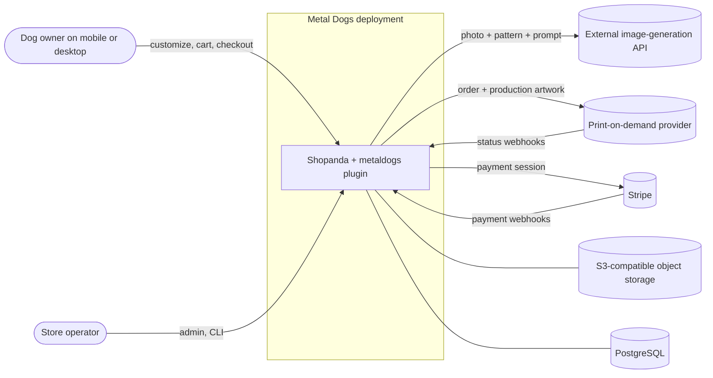
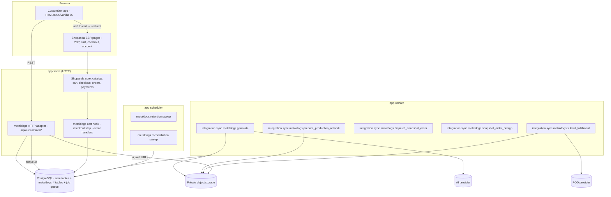
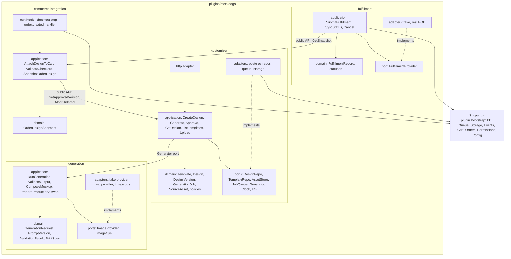
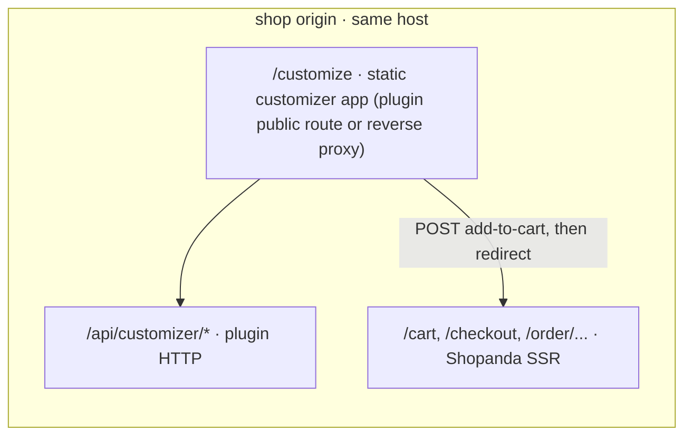

# Architecture overview

Metal Dogs is a Shopanda deployment plus one external plugin (`plugins/metaldogs`) and one static storefront application (the customizer). Shopanda owns commerce; the plugin owns the design-to-artwork pipeline. `plugins/metaldogs.Plugin` implements `pluginsdk.Plugin` (`Init(pluginsdk.Host)`, `pluginsdk.Migrator`). `cmd/api/register_products.go` registers `pluginsdk.Adapt(metaldogs.New())`. See [ADR-0001](../adr/0001-metal-dogs-as-shopanda-external-plugin.md), [ADR-0002](../adr/0002-storefront-customizer-and-shopanda-checkout.md), and [CR-26](../cr-rounds/CR-26-mig3b-pluginsdk-group-b2.md).

## System context



## Containers / processes

One binary, three runtime modes. All share PostgreSQL and object storage.



## Module layout inside the plugin

Organised by business capability; each module has its own domain, application, ports, and adapters. Dependencies point inward. The plugin consumes Shopanda through `plugin.Bootstrap` ports only and never imports `internal/infrastructure` or `internal/interfaces`.



Rules (from `AGENTS.md`):

- Domain packages import nothing outside the standard library and sibling domain packages in the same module.
- Cross-module writes go through the owning module's application API (`commerce` asks `customizer` to mark a design `ordered`; it does not write `metaldogs_designs`).
- Provider payloads, DB rows, and transport DTOs stop at the adapter.

## Storefront placement



Serving the customizer from the shop origin avoids CORS and third-party-cookie issues with the guest cart session. Whether it is served by a plugin public route or by the reverse proxy is decided in `S1`.

## Where things live (target)

```text
/                         Shopanda fork, pinned by commit (ADR-0001, UPSTREAM_PIN.md)
├── cmd/api/register_products.go  registerMetalDogs when plugins.metaldogs.enabled  # UPG4-01
├── plugins/metaldogs/            Go plugin, hexagonal per module (see above)
│   ├── customizer/
│   ├── generation/
│   ├── commerce/
│   ├── fulfillment/
│   ├── migrations/
│   └── README.md
├── storefront/                   customizer app: HTML, CSS, vanilla JS, assets, tests
│   └── README.md
└── docs/                         Metal Dogs product docs (upstream Shopanda docs not vendored)
```

## Upstream deviations

`.github/scripts/check-upstream-deviations.sh` diffs the tree against the pinned SHA. It ignores product trees that are not rows in this table: `plugins/metaldogs/**`, `docs/**`, `.github/workflows/**` (`ci.yml` adds `integration-metaldogs` and the hardened docs-policy step; `release.yml` refuses image name `shopanda`), and `.scratch/**`. Markdown is not ignored. Root `README.md`, `AGENTS.md`, `RUNBOOK.md`, and `PLUGINS.md` are owned rows, so they are not deviations. It then reads `docs/PRODUCT_OWNED.md`. Owned paths and companion paths are not deviations. A hook path is not a deviation when its expect holds and the file matches the pin; for `.gitignore`, the lines outside the marker block must match the pin. `cmd/api/register_products.go` is owned, so it is not listed. Every other differing path is in the table. An unlisted path fails the check. `internal/infrastructure/localfs/storage.go` matches the pin (PR-1580). `internal/interfaces/http/admin/search_admin_test.go`, `internal/interfaces/http/storefront/auth_middleware_test.go`, and `cmd/api/migrate_plugins_test.go` match the pin. The customizer opaque-bearer guest check and the Metal Dogs migrator collect test live in `cmd/api/register_plugins_metaldogs_test.go`. Nothing under `pkg/` differs.

| Path | Why it differs | Introduced |
| --- | --- | --- |
| `.cursor/rules/pr-documentation-checklist.mdc` | Metal Dogs main-only / CR-round checklist (not Shopanda `dev` + `docs/phase-*`). `.cursor/rules` is outside `docs/PRODUCT_OWNED.md` | F0-fix |
| `.gitattributes` | `merge=ours` for owned and companion rows. The manifest describes that driver and does not name this file. No effect until `git config merge.ours.driver true` | UPG9-t00 |
| `.github/scripts/check-product-docs-links.sh` | Scan Metal Dogs docs; forbid relative guide/diagram file hrefs; previous-pin full SHA guard. `.github/scripts` is outside the manifest | F0-fix |
| `.github/scripts/check-upstream-deviations.sh` | This list. Reads the manifest, then requires every other diff | F0-fix / UPG4-05 / UPG9-t01 |
| `.github/scripts/run-metaldogs-integration-tests.sh` | Metal Dogs DSN suite + canaries. `.github/scripts` is outside the manifest | F2 |
| `ci-samples/README.md` | Relative links into unvendored upstream guides and runbooks point at this pin's blob. The seed copy below matches this file | UPG9-t01 |
| `cmd/api/register_plugins_metaldogs_test.go` | Registration, NoCache, boot helpers, catalog-seed dispatch through `bindPluginCLIPorts`, opaque bearer guest check, Metal Dogs migrator collected when the plugin is enabled. The manifest owns `register_products.go` only | UPG4-01 / 05 |
| `plugins/b2b/README.md` | Relative guide link points at this pin's blob | UPG9-t01 |
| `plugins/example/README.md` | Relative guide link points at this pin's blob | UPG9-t01 |
| `plugins/pimdemo/README.md` | Relative guide link points at this pin's blob | UPG9-t01 |
| `plugins/sitekit/README.md` | Relative guide link points at this pin's blob | UPG9-t01 |
| `plugins/slotsdemo/README.md` | Relative guide link points at this pin's blob | UPG9-t01 |
| `plugins/warehousedemo/README.md` | Relative guide link points at this pin's blob | UPG9-t01 |
| `scripts/product-init/seed/ci-samples/README.md` | Seed copy of `ci-samples/README.md` | UPG9-t01 |
| `storefront/.gitkeep` | Empty storefront directory (product app is not the upstream theme tree). `storefront/` is outside the manifest | F0 |
| `storefront/README.md` | Product storefront narrative. `storefront/` is outside the manifest | F0 |

**Pin absorb honesty:** Pin is `084d1206` (PR-1603 public `order_item` extensions on confirmation email and order pages, shopanda#660). The SHA is on `upstream/main` and is the tip of `upstream/dev`. Tree equals `upstream/dev` tip `084d1206` and `upstream/main` tip `7d386c6b` (shopanda#661). `order_confirmed` lines and `checkout_confirm.html` / `account_order_detail.html` include `VariantID`, `SKU`, and public `order_item` extensions (`WithOrderExtensions(ValueAPI)`). The filter is visibility-only, so with the plugin enabled `metaldogs.design_id` renders as `Design ID: <uuid>` on that email and both pages. This pin accepts that; the bump is not behaviour-neutral for the shopper ([CR-38](../cr-rounds/CR-38-upg12-pin-084d1206.md)). There is no enrich hook for a derived image URL. E6b does not call `OrderThumbnailURL` ([CR-38](../cr-rounds/CR-38-upg12-pin-084d1206.md)). `OrderPort` has `Lines`, `LinesForOrders`, and `ListCreatedSince` (core migration `112_orders_created_at_id_asc_index.sql`). `finishCreatedOrder` snapshots cart extensions, then publishes `order.created`. A snapshot error still publishes. `Workflow.Execute` retries `create_order` once before compensate. With the flag on, the snapshot source is `Host.Orders()`. `dispatch_snapshot_order` calls `WithEventJobID` (UUID v5 of the job type and the order id). A blank id fails enqueue in `NewSyncJobEnvelopeWithID`. A repeated `order.created` is one dispatcher job. E4b binds `hostorders` when the flag is on ([CR-34](../cr-rounds/CR-34-e4b-order-source.md)). The flag stays false. When it is on, E5 also registers `GET /api/v1/admin/orders/{order_id}/artwork` and `metaldogs:order-artwork` ([CR-35](../cr-rounds/CR-35-e5-artwork-access.md)); each URL is a row in `metaldogs_artwork_access_log`. E6a ([CR-37](../cr-rounds/CR-37-e6a-order-thumbnail.md)) registers `GET /api/customizer/order-thumbnails/{token}` only when `thumbnail_signing_key` is also set. Checkout JSON errors can carry `plugin.<slug>`, a details object, and HTTP 503 (`pluginsdk.WithClientCode`, `WithDetails`, `UnavailableError`; PR-1597, shopanda#650). The E3 checkout step calls those (`plugin.metaldogs.design_unavailable`, `plugin.metaldogs.validation_unavailable`). SSR checkout confirms a Stripe PaymentIntent in the theme (`checkout_confirm.html`, `GET /checkout/payment/return`). `GET /checkout/payment/return` is out-of-scope in `PublicProductVisibilityRoutes` (PR-1599). This absorb does not record a Stripe test-mode run. `themes/default/templates/checkout_confirm.html`, `checkout_payment.html`, and `account_order_detail.html`, and `templates/emails/order_confirmed.html`, match the pin; the product does not override them. Hook and example files that differed on `d9ccc21c` match this pin. `.gitignore` matches outside the marker section; `scripts/ci/apply-product-gitignore.sh` fills that section from `.gitignore.product` (`/app` and `.vscode/`). `./var/media` stays unignored. The deviation check treats a hook file that differs from the pin outside that contract as a deviation. `!coverage.go` is not restored. Product lines sit on manifest paths: `product/reserved-slugs.txt`, `docker-compose.override.yml`, `.env.example.product`, `configs/config.example.product.yaml`, and `product/checks/`. Nothing loads the companions. `Makefile` matches the pin (`-include Makefile.product`). There is no `Makefile.product`: the old `docs-policy` recipe would replace `SHOPANDA_PLATFORM=1`, and `product/checks/metaldogs-docs.sh` already runs the hardened link check from the hook. `scripts/product-init/product-init_test.sh` matches the pin; the metaldogs `--force` refuse is `product/checks/metaldogs-reserved-slug.sh`. `.github/scripts/run-integration-tests.sh` is the pin wrapper around `scripts/ci/integration.sh`. The deviation check reads `docs/PRODUCT_OWNED.md` and does not list owned paths, companion paths, or hook paths that match the pin (`.gitignore`: outside the marker block). Mapping and the Shopanda gaps: [CR-29](../cr-rounds/CR-29-upg9-pin-72785f27.md). Metal Dogs admin health calls `Host.Jobs().CountsByType`. Generate and prepare enqueue call `SyncJobs.Enqueue` with `WithJobID` (UUID). Stale generate claims are requeued by the plugin after that enqueue. `cmd/api/plugin_boot.go` matches the pin. Cart extension fakes are race-free; `scripts/ci/unit.sh` runs `go test -race ./internal/application/cart/`. `ReadableStorage.Read` takes a context; `localfs/storage.go` matches the pin. Non-UUID job ids are `ErrRequeueNotFound` (PR-1579). `internal/` and `pkg/` have no Metal Dogs edits. `CapCatalogSeed` is CLI-only. It binds on a command that `Needs` it, or on empty `Needs` with `RequiresDB` (compat over-bind, PR-1574). `RequiresDB: false` siblings are not blocked (PR-1590/1591). The generate claim fence is `Host.OnRequeued`. Terminal re-pend is `Queue.Requeue` with `WithRequeueTerminal`. Add-to-cart uses `pending_line`, `ClassifyProductSlug`, and `DiscardEmptyGuestCart` ([CR-21](../cr-rounds/CR-21-upg4-pin-7c982b00.md)). E1 catalog seed uses `Host.CatalogSeed().Import`. Treat the table as the conflict allowlist together with [`../runbooks/shopanda-upgrade.md`](../runbooks/shopanda-upgrade.md).

Architecture diagrams in this directory describe the **target** module layout and job names (`integration.sync.metaldogs.*`). F3 adds platform job observability + a thin customizer health/obs.ping surface. G0 adds offline `metaldogs:eval` (fake provider).
