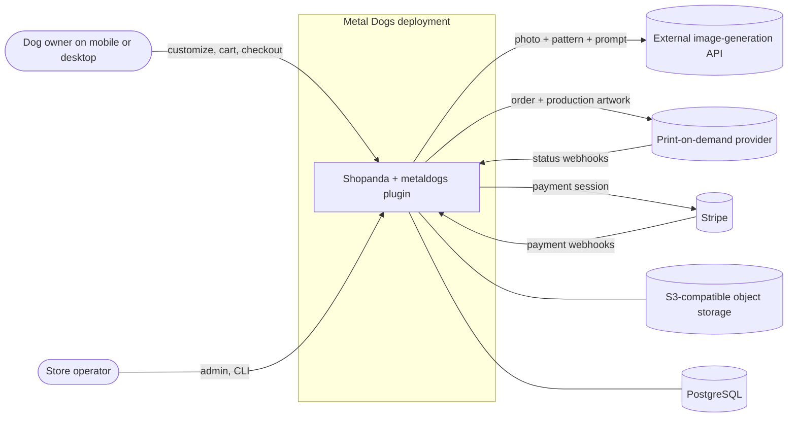
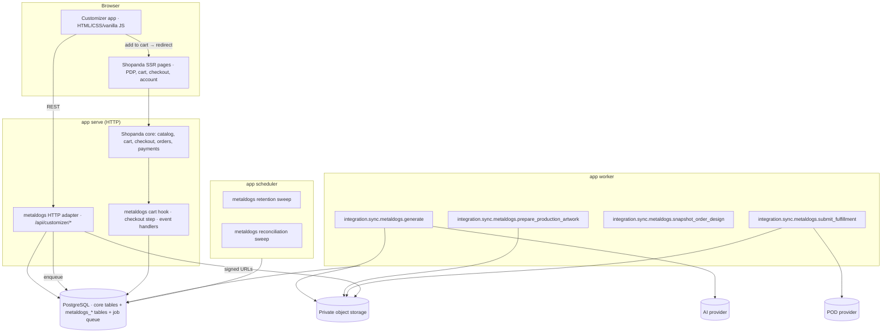
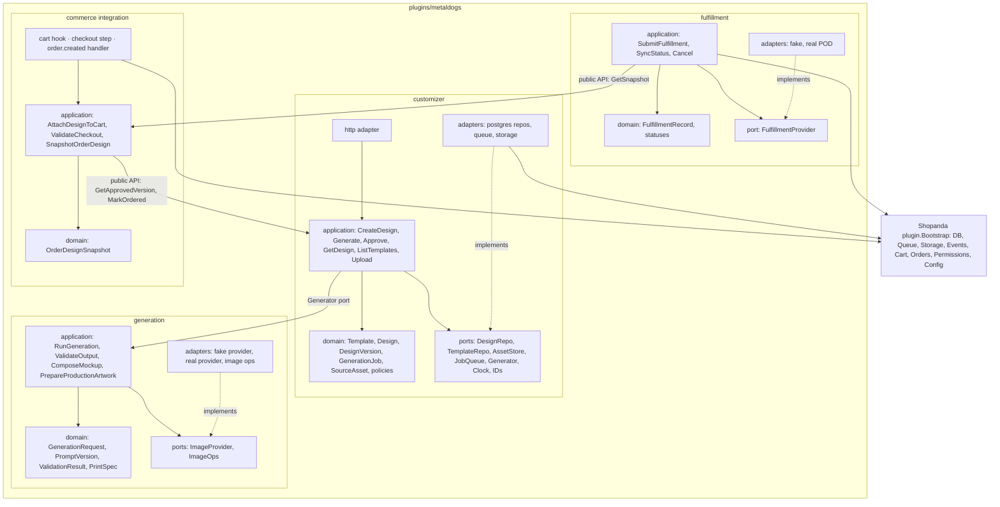
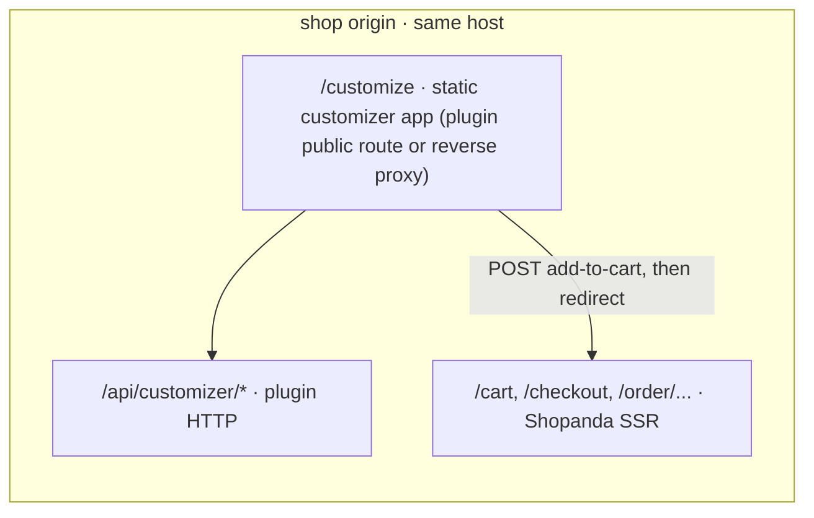

# Architecture overview

Metal Dogs is a Shopanda deployment plus one external plugin (`plugins/metaldogs`) and one static storefront application (the customizer). Shopanda owns commerce; the plugin owns the design-to-artwork pipeline. See [ADR-0001](../adr/0001-metal-dogs-as-shopanda-external-plugin.md) and [ADR-0002](../adr/0002-storefront-customizer-and-shopanda-checkout.md).

## System context



## Containers / processes

One binary, three runtime modes. All share PostgreSQL and object storage.



## Module layout inside the plugin

Organised by business capability; each module has its own domain, application, ports, and adapters. Dependencies point inward. The plugin consumes Shopanda through `plugin.Bootstrap` ports only and never imports `internal/infrastructure` or `internal/interfaces`.



Rules (from `AGENTS.md`):

- Domain packages import nothing outside the standard library and sibling domain packages in the same module.
- Cross-module writes go through the owning module's application API (`commerce` asks `customizer` to mark a design `ordered`; it does not write `metaldogs_designs`).
- Provider payloads, DB rows, and transport DTOs stop at the adapter.

## Storefront placement



Serving the customizer from the shop origin avoids CORS and third-party-cookie issues with the guest cart session. Whether it is served by a plugin public route or by the reverse proxy is decided in `S1`.

## Where things live (target)

```text
/                         Shopanda fork, pinned by commit (ADR-0001, UPSTREAM_PIN.md)
├── cmd/api/register_plugins.go   one added line: registry.Register(metaldogs.New())  # F1
├── plugins/metaldogs/            Go plugin, hexagonal per module (see above)
│   ├── customizer/
│   ├── generation/
│   ├── commerce/
│   ├── fulfillment/
│   ├── migrations/
│   └── README.md
├── storefront/                   customizer app: HTML, CSS, vanilla JS, assets, tests
│   └── README.md
└── docs/                         Metal Dogs product docs (upstream Shopanda docs not vendored)
```

## Upstream deviations

Files that differ from the pinned Shopanda commit outside `plugins/metaldogs/` and `storefront/` must be listed here and re-checked on every upgrade. Treat this table as the upgrade conflict allowlist together with [`../runbooks/shopanda-upgrade.md`](../runbooks/shopanda-upgrade.md).

| Path | Why it differs | Introduced |
| --- | --- | --- |
| `README.md` | Metal Dogs banner, remotes, badges → this repo; documentation section points at Metal Dogs docs + pinned upstream guides | F0 / F0-fix |
| `AGENTS.md` | Metal Dogs agent rules, remotes, **main-only** branch policy, build commands (replaces upstream AGENTS.md / phase-* workflow) | F0 / F0-fix |
| `.gitignore` | Union of upstream ignores with Metal Dogs IDE/binary entries (`/app`, `.idea/`) | F0 |
| `RUNBOOK.md` | Metal Dogs runbook index; Shopanda operator detail via pinned GitHub URLs (full upstream RUNBOOK not retained) | F0-fix |
| `PLUGINS.md` | Guide/diagram hrefs rewritten to pinned upstream blob URLs; COMMERCIAL stays local | F0-fix |
| `plugins/*/README.md` (demos + b2b) | Guide hrefs/backticks rewritten to pinned upstream blob URLs (including fragment links) | F0-fix |
| `.github/scripts/check-product-docs-links.sh` | Skip missing paths; scan Metal Dogs docs; forbid relative/`../` guide/diagram **file** hrefs (incl. `#fragment` / `?query`) and backtick paths; inline self-test before scan | F0-fix |
| `.cursor/rules/pr-documentation-checklist.mdc` | Metal Dogs main-only / CR-round checklist (not Shopanda `dev` + `docs/phase-*`) | F0-fix |
| `docs/**` (product) | Metal Dogs roadmap/ADRs/architecture/runbooks/cr-rounds | F0 |
| `docs/GOVULN_BASELINE.md` | Restored for fail-closed `govuln` CI (empty allowlist at pin) | F0-fix |
| `docs/COMMERCIAL.md` | Restored (B2B licensing boundary inherited with the GPL tree) | F0-fix |
| `docs/guides/README.md`, `docs/diagrams/README.md` | Stubs pointing at pinned upstream trees (full guides/diagrams not vendored) | F0-fix |

Inherited CI workflows still mention Shopanda `main`/`dev` dual-branch semantics; Metal Dogs ignores promote tooling until an upgrade deliberately adapts it.

| Path | Why it differs | Introduced |
| --- | --- | --- |
| `cmd/api/register_plugins.go` | Registers `metaldogs.New()` when `plugins.metaldogs.enabled` | F1 |
| `internal/platform/config/config.go` (+ test) | `Plugins.MetalDogs` / `SHOPANDA_PLUGINS_METALDOGS_ENABLED` (default false) | F1 |
| `configs/config.example.yaml` | Documented `plugins.metaldogs` toggle | F1 |
| `plugins/metaldogs/**` | Product plugin (hexagonal layout + Migrator; F1 `/enabled`, F3 health/obs — see F3 rows) | F1 |
| `cmd/api/cache_control_prefixes.go` | `/api/customizer` on Cache-Control no-store prefix list | F1-fix |
| `docker-compose.yml` | Publish Postgres on `127.0.0.1:${SHOPANDA_DATABASE_HOST_PORT:-5432}` for host-side tests | F2 |
| `.github/scripts/run-metaldogs-integration-tests.sh` | Metal Dogs–only DSN suite + canaries (decoupled from Shopanda) | F2 |
| `.github/workflows/ci.yml` | `integration-metaldogs` job + no-DSN / metaldogs coverage artifacts | F2 |
| `plugins/metaldogs/**` (correlation alias, public/admin health, `obs.ping`) | Product facade; depths admin-only (platform sync-job observability absorbed at pin `a8cbcb18`) | F3 |
| `plugins/metaldogs` AssetStore (`ports`, `adapters/mediastore` → platform SignedURLStorage) | Private object storage port; keys under `private/blobs/`; nothing writes yet | F4 |

Architecture diagrams in this directory describe the **target** module layout and job names (`integration.sync.metaldogs.*`). F3 adds platform job observability + a thin customizer health/obs.ping surface.
