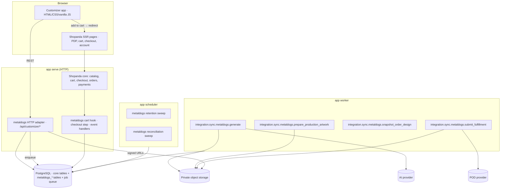
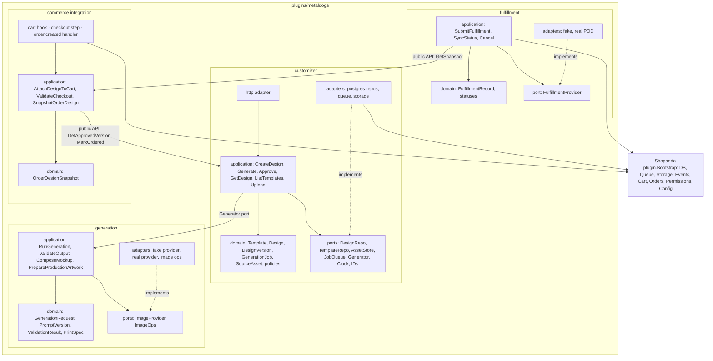
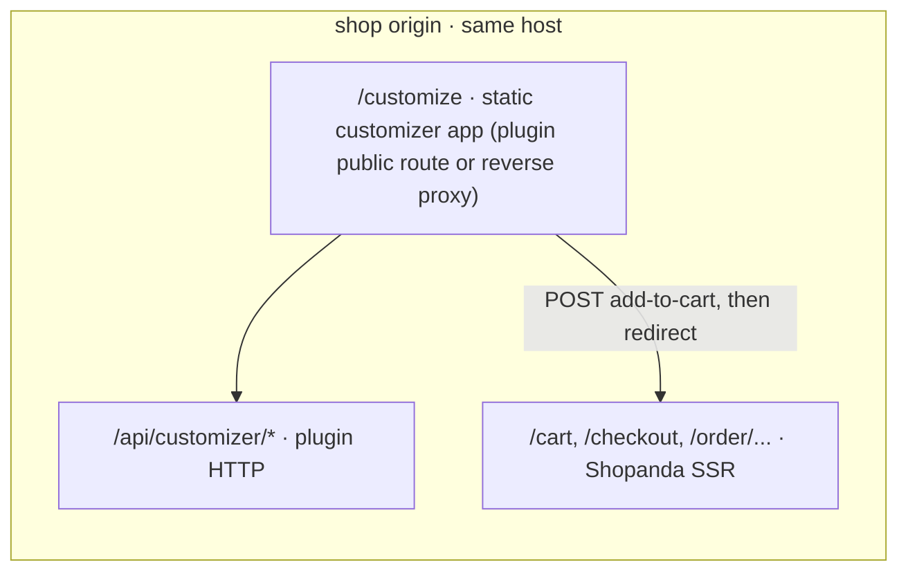

# Architecture overview

Metal Dogs is a Shopanda deployment plus one external plugin (`plugins/metaldogs`) and one static storefront application (the customizer). Shopanda owns commerce; the plugin owns the design-to-artwork pipeline. See [ADR-0001](../adr/0001-metal-dogs-as-shopanda-external-plugin.md) and [ADR-0002](../adr/0002-storefront-customizer-and-shopanda-checkout.md).

## System context


## Containers / processes

One binary, three runtime modes. All share PostgreSQL and object storage.



## Module layout inside the plugin

Organised by business capability; each module has its own domain, application, ports, and adapters. Dependencies point inward. The plugin consumes Shopanda through `plugin.Bootstrap` ports only and never imports `internal/infrastructure` or `internal/interfaces`.



Rules (from `AGENTS.md`):

- Domain packages import nothing outside the standard library and sibling domain packages in the same module.
- Cross-module writes go through the owning module's application API (`commerce` asks `customizer` to mark a design `ordered`; it does not write `metaldogs_designs`).
- Provider payloads, DB rows, and transport DTOs stop at the adapter.

## Storefront placement



Serving the customizer from the shop origin avoids CORS and third-party-cookie issues with the guest cart session. Whether it is served by a plugin public route or by the reverse proxy is decided in `S1`.

## Where things live (target)

```text
/                         Shopanda fork, pinned by commit (ADR-0001, UPSTREAM_PIN.md)
├── cmd/api/register_products.go  registerMetalDogs when plugins.metaldogs.enabled  # UPG4-01
├── plugins/metaldogs/            Go plugin, hexagonal per module (see above)
│   ├── customizer/
│   ├── generation/
│   ├── commerce/
│   ├── fulfillment/
│   ├── migrations/
│   └── README.md
├── storefront/                   customizer app: HTML, CSS, vanilla JS, assets, tests
│   └── README.md
└── docs/                         Metal Dogs product docs (upstream Shopanda docs not vendored)
```

## Upstream deviations

`.github/scripts/check-upstream-deviations.sh` diffs the whole tree against the pinned SHA and allowlists every path below. It ignores product-owned trees: `plugins/metaldogs/**`, `docs/**`, `*.md` (root `README.md`, `AGENTS.md`, `RUNBOOK.md`, `PLUGINS.md`, demo `plugins/*/README.md`), `.github/workflows/**` (`ci.yml` adds `integration-metaldogs` and the hardened docs-policy step; `release.yml` refuses image name `shopanda`), and `.scratch/**`. Those trees are the product. They are not rows in the allowlist. `internal/infrastructure/localfs/storage.go` matches the pin (PR-1580); it is not listed. `internal/interfaces/http/admin/search_admin_test.go`, `internal/interfaces/http/storefront/auth_middleware_test.go`, and `cmd/api/migrate_plugins_test.go` match the pin. The customizer opaque-bearer guest check and the Metal Dogs migrator collect test live in `cmd/api/register_plugins_metaldogs_test.go`. Nothing under `pkg/` differs.

| Path | Why it differs | Introduced |
| --- | --- | --- |
| `.cursor/rules/pr-documentation-checklist.mdc` | Metal Dogs main-only / CR-round checklist (not Shopanda `dev` + `docs/phase-*`) | F0-fix |
| `.env.example` | Private media path `./var/media`, sign-secret note, `SHOPANDA_PLUGINS_METALDOGS_ENABLED`, compose DSN | F1 / F4 |
| `.github/scripts/check-product-docs-links.sh` | Scan Metal Dogs docs; forbid relative guide/diagram file hrefs; previous-pin full SHA guard | F0-fix |
| `.github/scripts/check-upstream-deviations.sh` | This allowlist | F0-fix / UPG4-05 |
| `.github/scripts/run-integration-tests.sh` | Shopanda postgres/migrate/b2b DSN suite only; Metal Dogs canaries are a separate script | F2 |
| `.github/scripts/run-metaldogs-integration-tests.sh` | Metal Dogs DSN suite + canaries | F2 |
| `.gitignore` | `/app`, `.idea/`, `.vscode/` | F0 |
| `Makefile` | `docs-policy` runs the Metal Dogs link checker and this allowlist script, not `SHOPANDA_PLATFORM=1` | CR-06 |
| `cmd/api/register_products.go` | `registerMetalDogs` when the plugin is enabled or the flag does not parse. `register_plugins.go` matches the pin | UPG4-01 |
| `cmd/api/register_plugins_metaldogs_test.go` | Registration, NoCache, boot helpers, catalog-seed dispatch through `bindPluginCLIPorts`, opaque bearer guest check, Metal Dogs migrator collected when the plugin is enabled | UPG4-01 / 05 |
| `configs/config.example.yaml` | Commented `plugins.metaldogs` block (enabled + `generation`) | F1 |
| `docker-compose.yml` | Publish Postgres on `127.0.0.1:${SHOPANDA_DATABASE_HOST_PORT:-5432}` | F2 |
| `scripts/ci/docs-policy.sh` | Prefer `.github/scripts/check-product-docs-links.sh`; skip the promote fixture unless `SHOPANDA_PLATFORM=1` | CR-06 |
| `scripts/product-init/reserved-slugs.txt` | `metaldogs` so `--force` cannot clobber the product plugin | CR-06 |
| `scripts/product-init/product-init_test.sh` | Refuses `--force` for slug `metaldogs` and checks the tree is unchanged | CR-06 |
| `scripts/product-init/seed/scripts-ci/docs-policy.sh` | Seed copy of the product `docs-policy.sh` | CR-06 |
| `storefront/.gitkeep` | Empty storefront directory (product app is not the upstream theme tree) | F0 |

**Pin absorb honesty:** Pin is `d9ccc21c` (PR-1594 CLI skip of `CapJobs`/`CapMedia` and PR-1595 `WithJobID` requeue race, on top of `4bff865b`). Tree equals `upstream/main` tip `79c3b59a`. Metal Dogs does not call `pluginsdk.JobsPort.CountsByType` or `WithJobID`. `cmd/api/plugin_boot.go` matches the pin. Cart extension fakes are race-free; `scripts/ci/unit.sh` runs `go test -race ./internal/application/cart/`. `ReadableStorage.Read` takes a context; `localfs/storage.go` matches the pin. Non-UUID job ids are `ErrRequeueNotFound` (PR-1579). `internal/` and `pkg/` have no Metal Dogs edits. `CapCatalogSeed` is CLI-only. It binds on a command that `Needs` it, or on empty `Needs` with `RequiresDB` (compat over-bind, PR-1574). `RequiresDB: false` siblings are not blocked (PR-1590/1591). The generate claim fence is `Host.OnRequeued`. Terminal re-pend is `Queue.Requeue` with `WithRequeueTerminal`. Add-to-cart uses `pending_line`, `ClassifyProductSlug`, and `DiscardEmptyGuestCart` ([CR-21](../cr-rounds/CR-21-upg4-pin-7c982b00.md)). E1 catalog seed uses `Host.CatalogSeed().Import`. Treat the table as the conflict allowlist together with [`../runbooks/shopanda-upgrade.md`](../runbooks/shopanda-upgrade.md).

Architecture diagrams in this directory describe the **target** module layout and job names (`integration.sync.metaldogs.*`). F3 adds platform job observability + a thin customizer health/obs.ping surface. G0 adds offline `metaldogs:eval` (fake provider).
