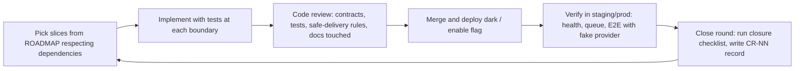

# Change-request rounds

A **CR round** is a closed change-request round: one or more roadmap slices that were reviewed, merged, and deployed (or confirmed deployable dark) together. Closing a round is the moment the documentation set is brought back in sync. Nothing is "done" in the roadmap until the round that contains it is closed and logged here.

## Lifecycle



## Closure checklist

Run at the close of every round; paste the completed checklist into the round record. A pin-only bump (Shopanda SHA, no product behaviour change) does not paste it. The record keeps conflict resolution and the upstream range, and the log links the file. CR-23, CR-25, CR-27, and CR-28 use that shape.

- [ ] `docs/ROADMAP.md`: slices marked closed; dependency changes; §1 verify-items updated with results.
- [ ] Architecture diagrams updated for every touched boundary: `architecture/overview.md` (context, containers, modules), `architecture/domain-model.md` (ER, state machines, retention), `architecture/flows/*` (swimlanes and sequences). New flows get a new file.
- [ ] API contract (`architecture/api.md`, created in `C1`) matches the deployed handlers: paths, DTOs, error codes, limits.
- [ ] ADRs: each decision taken in the round has an ADR (new, or an existing Proposed one moved to Accepted with its pending fields filled); superseded ADRs marked.
- [ ] Runbooks: every new job type, scheduler task, external dependency, flag, or failure mode has a runbook or an update; `TBD (slice)` placeholders for commands that landed in this round are replaced with the real commands.
- [ ] READMEs: `docs/README.md`, `plugins/metaldogs/README.md`, `storefront/README.md`, and `AGENTS.md` (real build/test/lint commands) are current.
- [ ] Tests: the record lists unit, feature, contract, and E2E coverage added, and the regression test for every bug fixed.
- [ ] Safe delivery: flags, migrations (expand/contract), rollback path recorded.
- [ ] Privacy/cost review: no new logging of personal data or URLs; cost controls unchanged or documented.
- [ ] Round record `CR-NN-<slug>.md` written using the structure below and linked from the table.

## Round record structure

```markdown
# CR-NN: <slug>

- Closed: YYYY-MM-DD
- Slices: F1, F2, ...
- Milestone progress: M0 → 4/6 slices

## What shipped
## Verification results (verify-items resolved)
## Tests added
## Flags / migrations / rollback
## Documentation updated (checklist pasted)
## Follow-ups filed
```

## Log

| Round | Slices | Milestone | Record |
| --- | --- | --- | --- |
| CR-00 | roadmap bootstrap (documentation only) | — | [`CR-00-roadmap-bootstrap.md`](CR-00-roadmap-bootstrap.md) |
| CR-01 | F0 Shopanda baseline (+ F0-fix docs/CI contract) | M0 → 1/6 | [`CR-01-f0-shopanda-baseline.md`](CR-01-f0-shopanda-baseline.md) |
| CR-02 | F1 plugin skeleton behind flag | M0 → 2/6 | [`CR-02-f1-plugin-skeleton.md`](CR-02-f1-plugin-skeleton.md) |
| CR-03 | F2 CI & PostgreSQL test harness (merged; billing-only CI gate) | M0 → 3/6 merged | [`CR-03-f2-ci-postgres-harness.md`](CR-03-f2-ci-postgres-harness.md) |
| CR-04 | F3 observability (Shopanda platform + MD facade) | M0 → 4/6 | [`CR-04-f3-observability.md`](CR-04-f3-observability.md) |
| CR-05 | F4 private object storage (AssetStore + local shim) | M0 → 5/6 | [`CR-05-f4-private-object-storage.md`](CR-05-f4-private-object-storage.md) |
| CR-06 | Shopanda pin absorb `a8cbcb18` (#568/#570/#571) | M0 pin current | [`CR-06-shopanda-pin-a8cbcb18.md`](CR-06-shopanda-pin-a8cbcb18.md) |
| CR-07 | G0 offline eval harness (`metaldogs:eval` + fake provider) | M1 → 1/3 | [`CR-07-g0-eval-harness.md`](CR-07-g0-eval-harness.md) |
| CR-08 | G1 OpenAI spike scaffold (exit gate open) | M1 scaffold | [`CR-08-g1-provider-spike-scaffold.md`](CR-08-g1-provider-spike-scaffold.md) |
| CR-09 | G2 template format v1 (draft loader; nothing published) | M1 → G2 done | [`CR-09-g2-template-format.md`](CR-09-g2-template-format.md) |
| CR-10 | G3 output validation (`generation/validate` + eval wire) | M2 → G3 done | [`CR-10-g3-output-validation.md`](CR-10-g3-output-validation.md) |
| CR-11 | C1 templates read API (list + get published DTOs) | M2 → C1 done | [`CR-11-c1-templates-read-api.md`](CR-11-c1-templates-read-api.md) |
| CR-12 | C2 uploads (`POST /uploads` + `metaldogs_assets`) | M2 → C2 done | [`CR-12-c2-uploads.md`](CR-12-c2-uploads.md) |
| CR-13 | C3 designs + ownership tokens | M2 → C3 done | [`CR-13-c3-designs.md`](CR-13-c3-designs.md) |
| CR-14 | C4 generate job + status polling | M2 → C4 | [`CR-14-c4-generate.md`](CR-14-c4-generate.md) |
| CR-15 | G4 mockup compose + C5 preview assets | M2 → C5 | [`CR-15-c5-preview-assets.md`](CR-15-c5-preview-assets.md) |
| CR-16 | C6 approve + DesignVersion freeze | M2 → C6 | [`CR-16-c6-approve.md`](CR-16-c6-approve.md) |
| CR-17 | C7 regeneration limits + cooldown | M3 → C7 done | [`CR-17-c7-regen-limits.md`](CR-17-c7-regen-limits.md) |
| CR-18 | E1 catalog product and variants | M3 → E1 | [`CR-18-e1-catalog.md`](CR-18-e1-catalog.md) |
| CR-19 | E2 cart line design attach | M3 → E2 | [`CR-19-e2-cart-design-attach.md`](CR-19-e2-cart-design-attach.md) |
| CR-20 | MIG1 cart path on pluginsdk | M3 cart SDK | [`CR-20-mig1-cart-pluginsdk.md`](CR-20-mig1-cart-pluginsdk.md) |
| CR-21 | UPG4 pin `fd4dd577` (00 through 05, including 00b–00g, 01b/01c, 03b) | M3 pin | [`CR-21-upg4-pin-7c982b00.md`](CR-21-upg4-pin-7c982b00.md) |
| CR-22 | MIG2 group A ticket 01 (logger, conflict, catalog literals, jobs.read, ids, enabled map) | M3 imports | [`CR-22-mig2-pluginsdk-group-a.md`](CR-22-mig2-pluginsdk-group-a.md) |
| CR-23 | UPG5 pin `ad14bd3a` (ticket 00) | M3 pin | [`CR-23-upg5-pin-ad14bd3a.md`](CR-23-upg5-pin-ad14bd3a.md) |
| CR-24 | MIG3a tickets 01–02 (price, currency, request id, isolated test DB). Baseline file still has the three vanished lines | M3 imports | [`CR-24-mig3a-sdk-group-b1.md`](CR-24-mig3a-sdk-group-b1.md) |
| CR-25 | UPG6 pin `647c6a2a` (ticket 00) | M3 pin | [`CR-25-upg6-pin-647c6a2a.md`](CR-25-upg6-pin-647c6a2a.md) |
| CR-26 | MIG3b tickets 01–04 (`pluginsdk.Plugin` + `Adapt`). Closed | M3 imports | [`CR-26-mig3b-pluginsdk-group-b2.md`](CR-26-mig3b-pluginsdk-group-b2.md) |
| CR-27 | UPG7 pin `4bff865b` (ticket 00) | M3 pin | [`CR-27-upg7-pin-4bff865b.md`](CR-27-upg7-pin-4bff865b.md) |
| CR-28 | UPG8 pin `d9ccc21c` (ticket 00) | M3 pin | [`CR-28-upg8-pin-d9ccc21c.md`](CR-28-upg8-pin-d9ccc21c.md) |
| CR-29 | UPG9 pin `72785f27` (ticket 00 bump; ticket 01 moves product files) | M3 pin | [`CR-29-upg9-pin-72785f27.md`](CR-29-upg9-pin-72785f27.md) |
