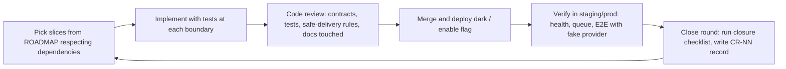

# Change-request rounds

A **CR round** is a closed change-request round: one or more roadmap slices that were reviewed, merged, and deployed (or confirmed deployable dark) together. Closing a round is the moment the documentation set is brought back in sync. Nothing is "done" in the roadmap until the round that contains it is closed and logged here.

## Lifecycle



## Closure checklist

Run at the close of every round; paste the completed checklist into the round record.

- [ ] `docs/ROADMAP.md`: slices marked closed; dependency changes; §1 verify-items updated with results.
- [ ] Architecture diagrams updated for every touched boundary: `architecture/overview.md` (context, containers, modules), `architecture/domain-model.md` (ER, state machines, retention), `architecture/flows/*` (swimlanes and sequences). New flows get a new file.
- [ ] API contract (`architecture/api.md`, created in `C1`) matches the deployed handlers: paths, DTOs, error codes, limits.
- [ ] ADRs: each decision taken in the round has an ADR (new, or an existing Proposed one moved to Accepted with its pending fields filled); superseded ADRs marked.
- [ ] Runbooks: every new job type, scheduler task, external dependency, flag, or failure mode has a runbook or an update; `TBD (slice)` placeholders for commands that landed in this round are replaced with the real commands.
- [ ] READMEs: `docs/README.md`, `plugins/metaldogs/README.md`, `storefront/README.md`, and `AGENTS.md` (real build/test/lint commands) are current.
- [ ] Tests: the record lists unit, feature, contract, and E2E coverage added, and the regression test for every bug fixed.
- [ ] Safe delivery: flags, migrations (expand/contract), rollback path recorded.
- [ ] Privacy/cost review: no new logging of personal data or URLs; cost controls unchanged or documented.
- [ ] Round record `CR-NN-<slug>.md` written using the structure below and linked from the table.

## Round record structure

```markdown
# CR-NN: <slug>

- Closed: YYYY-MM-DD
- Slices: F1, F2, ...
- Milestone progress: M0 → 4/6 slices

## What shipped
## Verification results (verify-items resolved)
## Tests added
## Flags / migrations / rollback
## Documentation updated (checklist pasted)
## Follow-ups filed
```

## Log

| Round | Slices | Milestone | Record |
| --- | --- | --- | --- |
| CR-00 | roadmap bootstrap (documentation only) | — | [`CR-00-roadmap-bootstrap.md`](CR-00-roadmap-bootstrap.md) |
| CR-01 | F0 Shopanda baseline (+ F0-fix docs/CI contract) | M0 → 1/6 | [`CR-01-f0-shopanda-baseline.md`](CR-01-f0-shopanda-baseline.md) |
